# The Palace island: Otringal's palace as a building of its own (2026-10-08, its outside and furniture 2026-10-12, on its hill 2026-10-12)

The user: "We need to create a new track based on the Palace that's featured on Otringal, this will need to be recreated as a new island.
The idea behind this track is that the cars race through the inside of the palace, through the window by the chest that Twinsen normally
leaves by then around the roof tops. To accomodate all of this we'll probably need to scale up everything. After this is created we'll add
a track to it later, let's just get our Palace island created for now".

And then (2026-10-12): "The Palace island we created needs work. We need to add in the outside of the palace as featured in Otringal.ile
... Let's also see if for each inside room of the palace we can recreate the decor that each room naturally has".

And then, with a picture of Otringal's palace from above: "Our new palace has a weird ground area that we should get rid of. The original
palace is sat on a raised cliff area - I've added a picture. We need to make the outside look more like the original. Perhaps scaling up
the roof section, or adding more towers to the roof section. It's okay for the inside to be underground. We may also need to scale up the
size of the inside of the palace so we can drive through the rooms", with the track's brief: "through the palace rooms, coming out the
window and around the roof tops? Point-to-point i.e. no laps, finishing with massive jump to harbor teleport".

## On its hill (2026-10-12, later)

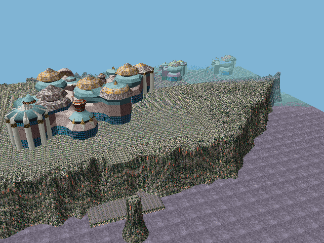

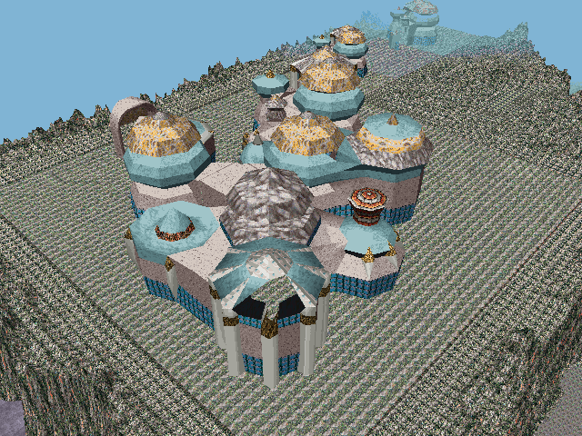

On Otringal's island the palace's halls stand on the flat top of a hill 17,000 high (cube (8, 7)), ringed by rocks a little higher, its
sides cliffs falling to the cloud sea, all of it a mossy rock. Now the Palace island is that hill, with the rooms inside it:

- **The rooms 4 times a brick across** (they were 3): a door between two rooms, two bricks, is 4,096 wide. The race cars' collision boxes
  are some 1,300 across and turn on some 5.5 cells at speed (the race-track docs), so a door is about three cars wide; a room is some
  27,000 across. The palace is 224 x 404 cells of the island, 14 layers of 640.
- **Under the hill** (`Terrain/Palace/PalaceCliff.cs`): the rooms' floor's foot at 10,000, their roofs' top at 19,216 -- the hilltop. Round
  the rooms the ground is the hill's: since 2026-10-13 only just round them -- flat at the hilltop 6 cells give or take 2 past their walls,
  the island the palace's L and no more (below; it was a plateau reaching 30, then 66 cells past their outline's hull, the corner of the
  L hilltop too, with a terrace and rocks on it) -- and its sides cliffs, 9 cells give or take 4, ragged, falling to the sea floor. All
  of it Otringal's mossy rock
  (its ground atlas, 4 x 4 tiles of 32 pixels as its hill has it), lit as the island's sun falls on it, with the cliffs' shadows; the sea --
  Otringal's cloud sea -- everywhere the ground isn't over it. Under the rooms the ground is low (the floor's foot), out of sight.
- **The roofs are the hilltop's rock**: their tops are Otringal's mossy rock too -- textured polygons of `OTRINGAL.OBL`'s page's rock (its
  64-pixel tile, the ground's rock at half its size, so 32 units a pixel; repeated, 8,192 units a polygon, 727 of them), one body a cube.
- **Two ways across the rocks** stay flat at the hilltop, 18 cells wide: east from the sixteen rooms' roof to the cliff's edge (the
  runway for the jump to the harbour), and from the hill's north edge across the corner of the L to the sixteen rooms' roof, in line with
  the domes' north-east hall (x 470: where the race's road from the round window comes up onto the hill, the domes ahead).
- **The round window open**: the long hall's end stands on the cliff's edge, the ground at its foot the floor's; its round window (the one
  Twinsen leaves by, 4 bricks wide and 8 layers high, its sill 3 layers over the floor's foot) is open through the wall onto the sky, the
  cars' way out. The big chest under it is gone. The palace's front door (room 154's, which led out onto Otringal's hilltop) is in the
  hill now, and filled.
- **On the roofs, a bigger palace**: Otringal's palace 5.5 times its size (86,642 x 100,639, 26,813 high) over the sixteen rooms, its arch
  in front of its porch as Otringal has it -- on the hilltop now, big enough to drive through (9,400 between its posts) -- and a wing on
  the long hall's roof: two smaller halls as Otringal's north hall (two small domes, its wing, its turret), 3.5 times their size. Their
  shape from above is the collision (152 boxes); the arch is solid.
- **The harbour**: east of the hill, a quay at 1,400 (Otringal's lowest) at the cliffs' foot, and out in the bay a rock pillar 6 cells
  across, its top 700 over the hilltop (19,916), and on it **the Dark Monk's teleporter** (`Terrain/Palace/PalaceTeleporter.cs`): a
  gold ring 7,240 across standing on its edge, facing the hill, a pale band inside it -- the race's finish (it is drawn only: a car flies
  into it).
- **The floors made whole**: a cell of a room's bottom layer with nothing in it -- a door's threshold, a hole the isometric picture hides
  -- is floor, the room's commonest floor brick (201 cells); and the ground under the rooms is paved, should a crack between a floor and a
  model show it (the hill's rock showed through by the race's carpet).
- **Every body and box in every cube it reaches**: the engine draws and collides only the decors of the cube the hero is in (the race
  tracks' decks are placed the same way), up to this editor's engine's 1,000 a cube; the busiest has 113.
- **The sky** is at 48,000 (Otringal's is at 22,199, under the domes' tops). **The fog** starts at 40,000 and ends at 70,000 (Otringal's:
  10,500 to 41,200): the domes clear from the race's road as it nears them, and a room's far wall through its door from the next (the
  rooms are 28,000 across). The engine's depth buffer is 16 bits scaled to the fog's end, so the end can be further than 65,535; and it
  draws the hero's cube and the 8 round it, no more.
- **Far objects** (`3DEXT/DECORS.CPP`): the engine left out an object any of whose foot's corners lay past the fog's end -- the domes,
  86,000 across, always had one, and were never drawn in the game. An object of this editor's that is drawn only (its box's top under its
  bottom) is left out only when all four are.
- The island: 7 x 9 cubes from cube (4, 3), 63 cubes.

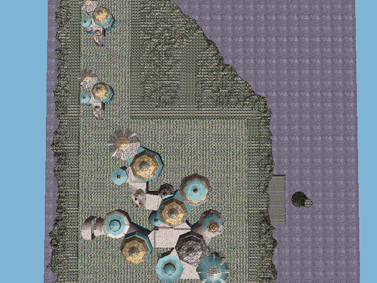

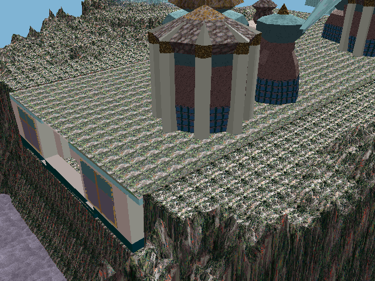

What follows is the first island (2026-10-08) and its outside and furniture (2026-10-12): the rooms and their furniture are still built
that way; the ground, the scale and the outside's place are as above now.

## What the palace is in the game

The Emperor's palace is not on Otringal's island file at all: it is an interior, a maze of sixteen rooms (scenes 151-166), each a grid of
13 x 13 cells, four by four, and the last room (scene 80: the chest, and the round window Twinsen leaves by) off its fourth row. An
interior's cells are bricks -- pictures, not shapes -- so the palace has no 3D model to drive through. Its outside is on Otringal's island
(cube (8, 7) of `OTRINGAL.ILE`): domed octagonal halls of `OTRINGAL.OBL` (bodies 33-49), five times smaller than the rooms and of another
shape; its arch and porch lead into room 154.

## The island

`Terrain/Palace/PalaceIsland.cs` builds two new files, `PALACE.ILE` and `PALACE.OBL`:
- **The rooms where the doors between them put them**: the editor's joined map of the palace (`Lba2Areas`), without the cell it moves some
  rooms apart for its picture (neighbours share their walls here).
- **Scaled up for the cars**: every cell is a box 3 bricks across (1,536 units) and 2.5 layers high (640 units). The palace comes to
  168 x 303 cells of the island and 14 layers.
- **Colours**: each cell has its brick's average colour (the exporter's blocky map, `GridMesher`), matched in Otringal's palette (RESS 31)
  and shaded by the way the face points. Only the faces that show are kept, merged into rectangles of one colour. The two walls of a room
  nearest the game's camera are bricks with nothing drawn (they would hide the room); they take the room's wallpaper, layer by layer the
  colour its other walls have at that height. The walls' outer faces take Otringal's palace's colours: a teal foot, its pale stone, a
  turquoise top.
- **The walls made whole**: the grids leave gaps -- beside a fireplace, under a wall -- that the isometric picture hides; where a room meets
  the outside through one, and in pockets no room reaches, the cells are filled (410 of them). The door out of room 154 stays open.
- **Bodies**: each room's faces go in one body (or more where there are many: 540 points and 540 faces at most per body, inside the
  signed 16-bit range round its middle). Each is a decor whose box nothing touches, so it is only drawn. 71 bodies with the furniture,
  about 21,700 faces.
- **Collision**: the filled cells are merged into boxes, each a decor with an empty body: walls, floors, furniture (725 boxes with the
  roofs, the chests and the outside's).
- **Rooftops**: each room gets a roof level with the top of its walls (the height most of its edge reaches), cut into slabs of 12 cells at
  most, in the stone of Otringal's palace's flat roofs. The roofs are solid, so the cars can drive on them.
- **The ground**: `OTRINGAL.ILE`'s atlases and palette on 4 x 6 new cubes from cube (6, 6) (`IslandScaler.NewFile`), the palace in the
  middle, Otringal's paved courtyard painted round it as a plateau at the rooms' floor (2200), and the last 10 of its 28 cells falling to the sea.
- `PALACE.OBL` is `OTRINGAL.OBL` with the palace's bodies added at the end (from body 151 on).

## The outside (`Terrain/Palace/PalaceOutside.cs`)

- **Otringal's palace on the roof**: its 18 objects (bodies 36-49: four halls -- three gold domes and a grey one -- each in quarters round
  its middle, with the towers, wings and the grey stone dome built onto them, and the porch with the red front door) 4.5 times their size,
  centred over the sixteen rooms, their foot on the roof (70,889 x 82,341 units, 21,938 high). The long hall's roof stays a terrace -- the
  rooftop straight. The roof slabs under the domes stay: they are the terrace the halls stand on.
- **Its collision**: its shape seen from above, as columns of the roof's cells as high as its top there (12 layers at the most: what a car
  can reach), merged into 146 boxes. A car on the rooftops drives round the halls and towers.
- **The stone arch** (bodies 33-35) 4 times its size round the door out of room 154 (the one Otringal's palace door leads to), turned to
  face out of it, on the ground; solid, as Otringal's is.
- The rooms don't line up with the domes: the interior is five times bigger than the outside and square where the outside is a cluster of
  octagons, so the cluster stands on the rooms rather than being their walls (its walls would cut through rooms).

## The rooms' furniture (`Terrain/Palace/PalaceFurniture.cs`)

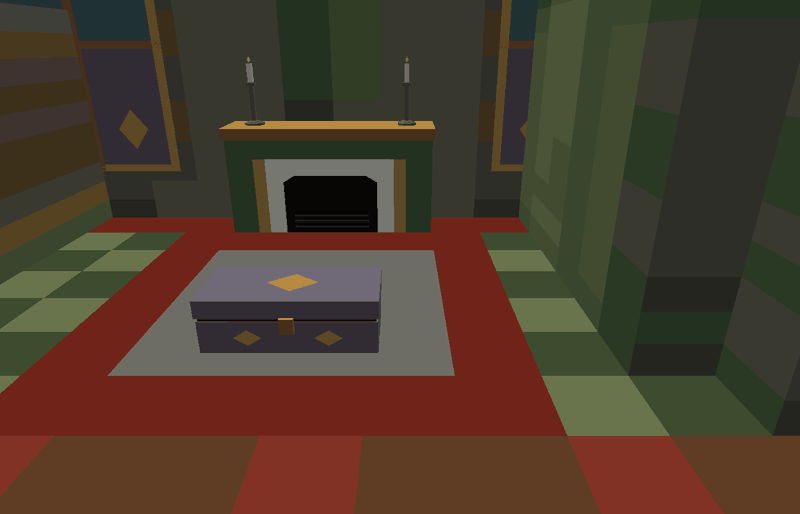

A room's furniture is in its grid: blocks of the palace's brick library, each a few cells of pictures. They are found again by their
block (a grid cell says which block it is and where in it), and made in 3D where their bricks were, in the bricks' colours:
- **Standing pieces** -- 60 red marble columns, 15 plants on plinths and 4 potted plants, 19 wall lamps, 14 benches, 5 fireplaces,
  3 candelabras, 8 candlesticks -- are models made from boxes, turned shapes and leaves; their cells stay in the collision.
- **Wall pieces** stay the wall, with their picture on it: the 2 portraits of the Emperor and the round window at the long hall's end (the
  one Twinsen leaves by -- room 80's way out is in front of it, the big chest under it) are sampled from their bricks' pictures (each spot
  of the face looked up where the isometric picture draws it); the 25 windows are a gold frame round panes, inside and out.
- **Chests**: the rooms' chests are sprite actors (12 small ones and the big one); they are 3D chests, solid.
- Left out: the doors (sprite actors the game slides open and shut with their track scripts -- the doorways stay open for the cars), the
  people (guards, soldiers, the robot), the invisible actors, and two small piles of rubble (sprite 341).
- An actor's 3D body (BODY.HQR) can't go on an island as it is: an island decor is drawn without its bones (`BodyDisplay`: each point
  as it is stored, relative to its bone), so it would have to be flattened to one bone, and its textured polygons would take the island's
  object page instead of the actors' (RESS 6). None of the palace's 3D actors is furniture, so none is used.

The busiest cube, (8, 10), holds 146 objects of the 200 a cube can.

## Wider doors and a way round the palace, for the race (2026-10-12, later)

The race through the rooms (`docs/LBA2_DESERT_RACE_TRACK_BUILD.md`, the palace's second round) wanted its road wider than the doors were:

- **The doors** are made four bricks wide (16 cells, `PalaceIsland.DoorBricks`) instead of the game's two: each doorway in the band of
  wall between two rooms (east and south of each room) is opened to that width round its middle, to the lintel's height, and the line
  from it to the facing door across the next room is cleared -- the furniture's pieces, plain blocks and chests that stood on it
  (`PalaceIsland`'s log: "the doors made wider: 24 doors ..., pieces ..., chests on them gone"). The floor stays under what is cleared.
- **A way round the palace's south-west**: the ground the island leaves clear round the building (its corridors, `PALACE.JSON`) gains a
  ring along the west side and round the south (`PalaceIsland.RingOut` cells out from the wall), so the race's loop over the roofs can
  come down the west side and round the corners to the east; it replaces the old way at x 470.

## A bigger roof top, and polygons a cell across (2026-10-12, later)

For the race's third round (`docs/LBA2_DESERT_RACE_TRACK_BUILD.md`: "let's scale up the roof top so it covers more of the outside of the
palace area"):

- **The roof top**: the hill's flat terrace is measured from the rooms' outline's hull now, not from the rooms, and is 24 cells wide
  (`PalaceCliff.Terrace`, was 10): the corner of the L between the long hall and the sixteen rooms -- rocks up to 3,800 over the roofs
  before -- is flat at the hilltop, and so is a band round the whole palace; the rocks rise only towards the plateau's rim.
- **Polygons a cell across at the most** (`PalaceIsland.NearRun`, `BrickBuilding.Rectangles`' limits): the engine leaves out a polygon
  with any corner behind the camera's near plane, and a floor, a ceiling or a wall merged a dozen cells long went whole when a camera low
  in a room passed over or beside it -- the hill's paving showed through the floor and the sky through the long hall's roof. The faces
  are merged a cell across at the most (a wall's still up it, a dozen layers), and each roof slab's underside -- the ceiling -- is a grid
  of cell squares: 32,885 faces in 88 bodies of the rooms (they were 18,999 in 67), the busiest cube 115 objects.

## The roof top bigger again (2026-10-13)

The user: "The roof of our Palace needs a lot of work. Let's make the roof top bigger".

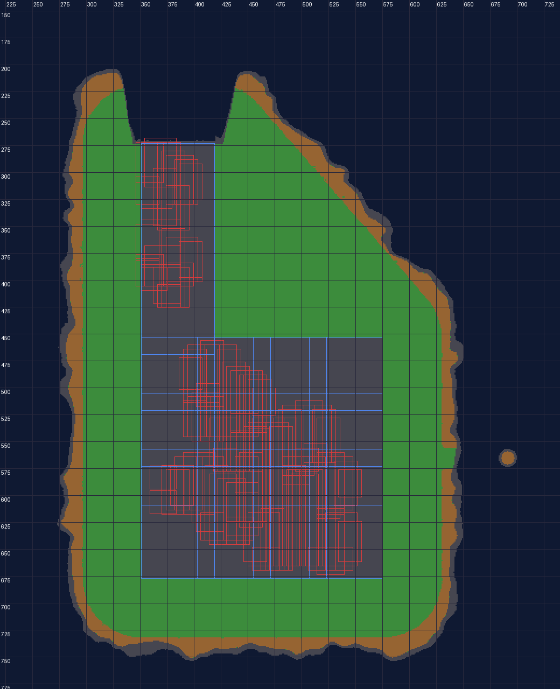

- **The plateau** reaches 66 cells give or take 12 past the rooms' outline (`PalaceCliff.Margin`, was 30) and its flat top 54 cells
  (`PalaceCliff.Terrace`, was 24): a broad flat roof top all round the palace, the rocks only on the rim at its edge. Beside the long
  hall's end the plateau still stops at the hall's wall, so the round window looks out from the cliff -- now into a bay between two arms
  of the hill.
- **The island** is bigger with it: 8 x 11 cubes from cube (4, 2) (it was 7 x 9 from (4, 3)), the palace 36 cells further east and 28
  further south in it (`PALACE.JSON` says where everything is).
- **The harbour's pillar** stands `PalaceCliff.Margin` + 50 cells east of the rooms (`PalaceIsland.PillarOut`, was a fixed 80): out past
  the cliffs however far the plateau reaches.

## The island only just round the palace, the turrets over all of it (2026-10-13, later)

The user: "Did we make the turrets bigger? Let's spread them out so almost the entire island has a roof, let's also make the turrets
taller and wider, we can add more turrets if we need to too", and then: "Make the island small enough so that it only just fits the
inside of the palace, then have the turret's on the roof cover the whole of our inside of the palace".

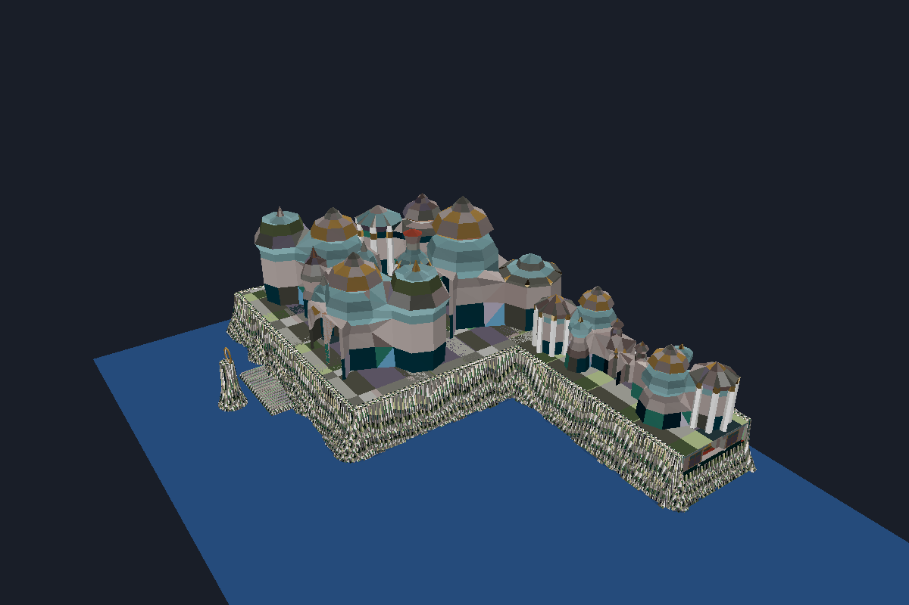

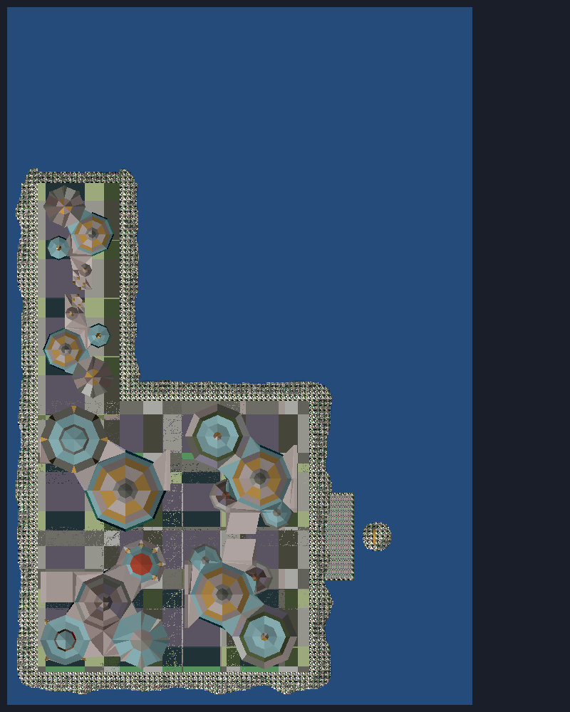

- **The island** is the palace's L and 6 cells give or take 2 past its walls, flat (`PalaceCliff`: Margin 6, Wobble 2, measured from the
  rooms themselves -- the corner of the L is sea now); 6 x 9 cubes from cube (5, 3), with room north of the long hall for the race's leap
  out of the round window (`PalaceIsland.NorthCells` 120).
- **The turrets** (`PalaceOutside`): Otringal's palace's four domed halls stand apart now, each a turret, over the whole of the roof --
  over the sixteen rooms two by two, each filling a quarter of their roof (96 % of it), turned to vary; along the long hall's part out of
  them, the north hall one after another. Each is 1.35 times as tall as it is wide: the west hall 8.7 times its own width and 11.7 its
  height (57,000 high), the east halls 7.2 and 9.7 (47,000), the south-east hall 6.4 and 8.7 (42,000), the north halls on the long hall
  4.7 and 6.3 (31,000) -- the cluster stood 5.5 times its size, 26,800 high. A body's points are 16-bit, so each scaled body is moved to be
  about its own middle (`TurretBody`), its decor's place moved the other way, turned with it as the engine turns it (`LongRotate`'s
  way). The porch and the stone arch -- the palace's way in at its hill's foot -- are left out: there is no ground for them.
- **Their collision**: their shape seen from above, all the way up (`MaxClimb` 100 layers): 1,265 boxes.
- **The sky** is at 90,000 over the turrets (`PalaceCliff.SkyY`, was 48,000).

## The roof whole from everywhere, and the floor up to the camera (2026-10-13, later)

The user: "There seems to be a lot of points on our new roof that isn't full and can be seen through", and "There's terrain clipping
through the palace floor and visible inside as pictured, we should fix this also".

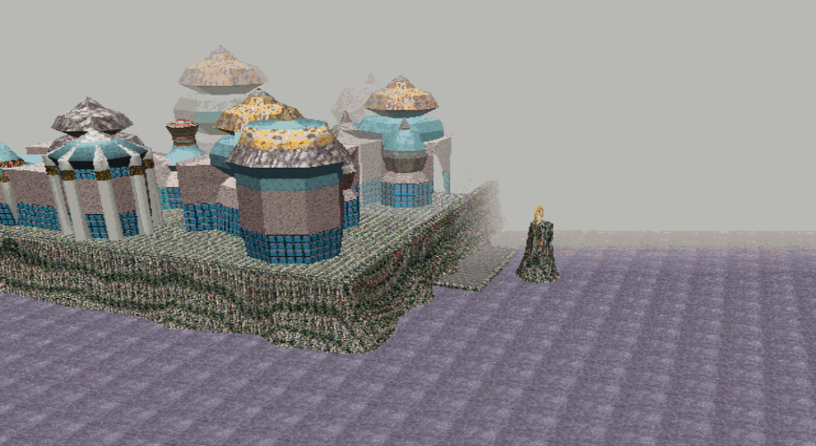

- **Seen from another cube.** The game draws the decors listed in the 3 x 3 cubes round the camera's own (the editor's 3D view: every cube
  of the island), and the turrets' pieces, the roof's rock and the rooms' bodies were listed only in the cubes their boxes reach: from
  further than a cube off a turret stood with quarters missing and the sky showed through the roof. Each is now listed in every cube
  within the far plane of it (70,000: `PalaceOutside.Seen`; `BrickBuilding.AddBodies`/`AddToCubes`' `reach`, the copy keeping its own
  box): 6,147 decors in all, the busiest cube 379 of the 1,000 this editor's engine draws. (This round's notes first had the engine
  drawing the hero's cube's decors only, and the copies bringing back the floor under the camera; it draws the 3 x 3, and what brought the
  floor back was the cut quads, below. Drawing every copy made the palace slow: see the next section.)
- **Behind the camera.** The engine dropped a polygon whole when a corner of it was behind the camera's near plane (3,000 in front at 480
  lines): the floor's squares under the camera went and the ground, 700 under the floor, showed through; near the editor's camera the
  roof's rock had holes the sky showed through. It now cuts them at the plane (`AFF_OBJ.CPP`, every polygon type, its map points and light
  carried to the cut corners; see `docs/LBA2_DESERT_RACE_TRACK_BUILD.md`). Cut there, the floor still ended 3,000 in front of the camera,
  on the screen with the camera tilted down: the palace's bodies -- the rooms, the rock, the turrets -- carry a flag (Info bit 11,
  `BrickBuilding.CloseFlag`, no retail body has it) that has them cut 400 in front of the camera instead. The floor runs to the screen's foot.
- The island's own ground (the cliffs' tops) is cut at the near plane as in the retail game: in the editor's 3D view, close to a cliff's
  edge, a wedge of sky can show there.

## Fast again (2026-10-13, later still)

The user: "Our palace track is now very laggy, and it's very laggy to view in our editor window too". The copies in every cube were all
drawn -- the game draws the 3 x 3 cubes round the camera's, the editor's view every cube -- nine times a frame in the game, some thirty in
the editor: 61 ms a frame in the rooms (1280 x 720) where the island had taken 25, and 330 to 760 ms a frame in the editor. The engine now
draws each of them once a frame, leaves out one wholly out of the view first, and holds a whole island's cubes in its caches (the editor
unpacked the palace's 54 cubes again every frame): 19 ms in the rooms, 13 in the hall, 29 to 54 ms in the editor. Details, and the
faces merged back into bigger rectangles (tried, left): `docs/LBA2_DESERT_RACE_TRACK_BUILD.md`, "The palace fast again".

## One red carpet, green checks, even walls, and pictures of the game's characters (2026-10-13, evening)

The user: "Let's simplify the flooring inside the palace. Let's make the main road section that's mostly red at the moment pure red just
with the white arrows. The surrounding area varies a lot, let's keep this consistent with a check pattern based on the green", then
"Whilst we're cleaning up the floor let's see if we can make the colours on the walls more consistent too as they're currently very
blocky. Let's also see if we can generate some pictures to hang on the walls based on some of the games characters".

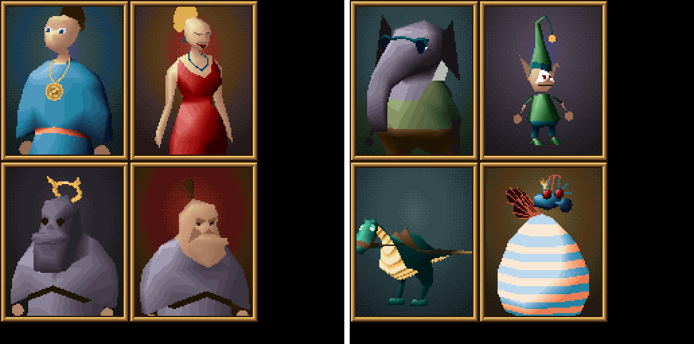

- **The floor** (`PaintFloor`). The carpets the doors lead to are one red, (119, 42, 30). These are the grids' red carpets and their
  brown border, at least two cells wide (a runner along an outer wall is one cell wide and leads to no door), and joined to carpet
  within 4 cells of a door's way through the walls. A cell the rooms didn't show as floor (a door's threshold, its widening, a hole) is
  red when there is carpet on both sides of it within 6 cells along a row or a column: the red runs on through the doors. A cell they did
  show that isn't carpet (the grey inlays where carpets cross) is red when there is carpet within 3 cells all round. The rest of the floor
  is checked cell by cell in the tiles' two greens, (127, 139, 94) and (64, 82, 53): 971 cells of red. The floor arrows are the race
  track's own decks, on top.
- **The walls** (`PaintWall`). Inside the rooms each wall is coloured by height over the floor: a skirting two layers high, a gold trim,
  the wallpaper, a gold trim three layers under the top, and a cornice. The grids' red pillars stay the carpet's red. (Each cell was its
  brick's average colour: a patchwork.) The outer faces keep Otringal's palace's teal, stone and turquoise.
- **Pictures** (`PalacePortraits`). Eight of the game's characters are painted when the island is built: Twinsen, Zoé, the Dark Monk,
  FunFrock, Jerome Baldino, Joe the Elf, the Dino-Fly and the Queen of the Mosquibees.
  - *The paint.* Each comes from the game folder's own body (BODY.HQR, and the body textures of RESS.HQR's entry 6). It is drawn in
    Otringal's palette in the colours the game draws that body in there. The sitter is shown three-quarters from the front, lit from above
    at the left as the game lights a body (steps up its colours' ramps), on a dark backdrop dithered in eighths, in a gold frame. Nothing
    of the game's is put into the program.
  - *The pages.* A picture is 96 x 120 pixels; four go on a page, so the eight take two pages of the island's object textures
    (`IslandFile.ObjectPages`).
  - *Where they hang.* Each takes a room's plain wall, 2 cells across and 8 layers up (4,096 x 5,120), from 2 layers over the floor. None
    of that wall may be a piece of furniture. The room's air must reach 5 cells out from it, so it is not a door's side (a door's way
    through the walls is 4 cells wide), with nothing standing in the first 2. A cell of plain wall must be left on each side.
  - *How many.* One goes in the middle of each such stretch, one every 7 cells along a long one. Each room takes its two longest
    stretches, and the long hall six more: 28 pictures in 13 rooms, the sitters by turns.
  - *How they are drawn.* A picture is a body of one perspective-correct textured polygon (type 16, TEXTUREZ), its page in the decor's
    body number (`IslandFile.DecorPageShift`). It is drawn close and in every cube it is seen from, as the rooms are. The wall's faces
    behind it are left out (`Faces`' `skip`), because the filler takes depth straight across the screen and would mix the two up.

## The carpet as wide as the doors, a way in, a fireplace that's a teleporter (2026-10-13, night)

The user, with pictures: "some of the red carpet doesn't join up, at the corners for example", "Enlarge the track width so it's the same
width as a door way. Let's change the tile colour next to the track to a different colour than the rest of the floor", "Add an entrance
door to the palace in the start room, we may need to reposition the large purple chest on the wall Perhaps over to the wall to the left of
it", "Our fireplace that's here ... near the dinofly picture let's turn it into a teleporter so driving into it brings us out of a second
fire place where the Queen of the mosquibees is on the wall. Let's move the queen's picture to where dinofly is, and drop the dinofly
portrait", and "Add a raised track outside on the roof that loops around the roof turrets".

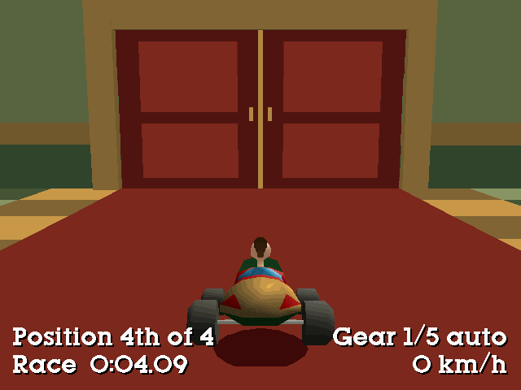

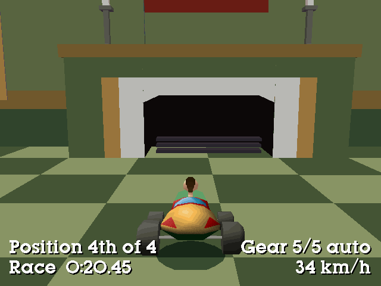

- **The carpet as wide as the doors.** The grids' carpets are two cells across. Every cell within one of them is carpet now too, so the
  carpet is four cells across (`DoorBricks`), the doors' width, and its corners are square (the gaps there are gone). The cells along
  it, a cell either side, are gold tiles in two shades (`BandLight`, `BandDark`); the rest of the floor is the two greens. Rooms are 13
  cells across, so most of each room is carpet now.
- **The palace's way in** (`EntranceDoors`). Room 154's east wall has a pair of doors on the bottom row's carpet line, as wide as the
  room's west door and as high: two leaves of dark wood with raised panels, gold handles by a gold seam, a frame standing out from the
  wall and a crest over it. They are on the wall's plane, its faces behind them left out, and no picture hangs within a cell of them.
  The carpet runs on to them. The chest that stood in front of them is against the north wall now, east of that wall's door.
- **A secret warp** (`PortalFrom` 151; `PalaceFurniture.Portal`). Room 151's fireplace, at the end of the bottom row's carpet, leads to a
  fireplace made in the same room, on its south wall between the pictures of the Queen of the Mosquibees and Zoé (the user, with a
  picture of the room: "the exit fireplace should be between the two portraits"; first it was room 159's). The made one is the grids'
  fireplace block (`FireplaceWide` 4 cells along the wall, `FireplaceHigh` 5 layers), its cells in the collision as the others' are.
  Both are hollow -- the middle two cells of the four along the wall and three layers up, out of the collision, the wall's faces at the
  back left out -- but look as every other fireplace does (the user: "Make the teleport linked fireplaces visually identical to the
  other fireplaces, they're a secret warp point"): the same breast, surround, black opening, grate, shelf and strips, black inside. The
  layout's `teleports` gives the race-track mode the box a car is taken in by (the first's hearth, from its back to 1.2 cells in front of
  it) and where it comes out (just in the second's, looking out of it, north into the room): RACEMOD.CPP `teleport=`.
- **The Queen's picture.** The Dino-Fly's picture is gone; the Queen of the Mosquibees hangs where it was, by the first fireplace, the
  second beside her. The other pictures go round the six others.
- **The turrets apart** (`PalaceOutside.SlotFill` 0.80, was 0.96; the long hall's two `HallFill` 0.70): the road round the roof goes
  between them -- the ways between the four over the sixteen rooms are some 24 cells across at their narrowest, the gap between the
  long hall's two some 27. They are still 35,000 to 47,500 high.
- **The teleporter's pillar** (`PillarNorth`, `PillarRise`): 78 cells north of the sixteen rooms' north wall, out in the sea, its top at
  28,766 (was 19,916, by the quay): in the way of the leap off the race's spiral, the Dark Monk's teleporter on it at 31,506.
- `PALACE.JSON` has two more keys: `entrance` (the doors' wall face and span, island cells) and `teleports` (each the box in and the place
  out, island cells and world heights, and the turn).

## The inside from above (2026-10-13, night)

The user: "Create a top down image of the inside of the palace track". The island as the race-track build leaves it, its roof and walls cut
away 1,600 over the floor: where the cut goes through a wall or a tall piece of furniture it is dark, the solid there. The doors' tops are
higher, so the doorways show as gaps. North is to the left and east up, as in the user's drawing of the roof route. The plain one is for
drawing on.

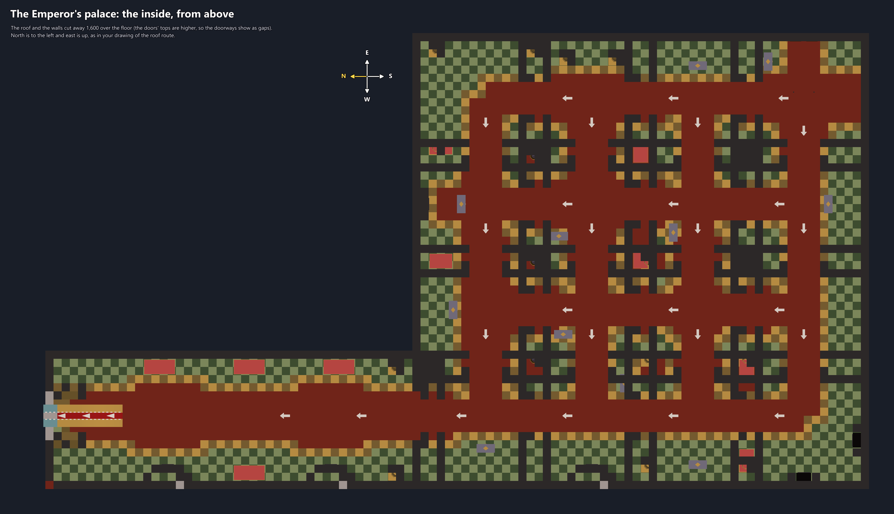

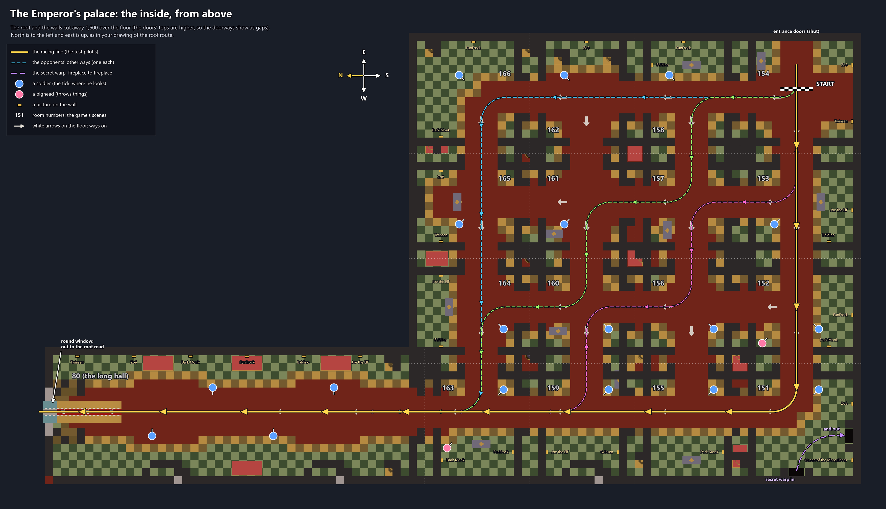

- Each room is the square round its carpets' crossing. The dark `#` shapes are where four rooms' corners meet: each room's own walls,
  with a strip of floor between them where two rooms' grids overlap. The labelled picture marks where rooms meet with faint dots and
  numbers each room with the game's scene it was built from.
- The labelled picture's lines come from the plan (`docs/racetrack/palace_track_plan.json`): the racing line (the test pilot's) to just
  through the round window, the opponents' `openRoutes`, the `guards` (each with a tick the way he looks), the `teleports`. The pictures'
  places and sitters come from the built island (`palacepictures`).
- Made by `tools/RaceTrackPlan/palace_topdown.py <game folder with the track built> <out folder>` (`ScriptRoundTrip` built in Release):
  `islandmesh --no-terrain --caps <cut>` (each solid box through the cut height as its dark cross-section there), `meshshot --top
  --clip-y <cut> --cut` (the triangles cut at that height, what is over it left out), the outside of the rooms left out, turned a quarter
  round, and the words drawn with matplotlib.

## Only the track red (2026-10-13, late)

The user, after the pictures above: "We have lots of red that isn't the inside track. The red track area should be the width of the door
way, there should be no other red on the floor. It looks like we've also attempted to round the corners slightly, let's keep the corners
nice and square."

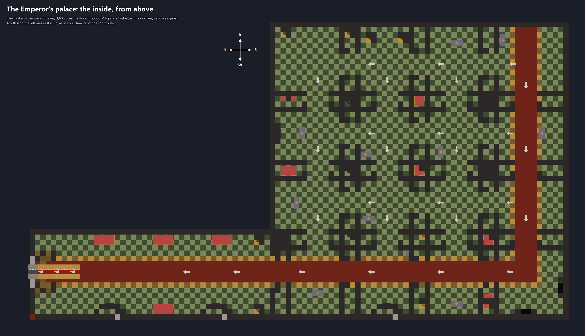

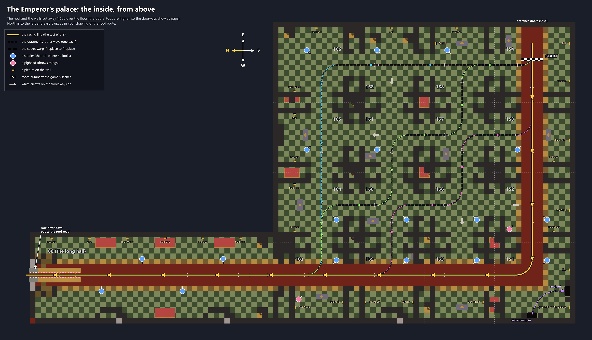

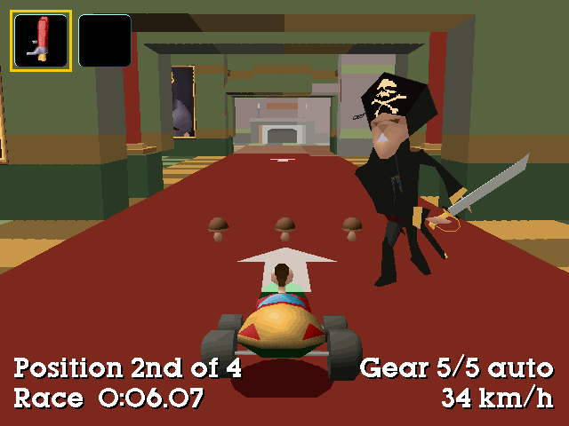

- Until then every carpet of the grids was red, widened to the doors' width: a red lattice through all sixteen rooms, its corners the
  grids' carpets' cut ones. Now the floor's only red is the race's track (`TrackRow`, `TrackColumn`): from the palace's doors in room 154
  west through the bottom row's doors to room 151's west column line, and from there north through the west column's doors (155, 159,
  163) and up the long hall to its north wall, the round window. Each stretch is exactly as wide as the doors on it (`DoorBricks`: the
  doors' own span along their walls, 16 cells), and the two meet in a square corner. The tiles a cell round it are gold, as before; the
  rest of the floor is the two greens' checks (`PaintFloor`). 548 cells of red (1,643 before), 235 of gold.
- The build warns if the track's doors aren't all in line and four bricks wide (they are).
- The benches' cushions are still red: they are furniture, not the floor.
- The teleporter's pillar is back by the harbour's quay, on the sixteen rooms' middle row's line and 700 over the hilltop (`PillarRise`;
  `PillarNorth` is gone): the race's leap is off the roof's middle way now, north over the cloud sea (the user's new way over the roof,
  `docs/LBA2_DESERT_RACE_TRACK_BUILD.md`).

## Sixty rooftops (2026-10-14, night)

The user: "Let's lower the roof tops. Are we able to add in more roof tops?". The six turrets (22,500 to 47,500 over the roof) are
sixty rooftops now (`PalaceOutside`: `RoofWidths`, `RoofTall`, `RoofRiseLeast`/`RoofRiseMost`, `RoofOverRoad`/`RoofUnderRoad`,
`RoofGap`, `RoadGap`, `RoadOverTop`, `RoofMost`): Otringal's four palace halls in turn, a quarter turn more each time round, 13 to 34
cells across and 7,000 to 12,000 tall, their tops round the race's road's height near them, packed round the road
(`PalaceOutside.RaceRoad`: the palace's track as the program builds it). Without a road (`Add`'s `road` null) the turrets are placed as
before. Their collision is their shape from above, as before. The busiest cube holds 551 objects of 1,000; the outside has 131 bodies.
See `docs/LBA2_DESERT_RACE_TRACK_BUILD.md` ("The rooftops") for pictures and the frame times.

## No outside, and an upstairs (2026-10-15)

The user: "The outside of the palace track just isn't working, and we've tried a few revisions, let's keep a copy of it so we can rebuild
it in the future if we need to, but for now drop it totally. Let's add an upstairs to the inside of the palace. Let's keep the same basic
colour theming, but maybe add a couple of bedrooms, a throne room, and any other rooms you can think of that would fit with a palace
theme."

- **The outside off**: `Build`'s `outside` is false by default now: no turrets or rooftops (`PalaceOutside`), no Dark Monk's teleporter
  ring on the harbour's pillar (`PalaceTeleporter`), no flat ways across the hilltop's rocks. The code stays: `outside: true` (or
  `ScriptRoundTrip palace ... --outside`) puts it back. The race's outside is archived in `docs/racetrack/palace_outside_archive` (its
  plan and design script) and the git tag `palace-outside-v12`.
- **The upstairs** (`PalaceUpstairs`): a second storey on the sixteen rooms' own grid. Each room of the ground floor is a slot upstairs,
  9 x 9 bricks inside (36 cells) between the same four-brick wall bands, 11 layers high (7,040). Its floor fills the layer where the
  rooms' roofs were (the ground floor's ceiling under it, in the stone the roofs' undersides had), its top at 26,640, the roof's rock over
  it all: the hill's plateau is at 26,896 now (19,216 before).
  - The rooms: the library (over 151), the music room (152), the princess's bedroom (153), the Emperor's bedchamber (154), his dressing
    room and bath (158), the throne room (over 156, 157, 160 and 161, the walls between them gone: 22 x 22 bricks), the treasury (162),
    the armoury (166), the banquet hall (over 164 and 165: 22 x 9) and the chapel (163).
  - Two of the ground floor's rooms are stairwells, open to the roof: 155 and 159. Each has a column in its middle (red marble, gold bands
    a storey apart) and the race's ramp winds round it.
  - The doors upstairs (`Doors`): the rows' and columns' doors on the ground floor's lines (bricks 3..6 of a room's inside), the
    stairwells' on their ramps' lines, the treasury's into the throne room two bricks south (clear of the throne's dais).
  - The ground floor's doors from 159 to 155 and to 160, and from 163 to 164, are walled up (`Closed`): the rooms the race comes down into
    -- 159, 163 and the long hall -- are reached only by the stairs.
  - The long hall goes up with it: its walls on up to the roof, two storeys high, its round window where it was.
  - The colours: the floor's red along the race's way (door to door, square-cornered, as wide as the doors), gold tiles along it, the
    greens elsewhere; rugs in the bedrooms, the library, the throne room (a purple runner up to the throne), the chapel's aisle and under
    the banquet table; the walls in the ground floor's bands (skirting, gold trim, wallpaper, trim, cornice) counted from the upstairs'
    floor. Pictures of the game's characters where a wall has room (`PalacePortraits.Spots` again, from the upstairs' floor).
  - The furniture (`PalaceFurniture.Upstairs`, made here -- the game has none of it): four-poster beds, wardrobes, a dressing table and
    mirror, a bath on gold feet, bookshelves full of books, a globe, a grand piano, a harp, music stands, chairs, the throne on a three-step
    dais, columns, chandeliers, a banquet table with a gold runner, plates and goblets, fireplaces, gold piles, gem pedestals, chests, suits
    of armour, weapon racks, an altar and pews; and the ground floor's candelabras, candles, plants and benches. Each in the strips the
    race's way leaves, a box in the cars' way (the chandeliers and candles none; a stairwell's column's narrower than it is, so a car on
    the ramp by its inner rail never touches it).
- Built: 133 bodies of the rooms (44,334 faces), the busiest cube 285 objects of 1,000 (577 with the outside).

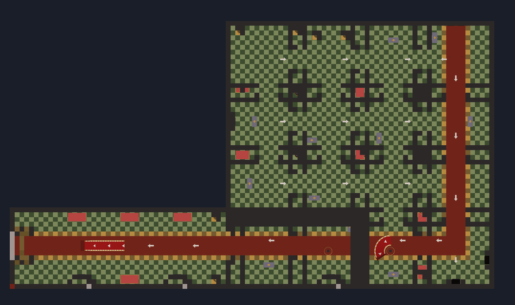

## Making it

- Tools > **LBA2: Palace island (Otringal's palace)…** (`MainWindow.Palace.cs`) adds the two files to the game folder, builds them again,
  or takes them out. It is refused while test edits or the 1996 demo are open. The new island appears in the Island list
  (Otringal's palette). Since 2026-10-12 the editor's 3D view also gives it Otringal's sky, cloud sea and light (`3DEXT/RENDERER_API.CPP`
  takes `PALACE` for Otringal's slot, as it takes `CXTOWER` for Island CX's); it had Citadel Island's sea and sky, the first slot's.
- `ScriptRoundTrip palace <game folder> <out folder> [source folder] [--no-roofs] [--outside] [--no-furniture] [--no-upstairs]` builds the same files
  into another folder. The source folder holds pristine `OTRINGAL.ILE` and `.OBL` (the game folder by default). `--no-roofs` leaves the
  roofs (and the outside) off so you can see inside, as in the second picture.
- Pictures: `ScriptRoundTrip islandmesh <ile> <obl> 31 <out.bin> [x0 z0 x1 z1] [--no-terrain] [--boxes] [--caps y]` and
  `ScriptRoundTrip meshshot <out.bin> <png> --target x y z --yaw a --pitch b --dist d [--clip-y y [--cut]] [--cull]` (a depth-buffered
  picture; `--top --box x0 z0 x1 z1` straight down; `tools/ScriptRoundTrip/PalaceStudy.cs` has the studies behind the outside and the
  furniture). `ScriptRoundTrip palacepictures <ile> <obl>` lists where a built island's pictures hang, and whose they are.
- `ScriptRoundTrip palaceportraits <game folder> <out.png> [scale]` paints the pictures' pages as the island has them.
  `ScriptRoundTrip palacefloor <game folder> <out.png>` maps the rooms' floor bricks from above in their average colours.
  `LBA2_PALACE_PAINT=<file>` has a build write the floor's paint, a line a cell.
