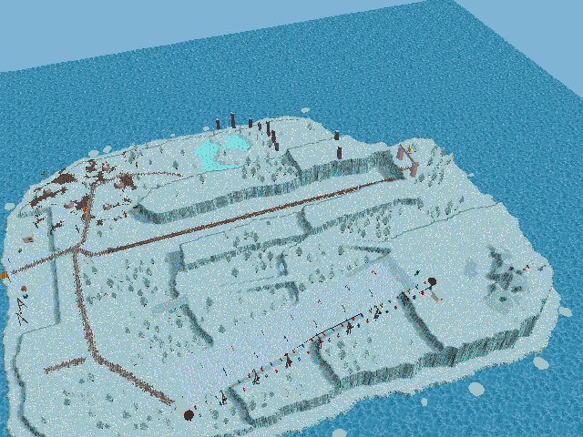
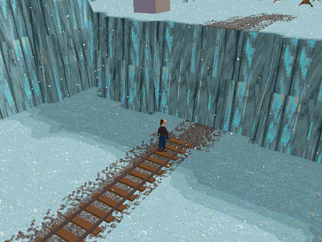
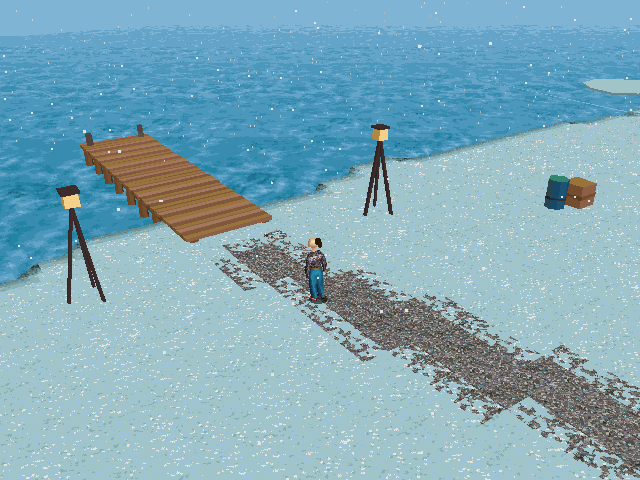
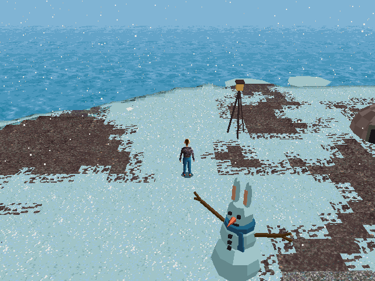
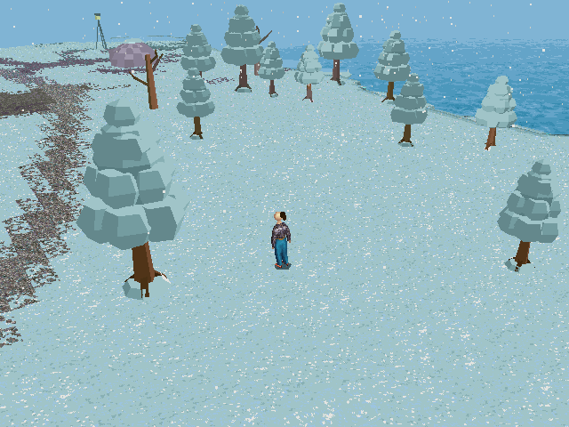
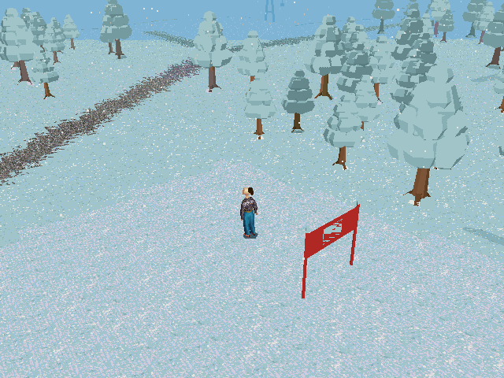
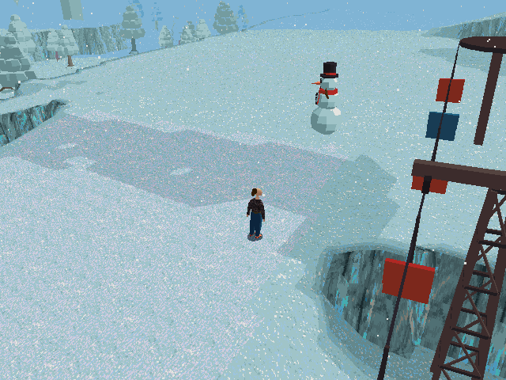

# The snow island: a new LBA2 island in the spirit of LBA1's Hamalayi Mountains (2026-10-22)

The user (2026-10-22): "Design a brand new island the same size as desert island for LBA2 with a snow theme. Let's take inspiration from
LBA1's Hamalayi Mountains, let's introduce some snowmen, and perhaps a small skiing area. This will be a separate mod to our racing mod,
but for now let's build it into LBAAssembler for testing."

**To use it:** Tools > **LBA2: Snow island (Hamalayi)…**. It needs both game folders set under File > Settings: the ground is textured with
LBA1's own Hamalayi bricks. It builds the island as a map of its own, `SNOWISLE.lbamap` (in the maps folder: `Maps` beside the program --
`release\Maps` -- or the open map's folder), and opens it in a map workspace, as File > Open map would. The status bar names its scenes and the one Twinsen
starts in, on the harbour's quay. Play that scene. File > Install map into game puts it into the game (its `MAPS` folder, or the game's own
files).

**Only LBA Assembler's own engine plays it** (maps and the snowfall are its additions).

## A map of its own

The island isn't added to the game's island list the way Polar Island is (island 12). It is a map (`docs/LBA_MAPS.md`): its ILE, its OBL and
an outside scene for each cube, in one `.lbamap` file. That keeps it a mod apart from the race tracks, and the engine plays it from a game
folder's `MAPS` folder with nothing else in the folder changed. The LBA1 folder is needed to build it, not to play it.

* **Its look** is the Desert island's (island 2): sky, sea, palette, the scenes' music and ambience. Island CX's grey-lavender sky and sea, Otringal's
  pink haze and Citadel's storm were tried; the Desert's clear blue sky over a blue sea, close to LBA1's turquoise, is the one that looks
  like a bright winter's day.
* **Its size** is the Desert island's: 19 cubes, 4 × 5 with the north-west corner missing (cubes 7–10 × 7–11, not 7,7).
* **Its scenes**: one a cube, 19, numbered from 400 where the game folder has room. Each has Twinsen on the walkable cell nearest its
  middle (a path first), and cube-change zones to its neighbours. The harbour's cube has him on the quay at the pier's foot.
* **Snow falls** on it: `weather = snow` in its `MAP.TXT` (and `weather SNOWISLE snow` in `ISLANDS.TXT` when it is installed into the game's
  files). See *The snowfall* below.

## Hamalayi

LBA1's Hamalayi Mountains are two outside areas: the prison valley (the landing place, three fighting scenes up a canyon, the prison) and
the Rabbibunny side (their village, the Sacred Carrot, the clear water lake, the bunker, the ski resort). What the island takes from them
(a study of their scenes: `ScriptRoundTrip hamalayi`):

* **Terraces of pale cyan snow cut by vertical ice cliffs**, never smooth slopes; a ragged shore ledge a couple of layers over the sea.
* **A canyon** climbing between cliff walls, a mine rail up its floor, to the **prison's pink concrete gate** with Funfrock's bust over it.
* **The ski resort** (scene 96): steel lattice lift pylons in a rusty brown, a little hut with a dark arched doorway and a rope fence, a
  snowman.
* **Puffy snow-laden trees**, **mauve rock pillars**, a **frozen pond** sunk into a plateau with **ice spikes** along its rock wall and a
  Rabbibunny **snowman with ears** (scene 92).
* **The Rabbibunnies' village** (scene 15): stone domes on brown earth, a carrot patch, dead trees.
* The harbour: crates, teal barrels, lamp tripods, a gantry crane, ice floes on the sea.
* LBA1's own bricks for the ground: its snow tops, its ice-cliff sides, the gravel of its quays and paths, the Rabbibunnies' earth, its clear
  water (frosted, for the pond's ice).

## The layout (`Terrain/Snow/SnowDesign.cs`)

From the sea up, in tiers of 8 layers (2,048 world units):

| Tier | Height | What is there |
|---|---|---|
| T0 | 512 | the shore ledge, the harbour's quay and the pier |
| T1 | 2,048 | the lowland: the village (south-west), the frozen pond (west), the ski slope's foot (east) |
| T2 | 4,096 | the massif's first tier |
| T3 | 6,144 | the north plateau with the prison gate, the massif's second tier, the canyon's south walls |
| T4 | 8,192 | the summit plateau, the canyon's north walls; the peak rising from it to about 12,000 |

* **The canyon** runs north from the lowland to the north plateau. Its floor climbs two layers at a time (8 stretches with a ramp each),
  between walls a tier or two higher all the way.
* **The ski slope** comes down the massif's south-east face from the summit plateau to the lowland: a smooth slope across the tiers it
  cuts, combed snow (a piste basher's lines), 13 slalom gates. The **chair lift** runs beside it: 7 pylons, the cables with 48 chairs, a hut
  and a bullwheel at each end.
* **Ramps** join the tiers: the quay to the lowland (two), the lowland to the massif's first tier, on to its second, and on to the summit
  plateau. The canyon's floor is the way up to the north plateau, and the ski slope a way up to the summit.
* The terraces' edges meander (the regions are tested a little off where a point is), and the flat tiers have drifts a few hundred units
  high.
* **The pond** is sunk two layers into the lowland, its banks sloping down to the ice over two cells, an isle of snow in it.

Everything Twinsen should reach, he can: `ScriptRoundTrip snowwalk` walks the built island from the pier over every cell that isn't a wall
or water. It reaches the village, the pond's shore and ice, the canyon to the prison gate, the north plateau, the ski slope's foot and top,
the summit plateau and the massif's tiers (89 % of the walkable cells; the rest are the canyon's wall tops).

## The ground (`SnowTerrain.cs`)

* **Heights**: each vertex the design's height; a cell whose corners are 900 or more apart is a cliff, textured with two of LBA1's
  ice-cliff bricks' sides one over the other, along its high edge. Slopes steeper than 40° are walls (the triangles' collision bit).
* **Textures**: LBA1's Hamalayi bricks' top faces, 32 pixels to a cell (one ground page): 8 snow bricks (a cell picks one), gravel on the
  paths and the quay, earth in the village, the clear water's bricks frosted for the pond, the snow combed for the ski slope, mauve rock on
  the peak's steep parts. Where gravel or earth meets the snow, a cell gets a tile of both (a lumpy mix), so the paths' and the earth's edges
  aren't the cells' squares.
* **Colours**: LBA1's snow is a pale cyan, and the island palette's nearest to it a stronger turquoise, so the snow is taken halfway to white
  first. Colours are matched by brightness and, four times as much, by hue (YUV): a plain RGB distance turned the snow's shadowed cyans
  into the lavender ramp's greys (pink patches on the trees).
* **Light**: baked from the cubes' sun with the mountains' shadows; flat ground at the palette's own colours (light 12).
* **The sky** over the cubes is raised to 6,000 over the peak (the Desert's sky height is lower than the peak).

## The things (`SnowObjects.cs`, `SnowMesh.cs`)

Every thing is a body of flat-coloured faces, each face lit by the cubes' sun as the ground's bake is (so they shade as the snow round them
does): 88 bodies, 549 decors, 352 collision boxes, 273 trees, 8 snowmen.

* Drawn **decors** have a box whose top is under its bottom (drawn only, culled by their whole footprint), a copy in each cube their box
  reaches. Tall things seen from far (the pylons, the cables, the stations, the gate, the crane, the summit flag) have copies in the cubes
  round them too, as the engine draws only the 3 × 3 cubes round the camera.
* What Twinsen can't walk through is a **collision box**, a decor of the empty body 0, in every cube it reaches (the engine collides only
  with the decors of the cube the hero is in): tree trunks, snowmen, the pylons' feet, the huts, the domes, the pillars, the gate's
  pillars, crates and barrels, the fence posts. The pier's deck is a box he walks on.
* Things that follow a way are built turned that way (the pylons, the stations, the gates, the domes' doorways towards the village's
  plaza, the fence); round things are turned at random (trees, floes) or to face a place (snowmen).
* Trees stand on level snow between the lowland and the massif's second tier, clear of the ways, the ramps, the village, the quay, the
  canyon and the pond: a line each side of the ski slope, woods where a slow noise says, a lone one here and there.

## The snowfall (engine: `SNOW.CPP`)

The rain's way (`RAIN.CPP`): 1,600 flakes in a box round the point the camera looks at, falling about 900 units a second, drifting with the
wind and swaying, drawn into the depth buffer (`LineRain`) so the ground and what stands on it hide those behind them. A flake that falls
under the box, or that the camera has left behind, comes back in at the far side. Near flakes are three pixels square, then two, far ones
one, white into the fog's greys. It follows the detail level's weather setting (`RainEnable`), as the rain does.

* The engine's `SceneSnows(scene)` (`EXTFUNC.CPP`): a map's scene from `MAPS` by its `MAP.TXT` (`MapPack_Snows`), a scene on an island file
  of its own by `ISLANDS.TXT`'s `weather` lines.
* Gotcha found: `ScreenXMin` and the rest are not the screen's size. They are `LineRain`'s box of what it last drew, and it empties that box
  when it draws nothing. A first version tested the flakes against them, and after the first flake drew nothing, no flake was drawn at all.

## In the editor

* `MainWindow.Snow.cs`: the menu item. It builds on a background thread, saves the map (a `.bak` of an earlier one kept) and opens it.
* Found while testing it: opening a map whose island has the same name as the one in view (built again over itself) showed nothing. The
  island in view was taken to be loaded already. `ShowOpenMap` now reads the island again (`OpenLba2Area`'s `reload`).

## Tests

`ScriptRoundTrip`:

* `snowdesign <out.png> [scale]`: the design from above.
* `snowisland <LBA1> <LBA2> <out.lbamap> [<game folder>]`: built (about 3 s), saved, and put in a game folder's `MAPS` (a sandbox's).
  `SNOW_LOOK=<island>` and `SNOW_WHITER=<0..1>` try another look and another white.
* `snowwalk <LBA1> <LBA2> [out.png]`: where Twinsen can walk from the pier, and whether the island's places are among it.
* `hamalayi <LBA1> <outdir> [scene...]`, `hamalayiregion ...`: the study of LBA1's Hamalayi outside scenes and their bricks.

Headless runs on a sandbox (`E:\dump\TEMP\snow\game`, its `MAPS` folder; `game2` with it installed into the HQRs): `tour.py <tag>
u,v,beta ...` puts Twinsen at places with the follow camera and takes screenshots. `ui_snow.ps1` drives the Debug editor on the sandbox's
settings: the menu item, its question, the map built and opened (the island in view).

| | |
|---|---|
|  |  |
|  |  |
|  |  |

## Not done

* No people: the scenes have Twinsen alone (and the engine's Meca-penguin slot).
* No holomap place: a map's scenes carry the Desert's island number; the Desert island's holomap shows nothing of it.
* The lift doesn't run (its chairs hang still) and there is no skiing: the slope is for walking down.
* The music is the Desert scenes' own.
