# The Temple of Bú: LBA1's temple as an LBA2 island, and its Halloween race (2026-10-16)

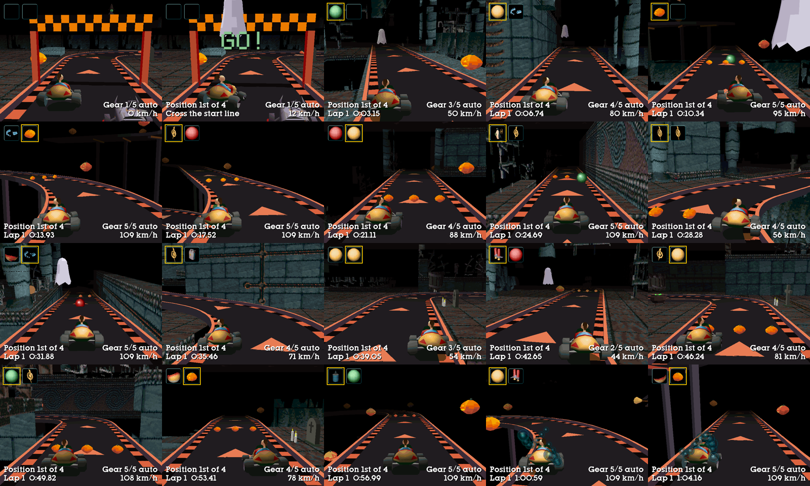

The user: "Port the temple of Bu from LBA1 into LBA2 as a separate island. Make sure it is visually the same with the same colour palette,
which means when viewed from the same angle as the fixed LBA1 angle it should match. After it's been ported generate a Halloween inspired
race track for it. This will be a separate release for a Halloween special track before our full racing mod is released. Let's make it as
creepy, scary, and Halloween inspired as we can do, let's turn our mushroom pickups into mini pumpkins. Add lots of typical Halloween decor,
pumpkins, witches, ghosts etc."

**To use it:**

- **The island on its own:** Tools > **LBA2: Temple of Bú (from LBA1)…** adds it to the game folder (both game folders must be set under
  File > Settings: it reads LBA1's scenes). The same menu builds it again or takes it out. Then pick `TEMPLE.ILE` in the Island list.
- **The race:** tick **The Temple of Bú: the Halloween race** in the race track window and Build. The build makes the island afresh, with
  doorways cut where the road goes. Then open `TEMPLE.ILE` and Play.

Only LBA Assembler's own engine draws it right: it is raced as Otringal's island 4 drawn from `TEMPLE.ILE`, in a palette and under a sky of its
own (the race file's `island_file=4 temple`, `island_palette=40`, `island_sky=24`).

## The port

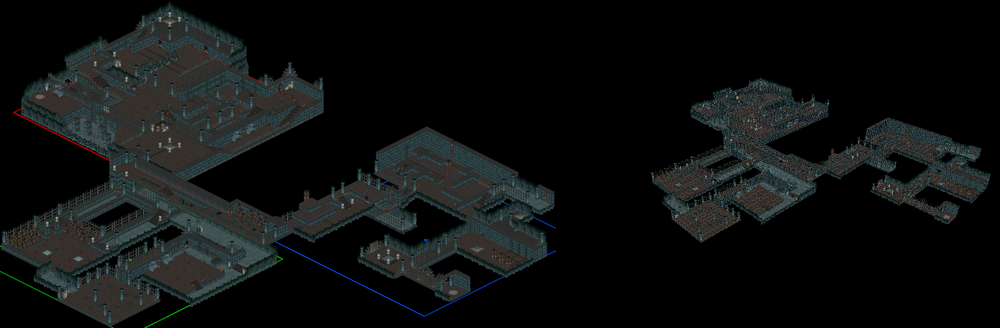

**The layout** (`Terrain/Temple/TempleLayout.cs`): the temple is LBA1's scenes 8 (the first floor), 40 (the crypt, sixteen layers lower, and
the long corridor) and 41, placed as the joined map (`Lba1Areas`, "Temple of Bú") has them: 24,516 cells.

**The frame** (`TempleFrame`): every cell is three times LBA1's size each way (Scale 3). The corridors, five to seven cells wide in LBA1, are
15 to 21 cells for the cars, the palace's doorway width. The temple's 34 layers then stand 26,112 high, under the engine's 32,767. A uniform
scale keeps the look from LBA1's angle the same. The island is 11 × 8 cubes (2..12 × 3..10), the temple from cell (224, 256).

**The objects** (`TempleObjects.cs`): every LBA1 cell is a box textured with its brick's own faces, unskewed from the isometric sprite (the
code is Polar Island's, `PolarTextures`). LBA1's interior bricks draw only the faces the grid leaves to be seen: a floor tile only its top,
a wall brick only the side it faces. So a brick that draws any face whole is a whole block. Only bricks that draw no face whole (a lamp's
pole, a rail) get the box their outline fits. Where a brick draws nothing on a face, the face is see-through (polygon type 12, "incrusted":
colour 0 isn't drawn): the railings' gaps, the cobwebs' strands, the skull lamps' surroundings. A face is left out where the box beyond it
is solid there. The bodies only draw (their decors' boxes touch nothing). What is solid is 7,663 merged boxes of their own, with LBA1's
stairs (shapes 2-5) as four steps each. 1,108 different brick faces on 11 object pages, 74,332 faces in 1,589 bodies.

*The faces LBA1 never showed* (2026-10-18, the full check before the release): a whole block's face that nothing covers -- a doorway's
jamb the race cut open, a floor slab's edge at a drop, a wall's -x/-z end -- was left out or drawn see-through where its brick's picture
had nothing there, and the chase camera looked into the black inside the walls. Such a face is drawn opaque now, with the face's own
picture filled in, or the brick's most-drawn face (a floor edge gets the floor's colours, a wall's top its stones), unless LBA1's own
picture shows through it there (checked against LBA1's drawing order), so LBA1's angle is unchanged. Bottoms are taken from the uncut
layout (a lintel over a cut doorway has its underside) and drawn over open space where something lower stands within 3 columns (a
ledge over a room). Neighbouring faces in a plane overlap by 8 units (no 1-pixel seams), and the 8|40 join's empty row at z 63 takes
scene 40's first row (19 cells: the corridor's walls and ceiling). Over the test pilot's lap, frames with a hole went from 132 of 276 to 7
(all deep in the fog); 4.6 % more polygons, 13 object pages, frame times the same.

**The round things** (`TempleShapes.cs`, 2026-10-17): the user: "Let's also improve the graphics for the temple track as some things like
barrels aren't correctly reproduced in 3D." A box with a barrel's picture on each side is a crate with a barrel painted on it. So the
temple's round things are turned instead: its barrels, its 99 columns, its amphorae, the goblets on its walls and its fire bowls.

- *The shape*: LBA1 places each as a block of its library (a column 1 × 8 × 1 cells, the barrel 2 × 4 × 2), its picture split among the
  block's bricks. The bricks drawn together are the thing as LBA1's camera sees it, looking down at 30°: a ring about an upright axis is
  an ellipse twice as wide as tall. Row by row, the picture's width about the axis is the thing's width at that height (with an amphora
  only the part of each row that holds a whole ellipse: its handles, which meet its mouth, are left out). Its top and bottom are the
  flattest the outline allows: a barrel's lid, a column's capital. 12 to 24 sides round, the profile followed to 0.02 cells.
- *Its texture*: LBA1's picture on it. Each texel is the picture's pixel where that point falls from LBA1's angle, over the whole half of
  the ring LBA1's camera sees (-45 to 135 degrees, two tiles); only the back half, which it never sees, is the front's mirror image, so
  the barrel's staves and hoops go all round it and the rims keep LBA1's dark shading (until 2026-10-18 only the front quarter was the
  picture and the rest mirrors of it: light rims). Its top is the picture's top: the barrel's lid, the fire in a bowl. Where the picture
  has nothing (a goblet's foot, between its points), the texture is see-through. A column's square plinth, read from the picture, is a
  square plate under it, and the capital may reach past the cell's half width (1.12 times) as LBA1 draws it.
- *Cell by cell*: each cell draws the part of the thing in it: a layer of the ring, and of the barrel, whose axis stands between four
  cells, the quarter in the cell. LBA1 gives no brick to the barrel's back quarter, which its camera never sees, so the brick across from
  it draws that quarter too. Where LBA1 placed two barrels (or columns) overlapping, one's picture in front of the other's, both are drawn
  whole. Where the race track's doorways cut through a round thing, the rest of it goes too: no column's top hangs over the road, and no
  fire bowl stands on nothing (38 cells).
- What is solid is unchanged: each cell's box, as before.
- From LBA1's angle the port still draws LBA1's picture. In the race track's build the temple has about 92,500 faces in 1,725 bodies
  (71,800 in 1,743 before), frame times are no longer, and the test pilot's laps are the same to a hundredth of a second.

`ScriptRoundTrip templeblocks <LBA1> <out>` lists the blocks the temple's grids place, with a picture of each and every placement
(blocks.csv). `templeshapes <LBA1> <out>` prints each round thing's profile and draws it as above.

**The shaped things** (`TempleModels.cs` and its parts, 2026-10-17): the user: "The Temple track still has a lot of blocky objects from
the conversion that need refining."

*What was blocky*, from the race's point of view: the test pilot's solo lap, its camera traced every frame (`camtrace 1`), and every
tenth frame cast through the temple's cells as the race track's build has them (`templecells`), each pixel the LBA1 block it meets first,
the road's deck in front of them. Floors (11.9 % of the screen on average), walls (4.0 %), the frieze (1.8 %) and the wall panels (0.7 %)
are boxes in LBA1 too, and the turned columns took 1.8 %. Of the rest, ranked:

| What | Frames it shows in (of 276) | Of the screen on average | At most | Now |
|---|---|---|---|---|
| Rocks: clusters of rounded lobes along the walls | 107 | 2.63 % | 22.6 % | rows of lobes |
| Grilles: the lattice fences, the crypt's galleries | 103 | 1.55 % | 13.1 % | a cut-out in their plane |
| The seated statues | 18 | 0.32 % | 14.6 % | figures |
| Iron fans: quarter-circle grilles in corners | 54 | 0.30 % | 3.7 % | cut-outs |
| Spiked rails, along stairs and wall tops | 27 | 0.24 % | 7.9 % | cut-outs |
| Stairs | 25 | 0.22 % | 6.9 % | steps |
| The small statues | 20 | 0.21 % | 5.5 % | figures |
| Totem posts | 17 | 0.18 % | 13.2 % | left: square posts in LBA1 too |
| Walls with shelves | 14 | 0.18 % | 8.9 % | left: walls |
| Rock pillars | 8 | 0.11 % | 6.4 % | left: square |
| The dais with sloped edges | 5 | 0.05 % | 4.2 % | left |
| Stone benches | 7 | 0.05 % | 4.2 % | left |
| The bed of spikes in the start room | 9 | 0.04 % | 2.2 % | spikes |
| The flame masks | 6 | 0.03 % | 2.1 % | figures |
| The rabbit statue | 3 | 0.01 % | 0.9 % | a figure |

Left too: the rocks hanging from the crypt's ceiling (always under the road, never seen from it) and the tilted and lying amphorae (a
frame each). The plank slopes beside the stairs became ramps on 2026-10-18 (below).

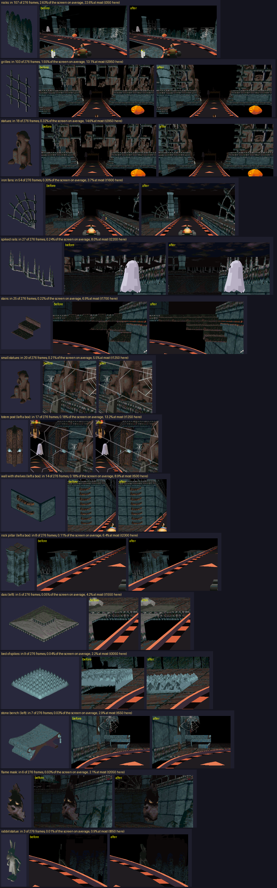

*What they became.* Each kind is read from its block's picture, LBA1's view of it from 30 degrees up, its own way (`Make`), and each
texel of a model is the picture's pixel where that point of it falls from LBA1's angle, as the round things' are:

- *Grilles, spiked rails, iron fans* (`Panel`): flat things standing in one upright plane along the block. The picture places the plane: a
  drawn pixel is the point of a plane at t across the block that LBA1's view sees there, and the plane is the t whose points of the
  drawn pixels lie inside the block (of those, the one standing lowest): 0.41 of the way across a grille's cell, 0.66 a rail's. Each cell's
  square of it is a see-through quad, front and back, with LBA1's picture unskewed onto it -- the bars, their knobs and the spikes as LBA1
  draws them, at one depth. The boxes had unskewed them onto their faces, each at a face's own depth: crosses floating apart. 42 faces a
  grille.
- *Stairs* (`Steps`): the two steps a cell LBA1 draws, each a tread, a riser and its sides, and the cell's back -- a side against a step
  of the same stairs, or against a wall, left out. Sides and backs take the riser's texels at their height (not the tread's nose).
- *Plank ramps* (`Ramp`, 2026-10-18; bricks 2341 and 5682): a slope with the picture on it, its sides see-through outside the planks'
  ends, its underside read from the picture. Solid: three steps under the slope a cell (nothing solid above it).
- *Rocks* (`Lobes`): a row of upright lobes spread over the picture's whole width on screen (the end lobes reach the block's corners),
  by turns behind and in front: one behind as tall as the picture's outline over its share of the row, one in front three quarters to
  nine tenths of that, each 1.15 to 1.35 times its share wide so neighbours overlap (no slits onto the void; by turns that look random, the
  same every build) -- a cluster, not a fence. Each stands on the ground line LBA1's view sees in its share, its bottom rounded where the
  picture's foot is above the floor (the rows hanging off floor edges); where LBA1 placed only part of a block, its lobes are cut flat and
  closed at the layers placed. A lobe: an ellipse across (no deeper than the block), its top rounded to a point; 6 sides, 18 faces.
- A brick a block holds twice (a lattice fence's post, brick 2383 of block 30) is placed where the cells round it say: the fences used to
  draw their first post's column a second time a layer lower.
- *Statues, flame masks, the rabbit* (`Figure`): a figure is the same either side of the way it faces, so its other side's view is
  LBA1's picture mirrored. Its shape is what both views leave of the block: the voxels (a twelfth of a cell, an eighth of a layer) whose
  point falls on the figure from LBA1's angle and whose mirror image -- across the block's middle along x or z, whichever leaves more: the
  way it faces -- does too. Slice by slice, a ring of 12 points round the slice's middle, each as far as it reaches that way, smoothed;
  the rings kept where the shape turns: 96 to 108 faces a statue. A side's texels are the picture's where the view that sees it best sees
  it (the mirror image's: the picture at the mirrored point); its back, which neither sees, has its sides' colours. (Lathed, the last
  round, they came out bottles.)
- *The bed of spikes* (`Spikes`): 8 x 8 four-sided points on a plate, as tall as the picture's farthest point (0.67 layers).

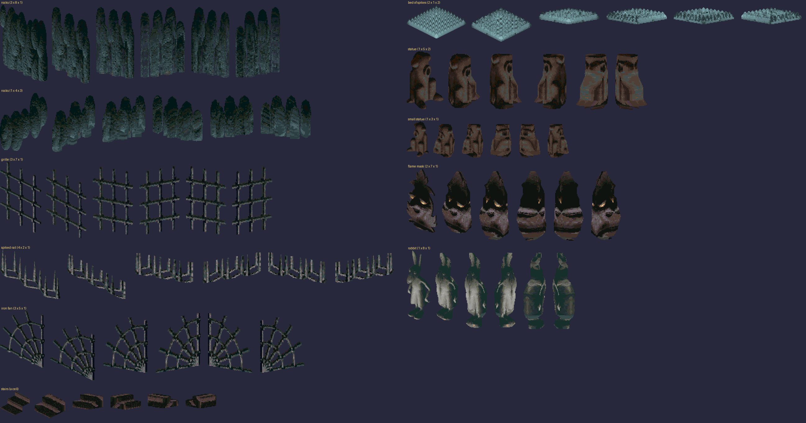

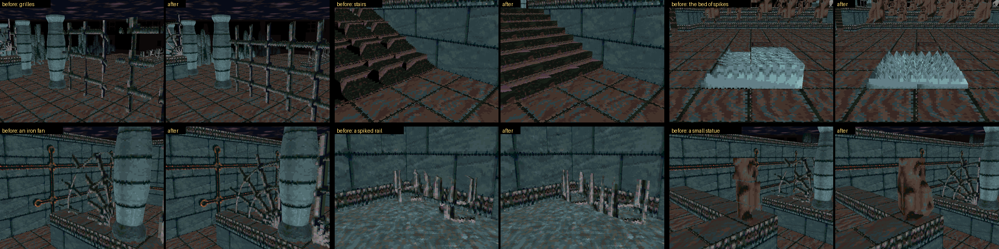

- *Cell by cell*: a model's face is drawn by the cell of its placement it lies in, so a chunk's body holds what is in its cells. A face
  turned to a solid block a fifth of a cell out of it (a rock's back against its wall, a statue's foot on its floor) is left out: 1,338.
- *The doorways*: where the race track's doorways cut a statue, stairs or the spikes, all of it goes, as a round thing does (no statue
  cut in two); of a grille, a rail or a row of rocks, the columns along it they cut (no grille's top hanging over the road), the rest stays,
  as the boxes did. 276 cells in all.
- *What is solid* is the cells' boxes, as before, less those the doorways took with them: 7,161 boxes (7,326). The test pilot's solo laps
  are the same to a hundredth of a second (55.50, 55.00, 55.06 s), and the race file the same.
- From LBA1's angle the port draws much LBA1's picture still -- the statues and the grilles closely, the rocks as a cluster of lobes like
  LBA1's, if not the same lobes.

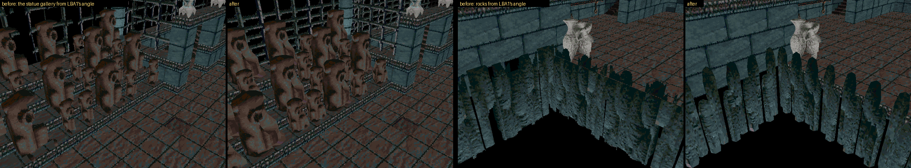

In the race track's build the temple has 104,700 faces in 1,587 bodies (92,500 in 1,725 before): 39,300 of boxes (68,100), 24,400 of
round things, and 41,000 of the models (rocks 25,300, grilles 6,200, small statues 2,500, statues 2,100, iron fans 2,000, stairs 1,000,
flame masks 600, rails 540, the rabbit 390, the spikes 260), on 11 object pages (12). Frame times are no longer: over the test
pilot's lap, each frame's least drawing time of three runs (the two builds by turns), 11.6 ms on average, 15.9 ms at the 95th
percentile (12.2 and 16.1 before; 640 x 480).

`templemodels <LBA1> <out>` prints what each model read from its picture and draws it as above; `templecells <LBA1> <plan.json> <out.csv>`
lists every cell as the race track's build has it (its block, brick, box, whether cut), for the survey's ray cast.

**LBA1's actors** (`TempleActors.cs`, 2026-10-18): the port had LBA1's grid but none of its actors, found by the full check before the
release. They are drawn now (draw-only decor), as each scene starts them: `Lba1Runtime` runs each scene a few frames for what shows at the
start (150 for where the doors settle); what the scripts hide at once, or what has no body yet, is left out (27 invisible turrets, 15
unpulled wall switches -- their niche bricks draw them --, falling rocks, spike cylinders, the mechanical penguins, the pickups).

| What | Made as | How many |
|---|---|---|
| Spiked and stone doors (sprites 50-52) | a thin panel in the picture's plane, LBA1's door clip baked into its texture | 12 |
| Lift platforms (sprite 14) | a textured slab | 15 |
| Floor plates (sprites 48/56) | a textured quad just over the floor | 27 |
| Wall switch (sprite 53) | a textured box | 1 |
| Statues of Bù (sprite 49) | a figure from LBA1's picture and its mirror image | 2 |
| Electro-plants, skeletons, spike traps, eye creatures, the bird, the Book of Bù | LBA1's own bodies in their scene-start pose, LBA1's lighting, scale 3 | 29 |

From LBA1's angle they stand where LBA1 draws them: over the pixels where LBA1 shows an actor, the mean colour distance went from 35.8 to
3.0. In a race track's build the five on or over the road are left out (two doors, two electro-plants, an eye creature floating at the
camera's height). 4,698 faces, 28 bodies and 3 object pages more; frame times the same. `templeactors` (ScriptRoundTrip) lists them and
draws them.

**The colours** (`TemplePalette.cs`): an island's palette colours the cars, Twinsen and the screen's text by index too, and every retail
island has the same palette, tuned a little. So LBA1's whole palette won't do. Instead, Otringal's has the temple's colours written into it:
each, the most drawn first, into the nearest slot no other has taken, when it is within 24 (a colour an actor drawn there hardly sees
change). 96 of the temple's 106 colours get slots of their own, 99.98 % of its pixels: those are exact. The shading and fog table is made
for that palette. Its row 12 (the level objects' textures are drawn at) is the palette itself. Its fog is black: far rooms fade into the
dark, as LBA1 draws the temple in the black. Measured on a render from LBA1's angle: 100 % of the temple's drawn pixels are LBA1 palette
colours, and the mean colour is within 0.7 (of 255) of LBA1's own picture's.

**RESS.HQR**: the palette goes in entry 40 and a night sky (dark violet clouds, a black sea) in entry 24. These are RESS_XPL0 + 13 and
RESS_SKYSEA0 + 13, slots the retail file leaves empty.

**The engine**:

- `AMBIANCE.CPP` ChoicePalette takes the race-track mode's `island_palette=` and the editor view's `IslandPaletteOverride`. The editor's
  island loads left CubeMode at interior, so its palette had always been citabau's (only its colours, converted with the island's own
  palette, hid it).
- `EXTFUNC.CPP` takes `island_sky=`.
- `RENDERER_API.CPP` maps "temple" to island 4 with entries 40 and 24.
- Object pages: 32, the decor's page in its Body's bits 18-22 (`MAX_OBJ_PAGES`, `IslandFile.MaxObjectPages`).
- The full check's engine round (2026-10-18):
  - *Fog by depth* for LBA Assembler's draw-only decors (`DECORS.CPP`, `AFF_OBJ.CPP` `ObjFogPolygon`, per-pixel fillers in
    `POLYTEXT.CPP`/`POLYFLAT.CPP`): a temple chunk is up to 6 x 6 columns and the full height, and one fog level per body made far walls
    a patchwork that jumped a level at a time as the camera moved. A polygon within one level keeps it; one spanning levels is fogged
    pixel by pixel. The game's own decors keep one level a body; other tracks' long road pieces now grade with depth too.
  - *The island's body cache*: 4,096 slots (it had 1,024 for the temple's 2,147 bodies, and entering the lower hall reloaded ~220 of them
    every lap: a 41 ms frame), and `HQR_Preload` unpacks an island's bodies in one go when it loads (12-23 ms for the temple).
  - *Spooks* fade into the fog over the last 1,500 before the camera and aren't drawn nearer than their size + 1,500 (at least 2,200).
  - *The start gantry*: the rail camera's eye stays 800 under a draw-only frame across the start line (`GantryEye`), and the swerve past
    the marshal keeps 600 from posts.
  - `drive_as` applies without power-ups too (`HeroLook`), and `hud=0` no longer hides the car with nothing drawn in its place.
  - A music file not found is remembered (`STREAM.CPP`): headless runs paid 150-390 ms a cube change looking for it again.

**Commands** (ScriptRoundTrip):

- `templebuild <LBA1> <LBA2 game>`: the plain island into a folder.
- `templeregion <LBA1> <png> [x0 x1 z0 z1]`: LBA1's own picture of the temple.
- `templemap <LBA1> <png>`: a height map.
- `templecolours`, `templebricks`: the colour and brick studies.
- `templeblocks <LBA1> <out>`, `templeshapes <LBA1> <out>`: the blocks the grids place, and the round things turned (above).
- `templemodels <LBA1> <out>`, `templecells <LBA1> <plan.json> <out.csv>`: the shaped things made models, and every cell as the race
  track's build has it (above).
- `polarview` with `VIEW_ISLAND=TEMPLE VIEW_Y=<height>` renders it from any angle. LBA1's is pitch 341, yaw 3584.

## The Halloween race

The plan is `docs/racetrack/temple_track_plan.json`, from `tools/RaceTrackPlan/temple_design.py`, which reads a plain build's `TEMPLE.JSON`.
LBA1's temple is a dungeon at three heights: the first floor and its corridor at 14,080, scene 8's lower hall at 11,008, and the crypt at
1,792. In LBA1 these are joined by narrow stairs, with dead ends and no way round. The lap is a raised road a little over the floors (rail
held). Where it passes walls, it goes through doorways cut in them: 844 cells, the plan's `templeCuts`, and the floors they took laid
again (`templeFloors`, `templeSkirts`: see "The cuts made good" below). Between the heights it runs on ramps, and down to the crypt and back
up on spirals through the black void round the temple. 1,719 cells, steepest 12 %; about 65 s a lap with a car at 110 km/h.

1. The start, on the straight through the crypt's west room, heading east. The opponents wait in a slip lane beside it while the player
   qualifies (the plan's pit spots; see "The slip lane" below).
2. Through the crypt's rooms: the lower passage, the south-east room, north into the east room.
3. Out of its east side and up a spiral to the long corridor's east end.
4. West along the corridor: its floor is twelve cells wide, so the road is eight, and the spiral frieze on its north wall stays whole.
5. North into the first floor, down a ramp into the lower hall, round it, up into the west rooms and round them.
6. Out over the first floor's open south edge and down a spiral to the crypt.

**Halloween** (`TempleHalloween.cs`, the plan's `halloween`):

- *The road*: the deck theme `halloween`: near black, pumpkin-orange and black curbs, glowing orange rail tops, dark plum sides. The start
  gantry is in orange and black squares (`DeckTheme.Gantry`).
- *Decor* (drawn only, nothing to bump into), 86 pieces: jack-o'-lanterns beside the road on the floors and hanging in the dark over the
  void. Their carved faces glow in the palette's fire colours (240-247, the same in every island's palette). There are gravestones and
  crosses with candles, witches' cauldrons brimming with glowing green brew, and a totem of giant jack-o'-lanterns up each spiral's middle.
- *Spooks*, 27: bodies of BODY.HQR the race-track mode flies and draws itself, as it draws the Wannies' frog (`RACEMOD.CPP spook=<body>
  <flags> <height> <way...>`). There are no actors, so no scene limit and no animations to fit. Witches on their broomsticks circle the
  spirals and patrol the corridor, the lower hall and the crypt. Every few seconds one stops and throws a fire ball at a car below her
  (flags 1; a hit stuns the car as a gas monster's does, "hit by a witch's fire ball"). Ghosts drift across the road over the cars and
  the chase camera, and bats wheel high over it (flags 2: round and round their way) -- LBA2's own flying rats since 2026-10-18, flapping
  their wings (see "The game's own rats and skeletons" below). None comes lower over the road than 2,500 (see "The cuts made good" below).
- *Mini pumpkins*: the power-ups' mushrooms, the fakes the cars drop and the item box's icon are a jack-o'-lantern. It is the mushroom
  entity 112's body 3.
- *The music* (since 2026-10-18): LBA1's own temple music -- music 5, which LBA1's scenes 8 and 40 play (scene 41's is 2), CD track 6 --
  made by the build from the player's LBA1 (`Temple/TempleMusic.cs`): the cue sheet's audio track out of the disc image (GOG: `LBA.DAT` over
  `LBA.GOG`; also any `*.cue` over BIN/WAV/OGG files, or a loose `Track06.wav`/`.ogg`), its silent ends trimmed, written as
  `RACEMUSIC\LBA1_TEMPLE.WAV` (2:44.6, 27.7 MB) in the game folder and named by the race file (`music=`, `RACETRACK.JSON` `Music`). Never in
  the repo or an installer. GOG's cue sheet lists no pregaps: every track of its image starts 2 s before its `INDEX 01` (and the cue's
  track runs 2 s into the next one), so the track is read from 4 s before it and cut at the gaps either side. It looks in
  `LBA1_MUSIC_DIR`, the LBA1 folder and the two above it. Without LBA1's audio (the floppy release: its music is MIDI only) the scenes'
  own music plays, LBA2's Temple of Bù's (3), as before; the ambient sounds are LBA2's Temple of Bù's (scene 10) either way. Every race's
  music, this one's or a scene's, now keeps going until the race is over (`MUSIC.CPP` `LoopMusic`, `STREAM.CPP` `PumpStreamLoop`: the
  track queued again behind itself 2 s before it runs out, no gap) and is left to end as it ends after the finish. Probe:
  `templemusic find|picture|capture` (ScriptRoundTrip).
- *The line-up*: Halloween's monsters in cars made for them (since 2026-10-18): the vampire in his coffin (the one to beat), the witch on
  her broomstick and the zombie in his hearse -- "The vampire, the witch and the zombie" below. (2026-10-17 to 18 the skeleton in his ghost
  car, the ghost in hers and the two-headed monster in his monster truck; the Dark Monk, Ker'aooc and Tabata before them.)

The scenes are 301-327, one for each cube the road's width crosses (`TempleTrack.SceneCubes`). The start scene is 326.

### The slip lane (2026-10-17)

The user: "We need to add a slip lane for the temple track, currently trying to complete a qualifying lap gets blocked with the other cars
on the start/finish line."

*Why it was blocked.* The plan's three waiting spots were on the crypt's floor 20 cells north of the start straight, at z 566. That is
cube (6, 8), not the start line's cube (6, 9). `RaceTrackScenes` writes only the start cube's waiting spots (`pit=`), so the race file had
none. With no pit spot, the race-track mode stands an opponent on its grid spot behind the player through the qualifying lap: on the racing
lane, 3 to 14 cells before the line. Twinsen's car ran into the last of them at 110 km/h, was put back on the road behind it every 3 s, and
the qualifying lap never ended. The build now says so: "WARNING: the waiting spot ... is not in the start line's cube".

*The lane.* A strip of road beside the start straight (the plan's `raisedStrips`, as the Emerald Moon's pit lane), on its north side: the
inside of the lap, away from the racing line, which keeps to the middle and then the south side for the corner after the line. Across the
road, cells north of its middle:

- it grows out of the road's edge at x 389.5-394.5, just past the west doorway's walls, and leaves it at x 393.5-395.5;
- it runs apart from x 395.5 to 414.5, from 6.25 to 10.75 north: 4.5 cells wide, with 1.75 cells of clear space from the road;
- it passes through the start line, comes back to the road's edge at x 414.5-416.5, and shrinks into it by x 421, before the corner.

It is all in the start's cube. The cube north of it is not one of the race's scenes, so the engine holds a car at z 576.5, and the lane's
rail holds it there too. It has its own deck, curbs and rails in the Halloween colours. The start line is painted across it and counts
there (the line reaches 11.25 cells north).

*Waiting.* There are five spots along its middle (z 577.5; x 396, 400, 404, 408 and 412; the road's height), one for each opponent a grid
of six holds. While the player qualifies, the opponents stand there. When he crosses the line, the race-track mode forms the grid as on
every track: each car on its grid spot on the road, in qualifying order, then the count-down. Without qualifying the grid forms at once
and the lane stays empty.

*Unchanged:* the racing lines, the checkpoints, the item rows and the lap times. Solo laps are the same to the hundredth: 55.50, 55.00 and
55.06 s on the line, and the same 1.5 cells either side. One ghost scare at the line (414.8, 579.2) stood on the lane and is gone: no
other place beside the road there fitted. A jack-o'-lantern moved 3.3 cells north, off it. The road has no arrows along the lane (a piece
with a strip draws none).

Tests: `E:\dump\TEMP\templeslip` (`build.sh`, `racefile.sh`, `pilot.sh`, `suite.sh <game> <prefix>`: qualifying and no-qualifying races
with the pilot on its line and 1.5 cells either side; `solosuite.sh`; `others.sh`: other tracks built with HEAD's and the working tree's
`ScriptRoundTrip`, every file compared).

### Skeletons, scares and the ghost (2026-10-17)

The user: "Let's make the temple track creepier with some skeletons and also do visual scares, perhaps a witch dive bombing at the player
and pulling up at the last second to avoid a collision", and "a special item to the temple track of a ghost pickup that when used targets
the other cars and briefly covers the screen with a ghost outline, we should make this translucent enough for a player to see through and
not make it last more than about 10 seconds".

- *Skeletons* (`TempleHalloween.Skeletons.cs`, the plan's decor kinds 6-9): LBA1's own skeleton, the one that wakes up in LBA1's temple
  (LBA1 BODY.HQR 55, its knife left out), posed with its own animations (ANIM.HQR 244 sleeping, 245 waking up, 246 standing) and by hand,
  1.4 times LBA1's size, and made decor bodies of one bone in the temple's palette like the rest of Halloween (bone: the warm greys 231-239).
  23 of them beside the lap, drawn only: 7 lying on their backs by the road, 3 slumped against walls where the wall is far enough from the
  road for their legs, 6 hanging by their wrists in chains on the walls, 7 hanging on long chains in the dark beside the spirals and the
  straight over the void. The build needs the LBA1 folder for them (it has it for the temple itself).
- *The witches' dives* (`RACEMOD.CPP dive=`, Dives): six places over the lap where nothing of the temple stands over the road (the plan's
  `dives`: the long corridor twice, the straight over the dark, both spirals, the crypt's straight). As Twinsen's car comes 28 cells along
  the lap from one, 70 % of the times a witch (the spooks' witch body) sets off from 6,000-8,000 over the road there, glides, dives steeply
  along the road at the car, pulls up out of the dive 6 cells ahead of it, skims over its roof and climbs away behind it, over the camera.
  Her place is worked out from the car's own every frame (how far ahead of it she is along the guide line), so she is never lower over
  the car than 320-620 over the top of its box, whatever it does. Nothing is hit or slowed; the log says how close each one came
  ("the witch's dive (place 1) over after 1.2 s: at the closest her lowest point 436 over the top of the car's box ... never touching").
- *Things jumping up* (`scare=`, Scares): eight places beside the road on the floors (the plan's `scares`): as the car comes within 14
  cells, 75 % of the times a skeleton reaching out with both arms (LBA1's skeleton, standing) or a ghost jumps up out of the floor, lunges at
  the road for 1.4 s and sinks back.
- *The ghost power-up* (`haunt=`, PU_GHOST, after the golden Gazogem so every other track's items keep their numbers): drawn from the
  pumpkins only on the temple, more often by the cars at the back. Twinsen's haunts every other car for 5 s: slowed to 80 %, weaving up to
  1.2 cells across its road (never past its edge less a car's half width) with its nose swinging, a ghost circling over it. Another car's
  haunts Twinsen: a ghost's outline over his screen, 84 % of its height, bobbing -- the scene under its sheet blended 22 % of the way to
  its pale lavender, its outline 60 %, its eyes and mouth half way to black (each pixel the palette's nearest colour, dithered), fading in
  over 0.7 s and out over the last 3 s, 8 s in all; one at a time. The protection spell and the super jet-pack keep it off, as they do the
  other attacks; a saved game loaded forgets it (ForgetPowerUps). Its item box icon is the ghost.

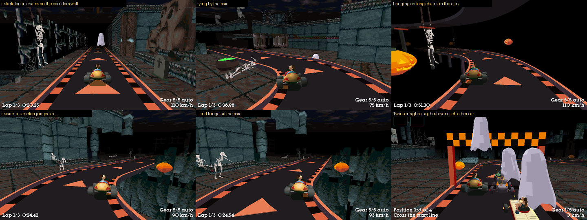

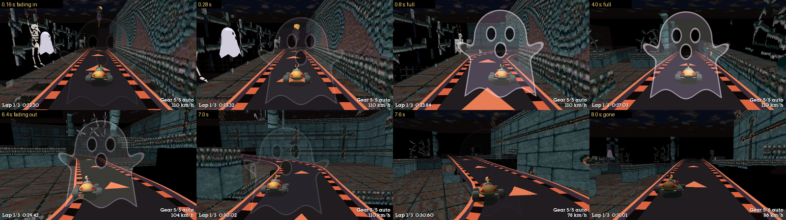

- *The ghost's flight* (2026-10-17, later -- the user: "The ghost powerup has no visual effect when a player launches it, let's have it
  rise up, split into one ghost for each car, and then fly off to haunt them"; RACEMOD.CPP `GhostLaunch`, `GhostPlace`, `Ghosts`,
  `HauntCar`). Twinsen's ghost rises out of his car (0.24 s, to 350 over its roof and 1,800 ahead of it, in sight of the camera behind
  it -- straight over the car it rose out of the top of the screen), hovers turning (0.14 s: a whole turn since it set off), then splits
  into one ghost for each car it is to haunt -- the cars it always haunted: racing, and not on a super jet-pack (checked again as each
  gets there: a car that took a jet-pack meanwhile isn't caught) -- fanned out 0.75 rad apart. Each flies its own curve to its car
  (out the fan's way and up, in from behind and over the car), both ends moving with their cars, in its distance at 24,000 a second:
  0.32 s at the least, 0.76 s at the most -- a car further off, or in another scene, gets the most, its ghost off towards it into the
  distance. It gets there where the circle round the car starts, on the side it comes from, and becomes the circling ghost: the
  haunting starts then (5 s, as before), the ghost already at its height (it doesn't rise out of the car first, as a ghost not flown
  there does), sinking into the car at the end. From Ctrl to each haunting: 0.70 s for the cars near, 1.14 s for the far ones (0 before:
  at once). To a car behind Twinsen's, the curve climbs steeply first, over the camera and out of the top of the screen; none is drawn
  within 2,200 of the camera (going by it, it filled the screen). With no other car to haunt it flies up and away. Drawn as the circling
  ghosts are (`DrawOver`: the ghost's body, depth-tested against the scene, in its fog). Logged: "Twinsen's ghost rises out of his car:
  3 other cars to haunt", "Twinsen's ghost splits into 3, flying to The Dark Monk (7.7 cells, 0.32 s), ... (136.6 cells, far, 0.76 s)",
  "Twinsen's ghost reaches The Dark Monk, 0.70 s after it was used".
- *Another car's ghost* rises out of its car the same way and flies at Twinsen's camera: it ends 2,200 in front of it on its view,
  facing it -- about the size of the ghost then over his screen -- coming in from further along the view (from behind the camera: over
  it first). As it gets there the screen's ghost starts, half faded in already (the flying one become it); the protection spell and the
  super jet-pack keep it off then, as before. 0.70-1.14 s after the car took it. ("Ker'aooc's cauldron's ghost flies at Twinsen's car
  (15.1 cells off, 0.32 s)", "... reaches Twinsen's car, 0.72 s after it was taken".)
- Without the ghost's body (no `haunt=`: a console test elsewhere) it all happens at once, as before; no other track draws a ghost.

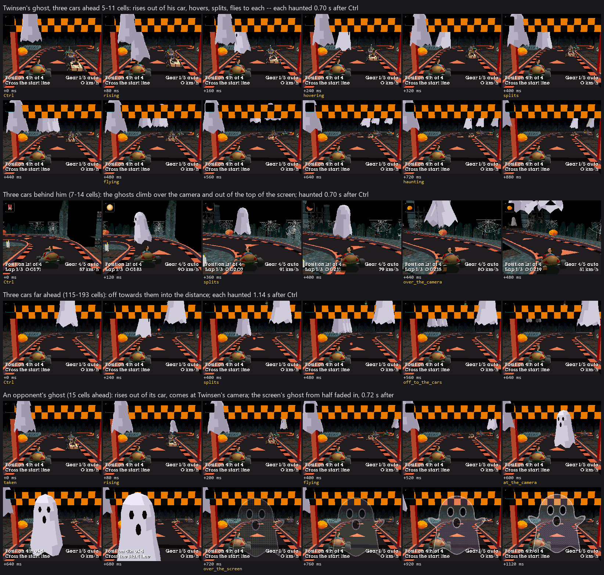

Console (tests): `racedive [place]` a witch dives now, `racehaunt [n]` the screen haunted as by another car's ghost (with n, opponent n's,
1 the first, flying from its car), `racescare [n]` a scare jumps up now, `raceitem 12` Twinsen's ghost on the others. Tests:
`E:\dump\TEMP\ghostfx` -- `ghost.sh <tag>` (AT, CMD, PILOT=0 to stand on the grid, SLOW=<k> a slower car), `sheet.sh`, `races.sh`.

### Cobwebs and the giant web (2026-10-17)

The user: "Can we also improve the temple track add in some cobwebs, perhaps a giant cobweb we have to drive through."

- *The giant web* (`TempleHalloween.Cobwebs.cs`, the plan's `giantWebs`): across the long corridor's east doorway, between the two columns
  either side of the road there, 12 cells across and 5,600 high. The lap comes up to it out of the dark at the top of the east spiral, 60
  cells of straight, so it is seen from across the dark. An orb web of 26 radials and a spiral sagging between them, its strands pale
  ribbons of the palette's greys (58-60), facing the cars coming. A giant spider (dark purple, its legs banded rust, eight glowing red eyes,
  a pale skull on its back) sits at its hub, its back to the cars.
- *What happens* (`RACEMOD.CPP web=`, Webs): a car coming within 34 cells sends the spider scuttling up to the web's top thread, its legs
  in turn, in 0.9 s. A car -- any, the opponents too -- crossing it between the columns tears it ("Twinsen's car tears through the giant
  web"): its middle, half an ellipse standing on the road the road's width and the camera's height, is gone; tatters hang from the torn
  threads round the hole, flung along the way by the car and swinging back, dying down to a sway; scraps of web fly after the car for 1.3 s,
  tumbling and falling. The cars after it go through the hole ("... goes through the torn giant web"). 15 s after the tear it is whole
  again, its spider back at its hub -- but never while Twinsen's car is coming up to it, so he never sees it mend.
- *On the screen*: Twinsen's car tearing it, a web sticks over his screen as the camera goes through (0.3 s after the car): its hub off
  the top left, its threads across the screen, torn here and there, see-through as the ghost's overlay is (the haunting's blend tables,
  42 % of the way to its pale colour at the most), sliding down a little and fading out, 1.7 s in all. Nothing slows or stops any car: the
  test pilot's solo laps are the same to the hundredth of a second as before.
- *How it is drawn*: by the race-track mode, into the background as the giant frog is (its depth written: a car behind its strands is hidden
  by them). The race file has the web (`web=`) and its parts (`web_part=`: 0 drawn always -- the frame and what a car leaves, 1 its middle
  while whole, 2 a tatter once torn, 3 a scrap after the tear), bodies of BODY.HQR the build appends (12: the frame's and the middle's
  pieces, three tatters, two scraps, the spider's two leg poses). Its faces are pieces of no more than 700 (the near plane; the close flag):
  the camera goes through it. A still copy, whole with its spider, stands among the island's decor for the editor's view (the frog's way:
  hidden while racing by game variable 212, the temple's held variable).

- *Cobwebs round the lap* (the plan's decor kinds 10-15, drawn only): 30 webs and 9 spiders, none over the road. In the corners of the walls
  beside it, hanging from the walls' tops (13, two big); across a door gap (1); between two of LBA1's columns (1); flat on the walls, as
  LBA1's own cobwebs are, either side of the doorways the road goes through and along the walls beside it (15; not the corridor's frieze,
  nor where a skeleton hangs); and small spiders hanging on their threads in front of every third corner's and wall's. Each is an orb web:
  radials fanned from its hub, a spiral round them, threads hanging from an old one's bottom -- three of each corner's and wall's, made
  differently. Its strands are thin pale ribbons seen from both sides.

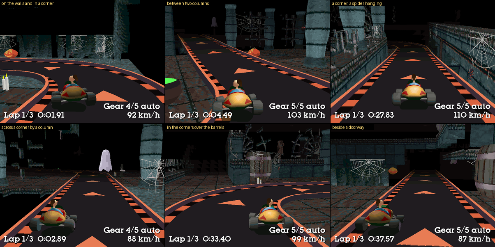

Console (tests): `raceweb [0|1|2|3]`: the giant web torn now as by Twinsen's car (1, none: the web over his screen too), whole again (0),
its spider off up its web (2), torn as by another car (3).

### Twinsen's pumpkin F1 (2026-10-17)

The user: "Let's create a pumpkin inspired F1 car for our Temple track for Twinsen to drive."

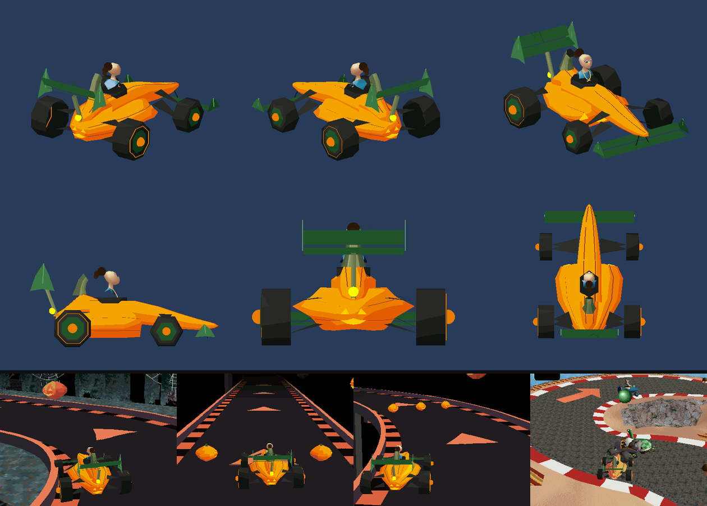

- *The car* (`RaceTrackCharacterCars.Pumpkin.cs`, `BuildPumpkin`): a single-seater on the cars' kit (CarMesh, the racer's 18 bones). A
  long, low nose rising to the cockpit; round the cockpit's back half the sidepods and the engine cover are one big pumpkin lying along
  the car, six lobes ribbed down its length (each lobe's points its own, so the game's light shades it round, darker lines in the
  grooves). Its colours are the fire oranges the Temple's own pumpkins are (241 on, taking 0.28 of the light: 241-243 as the light falls,
  red-orange to amber); in other islands' palettes their tables make them those islands' oranges and golds. The pumpkin's front is a
  jack-o'-lantern's face, glowing (244): the sidepods' inlets its eyes, the car's nose its nose, a toothy grin under it; its back a small
  face, its grin the rain light and the exhaust's glowing ember (245) its nose -- what the chase camera sees. The airbox is the pumpkin's
  ridged olive stalk behind Twinsen's head, bent forward, its cut end the intake; the wings are green planes between pumpkin leaves (the
  endplates, veined), a vine's tendril curling over the rear wing. Four exposed wheels on thin black wishbones: black slicks, the rear
  ones banded orange round the wall, green wheels with orange caps. Twinsen (BODY.HQR 1, cut at the rim, his arms down in the cockpit)
  shows his shoulders, head and ponytail. 521 points, 455 polygons, 68 lines and 8 spheres (the engine's limits: 550 each); its box its own
  (x ±550, y 0..750, z -776..890: longer than the racer's car it is made on).
- *Where it is*: race car 220 of RACECARS.JSON ("Pumpkin F1", driven by Twinsen), the racer entity's body 64 and its half-size copy 164
  (the lightning spell). Every build adds it after every track's bodies (`InstallPumpkin`, at the end of `RaceTrackService.Build`), so no
  other body moves: a build's files differ from the build before only by BODY.HQR's two new last entries, RESS.HQR's entity table and
  RACECARS.JSON's new last line.
- *Twinsen's on the Temple*: the car setup's "drive as" -1 is now *Twinsen's own car*: his buggy, or the car a track has for him
  (`RaceTrackCharacterCars.TrackCar`: the Temple of Bú's the pumpkin F1). The car file of the Temple then has its `drive_as=`
  (`RaceCarEngineFile.TrackCarLines`, `RaceCarSetup.TrackCarKeys`); the other tracks' don't. Any other choice in the Race car window wins
  -- a character's car, the laser buggies, or "Twinsen's buggy, on every track" (-4). Race car setup > Your car lists the pumpkin F1 at the
  top of the cars, to drive anywhere; the race game's car page opens on it (the installer's `GameInstall.Cars`).
- *It handles as the buggy*: it is drawn in the buggy's place (`RACEMOD.CPP drive_as=`, the opponents' driving animation: it bounces the
  car and its wheels; no wheel spins or steers in it, as in the other cars), pitched with the road. The test pilot's race against the
  opponents (same race seed) is the same to the hundredth of a second in the pumpkin F1 as in the buggy and as the build before: 57.46,
  63.97, 59.96 s, 1st of 4, no rescues.

### Halloween's monsters, and easy, medium, hard (2026-10-17)

(Since 2026-10-18 the monsters drive cars of their own: the vampire, the witch and the zombie, on these same lines and grid places with these
same levels -- "The vampire, the witch and the zombie" below.)

The user: "I thought we'd made halloween themed opponents for our Temple track but they seem to be Dark monk, Ker'aooc, and Tabata", and
"Let's also create an easy/medium/hard mode, but let's focus that on the temple track for now, we can worry about the other tracks at a later
date."

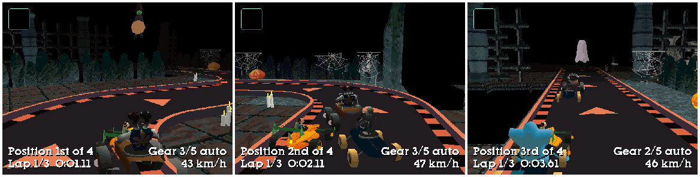

**The line-up** (`RaceDriver.Temple`): Halloween's own monsters in the cast's cars (RACECARS.JSON) -- the skeleton in his ghost car (car 65,
the one to beat: the temple's own, LBA1's skeleton wakes up in it, and its halls are full of them), the ghost in hers (114) and the
two-headed monster in his monster truck (149) -- on the lines the Dark Monk, Ker'aooc and Tabata had (the same sides, tops and grips: the
lines are byte for byte the same). Of the Halloween cars, these three read best from the camera behind them on the temple's near-black
road (each tried in the race, five side by side): the ghost's pale blue figure stands out at any distance, the skeleton's pale bones show
over his dark car's rim, the monster's two heads with their red eyes stand up over his. The giant spider sits whole and flat on its
cockpit's floor, so from behind its truck reads as an empty purple truck; the gas monster's car and the Eye's are dark on the dark road.

- *Cast cars as opponents*: until now an opponent could only drive a body of the racer's entity (157). The cast's cars are bodies of
  entities of their own (345 and 346 in a build: copies of the racer's, its animations), so `RaceDriver` has `Cast`, the car's number: the
  build looks the car up in the folder's RACECARS.JSON (installed earlier in the same build) and puts its copies in the scenes as that
  entity and body (`RaceTrackScenes.Apply`); its half-size copy for the lightning is beside it in that entity (`opponentN_small=`), so the
  engine needs nothing new. A car missing from RACECARS.JSON is left out with a warning.
- *What changed in the files*: of a Temple build, only SCENE.HQR (the three opponents' actors in each of the 27 scenes: entity 157 bodies
  10, 53, 54 -> entity 345 bodies 1, 50, 85), SCENE.HQD and RACETRACK.JSON (the drivers' names and bodies); BODY.HQR, RESS.HQR and
  RACECARS.JSON are the same. The race file: the names, the `_small=` bodies, and the levels' lines.
- *The race game*: the car page lists the three monsters' cars first after the pumpkin F1 (the installer's `GameInstall.Cars`), its
  README says who the race is against.

**The levels** (`Terrain/RaceDifficulty.cs`, `RaceTrackIsland.Levels`: the Temple's alone for now). They change the opponents and the
track's hazards, never the player's car (his setup is his own):

| | Easy | Medium (as before) | Hard |
|---|---|---|---|
| Opponents' skill (points on the one to beat's 86 %, and on the others' 72-98 % range) | -10 | 0 | +8 |
| Catch-up: how much harder one pushes when behind Twinsen (at 60 cells) | 0 % | 8 % | 14 % |
| Easing off when ahead of Twinsen (at 60 cells) | 15 % | 0 | 0 |
| Pumpkin rows an opponent takes an item from | 40 % | all | all |
| Attacks aimed: penguins, oil, fakes held until he comes up close behind, the yellow / green ball until he is close ahead, the red until he is the car in front | no | no | up to 6 s |
| The witches' fire balls and dives | half as often | as ever | 1.4 times as often |

The engine (`RACEMOD.CPP`): `difficulty=<0|1|2>` and `difficulty_level=<level> <skill> <catch-up> <ease> <items> <aim ms> <hazards %>`,
read only when present -- every other track's race file has none and races exactly as before (`ApplyDifficulty` before the skills are
drawn, `DifficultyTakes` and `DifficultyHolds` in `OpponentMushrooms`, `OpponentAims` every frame, `DifficultyEase` beside the catch-up,
`HazardEvery`/`HazardChance` in `Spooks` and `Dives`). The last `difficulty=` counts: the editor writes the setup's, the race game's menu
adds the player's pick after it. Medium is today's race to the tick: no extra random draws, the same numbers (with race seed 1 the
pilot's laps and the three opponents' are the same to the hundredth as HEAD's with the old line-up: 55.24, 57.30, 57.08 s). A race with no opponents (a time trial, Play with "Race the opponents" off)
has no levels: its witches are as before. With the setup's "They push harder when they fall behind you" off, every level's catch-up is 0.

**Where it is chosen**:

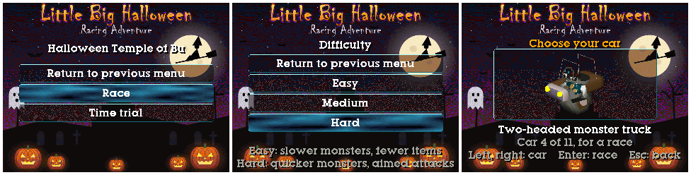

- *The editor*: Race car window > Opponents > Difficulty (Easy / Medium / Hard, with what the chosen one does), saved in the settings
  (`RaceCarSetup.Difficulty`, medium by default) and written into the race file for the Temple.
- *The race game*: Specials > Halloween Temple of Bu > Race > **Difficulty** (Easy, Medium, Hard, the last one chosen first: kept in
  `RACEGAME_PREFS.TXT` in the user's folder) > the car. A time trial goes straight to the car (no levels: its best times are the same at
  every level); races record nothing in the best times. RACEGAME.CPP shows the page for any special whose race file has levels.

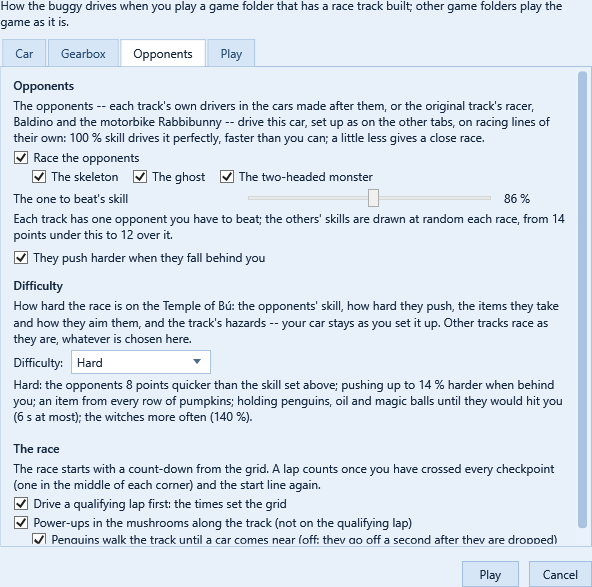

**The benchmark**: the headless test pilot races three laps against the monsters at each level, in the race game's car (110 km/h,
acceleration and brakes 300 %, steering 200 %, the pumpkin F1, no qualifying: Twinsen on pole), race seeds 1-4 or 1-8
(`qualifying_seed=`: the others' skills, the items' draws). The pilot drives the racing line at its planned speed (100 %: the line driven
perfectly, better than a player can), 1.5 cells off it, or at 92, 85 or 80 % of the line's speed everywhere (the console's new
`autodrive 1 5 0 <pace>`: a slower driver; a slower car is no test, the opponents' lines are planned from the player's car). "Closest
monster" is Twinsen's time to the line after three laps against the first monster's (+: he was ahead); "attacks taken" the magic balls,
fake mushrooms, penguins, lightning, ghosts and witches' fire balls that hit him (not oil: his own slicks, mostly, lying there the next lap):

| Level | Pilot | Races | Won | Places | Closest monster at the line, s (mean; range) | Attacks taken a race | Oil skids a race | Monsters' items a race (aimed at him) | Rescues |
|---|---|---|---|---|---|---|---|---|---|
| Easy | on the line, 100 % | 4 | 4 | 1, 1, 1, 1 | +43.2 (+37.2 .. +55.7) | 1.0 | 3.5 | 1.5 (0) | 0 |
| Easy | 1.5 cells off the line | 4 | 4 | 1, 1, 1, 1 | +35.2 (+33.6 .. +38.9) | 0.0 | 3.5 | 1.5 (0) | 0 |
| Easy | on the line, 92 % | 4 | 4 | 1, 1, 1, 1 | +28.6 (+25.3 .. +34.2) | 1.8 | 3.5 | 1.0 (0) | 0 |
| Easy | on the line, 85 % | 8 | 7 | 1, 1, 1, 1, 1, 1, 1, 2 | +20.5 (-1.0 .. +32.7) | 0.8 | 4.4 | 1.6 (0) | 0 |
| Easy | on the line, 80 % | 8 | 7 | 1, 1, 1, 1, 1, 1, 1, 3 | +10.0 (-7.3 .. +21.1) | 0.9 | 3.9 | 1.9 (0) | 0 |
| Medium | on the line, 100 % | 8 | 7 | 1, 1, 1, 1, 1, 1, 1, 2 | +9.1 (-1.4 .. +16.4) | 0.6 | 4.5 | 1.8 (0) | 0 |
| Medium | 1.5 cells off the line | 4 | 4 | 1, 1, 1, 1 | +9.7 (+2.6 .. +16.2) | 0.0 | 4.5 | 0.8 (0) | 0 |
| Medium | on the line, 92 % | 8 | 3 | 3, 2, 1, 2, 4, 1, 1, 4 | -5.6 (-38.3 .. +7.2) | 2.6 | 3.8 | 7.1 (0) | 0 |
| Medium | on the line, 85 % | 4 | 3 | 4, 1, 1, 1 | -0.4 (-13.5 .. +7.6) | 2.8 | 1.8 | 8.5 (0) | 0 |
| Hard | on the line, 100 % | 8 | 5 | 1, 1, 1, 1, 1, 2, 2, 3 | -2.7 (-24.4 .. +1.6) | 3.6 | 2.6 | 7.8 (1.8) | 0 |
| Hard | 1.5 cells off the line | 8 | 5 | 1, 1, 1, 2, 1, 1, 4, 2 | -2.7 (-19.9 .. +3.2) | 3.1 | 2.4 | 6.9 (2.1) | 0 |
| Hard | on the line, 92 % | 8 | 1 | 4, 4, 1, 4, 3, 4, 3, 2 | -7.5 (-15.2 .. +5.2) | 4.5 | 2.4 | 11.9 (3.1) | 0 |
| Hard | on the line, 85 % | 8 | 2 | 4, 3, 1, 4, 4, 2, 1, 3 | -8.9 (-25.8 .. +4.3) | 3.1 | 1.8 | 9.8 (2.2) | 0 |

- *Easy* is won by a driver a fifth slower than the line everywhere (7 of 8, by 10 s on average); its one loss is a race where the ghost,
  drawn quick, took three penguins and a ghost to him. The perfect line wins by 35-55 s. The monsters hardly use items: they are behind him,
  where the leader has emptied the rows, and take from 40 % of them.
- *Medium* is as before: the perfect line wins 7 of 8 by 9 s on average (HEAD's line-up, seeds 1-4: by 4-14 s), and a driver 8 % off the
  line's speed wins 3 of 8.
- *Hard* makes the perfect line fight: 5 of 8 won, never by more than 1.6 s, the three monsters within a few seconds of it at the line.
  Pushing up to 14 % harder behind him they stay on his tail, take the rows' items he leaves and aim about two a race at him: six times
  the attacks medium's perfect line takes. A driver 8 % slower wins 1 of 8.

No race needed a rescue or was stuck, at any level (92 races).

### The flag marshal on the grid (2026-10-18)

The race is five laps, with a flag marshal since 2026-10-17: the School of Magic's rabbibunny assistant (entity 77, BODY.HQR 124), a green
start flag and a chequered flag in her hands (`Temple/TempleMarshal.cs`, RACEMOD.CPP `marshal=`). She stood on a plinth 6 cells past the
line and 7 out beside the slip lane, at the edge of the grid camera's view. The user: "The magicians assistant who waves the flag isn't
visible behind the start finish line, let's have her start the race from the grid between the cars, with cars going either side of her.
Then have her standing close to the track to wave the flag at the end of the race."

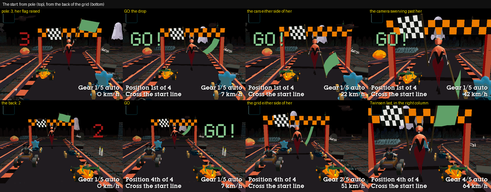

**The grid** (the plan's new `gridFirst` and `gridSide`: RaceTrackPlan, RaceTrackOptions, `RaceTrackScenes.GridSpot`; every other track
keeps 3 and 1.75). There are two columns, 2.75 cells either side of the road's middle. That leaves 3 cells between the columns' car boxes,
and each car's middle half a cell inside its rail. Pole is 5 cells behind the line, then the spots are 3.5 apart as before. The slip lane
and its waiting spots are unchanged.

**The start.** She stands in the road's middle, 2 cells short of the line and 3 ahead of pole's middle (pole's nose is 1.25 cells behind
her). She has no plinth here and faces the cars. From the grid's forming she raises the green flag for the count-down and sweeps it down
at GO. Before a qualifying lap she does the same as Twinsen's car crosses the line. The race file has `marshal_start=<x> <z> <road y>
<turn>`. The drop now comes down in front of her, towards the grid. Swept out to her side as before, its pole (three cells long at her
size) came down over a column, and the cars drove through its cloth.

- *Nothing drives through her.* Each opponent keeps to its grid column until its middle is 3 cells past her (`MarshalColumn`). Its way
  across from its line is set to the column every frame, then faded out over the usual 12 cells. The lines run across the road there,
  towards the corner after the line, and the skeleton's line went within 1.76 cells of her. A car that comes nearer than 1,000 units (a
  car's box, 633, and her 330) is put out across the lap (`MarshalKeepOff`); the tests never needed it.
- *Twinsen's car glances off her like a post* (`MarshalPost`, in `RaceMod_Rail`). A move that ends within 1,000 of her middle is put out
  across the lap to 1,000, on its own side, keeping its place along the lap and its speed. It is never stopped and never rescued. The test
  pilot drives its racing line through the road's middle and glances off her at every start.
- *Leaving the road.* Once every car is 3 cells past her she hops off in four bunny hops (0.38 s each, an arc 380 high) onto her plinth
  beside the road. If some car never passes, she goes 15 s after GO anyway.
- *The camera.* The rail camera rides the road's middle 9 cells behind the car, which is where she stands. On the grid, a car close
  behind her (pole) has its eye at least 15.5 cells behind her, so her raised flag is in view. The eye eases back over 1.5 s once the car
  moves off. As the cars set off, the eye keeps 3.6 cells across from her middle, on the car's side, eased in and out over 9 cells
  (`MarshalBack`, `MarshalEye`). Without that it passed through her. While she is on the road, the count-down moves to the side of the
  screen the car is on (`MarshalCountX`), because in the middle it was drawn over her.

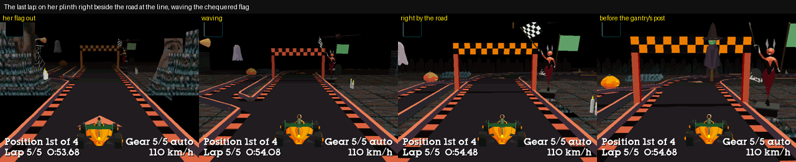

**The finish.** She stands on her plinth right beside the road: its edge 0.35 cells off the road's south edge, 1.5 cells short of the
line, on the side away from the slip lane. The gantry's post is behind her as the cars come up. The plinth is now a body of its own
(`marshal_plinth=`: entity 77's body 41), standing there all race; her own body 40 has none. The camera behind a car coming up the straight
sees her until the car is a few cells from the line. She waves the chequered flag as before. A ghost that drifted across the road at the
line now crosses 7 cells past it, because at the line it drifted through her.

**Unchanged.** Every other track's built files and race files are the same as HEAD's: 17 tracks at each difficulty, 485 checksums. In the
Temple's race file only the grid, the marshal's lines and that ghost's way change. The opponents' lines, the checkpoints and the items are
the same.

- *Solo laps* (no opponents, no items) after the first: on the line 55.00, 55.06, 55.06 s and 1.5 cells right 56.47, 56.33, 56.47 s, the
  same as HEAD's to the hundredth. The first lap is 0.12 s quicker, because pole is 2 cells further back and the car crosses the line
  faster. At 1.5 cells left the later laps are 0.06-0.11 s quicker. With HEAD's grid lines the new build gives HEAD's laps exactly (56.59,
  56.10, 56.10, 56.10), so the difference comes from the start position, not from anything on the lap.
- *Races* against the monsters: race seeds 1-3, each with no qualifying (from pole), with a qualifying lap, and from the back of the grid.
  That is nine races on this build and the same nine on the old one. No race needed a rescue or had a car stuck. Every opponent passed her
  in its column, its middle 2.75 cells from hers, and none needed putting out. With seeds 2 and 3 and no qualifying, laps 2-5 are the old
  build's to within 0.01 s (55.00, 57.25, 61.60, 54.91 and 54.82, 57.00, 64.25, 57.18) and lap 1 is 0.12 s quicker. The other races go
  their own ways through the items' chances.
- *Left on the grid*: with Twinsen sitting at the back of the grid, she hops off 15 s after GO, in his view. On pole, a stationary car is
  shunted forward past her by the car starting behind it.

Tests: `E:\dump\TEMP\templeflag2`: `build.sh <game> head|work` (the temple alone from `templegfx\game0`), `racefile.sh <game> head|work`,
`engbuild.sh "" <folder>` (the worktree's engine), `pilot.sh` (`NOPILOT=1`, `PILOTAT=<tick>`, `CAM=1`; a straight start with
`--exec-at <tick> "input up <ticks>"`), `batch.sh` and `report.py` (full races, `WHICH=base|new`), `ticks.py <tag>` (each event's tick from
the camera trace), `solo2.sh` (solo laps, HEAD's build and this one), `regress_both.sh` (every other track), `sheet2.py` (the pictures).

### The cuts made good (2026-10-18)

Before the release, an audit of the race build measured what the doorways the road cuts leave, and where the race's additions sit. The
fixes, all in the plan (`temple_design.py`) and in what the build does with it (`TempleIsland.Carve`):

*Pits beside the road.* LBA1 puts no floor under a wall, a statue, the dais or the bed of spikes by the grid: the brick standing on the
floor is the floor there. Cut out, they left holes to the void beside the road, and a row of rocks cut whole took its foot, the floor
cell, with it. The cuts also took floor cells beside the ramps: a cell was cut wherever it reached into the room over any road point
within 6 cells, so a ramp's lower points cut the floor beside its higher ones. Of the 302 columns the cuts took cells of, 109 were left
lower than the floor round them, 96 with nothing under them at all.

- *The rule* is now per island cell. Under the deck (and a cell past its edge: the car's box, 633 round its middle and not turned, reaches
  half a cell past it on a diagonal), a cell is cut from 40 under the road's lowest surface within the car's length of the point nearest
  it. Past that, beside the road, it is cut only from the highest surface within reach, on the same pass of the road (points within
  1,500 in height of each other). So the floor beside a ramp stays where it is no higher than the road beside it.
- *Thin tops*: what a cut leaves of a column over it, one or two layers (a wall's top over the road's edge, a thin lintel), goes with it:
  51 cells.
- *Floors laid again* (the plan's `templeFloors`: for each column the road comes within reach of, the highest a cell may stand there, and
  the floor round it at the road's height). Where a column the cuts took cells of (or the round and shaped things that went with them) has
  nothing from that floor up, the build lays a floor cell there, the brick the floor round it has most: 194 cells. Where no floor is round
  it at the road's height (the road going down through a floor that stands higher on both sides), one is laid at the highest under the
  deck, if a wall stands within five layers of it.
- *Skirts* (`templeSkirts`): under a floor kept beside such a column, the dark down to the laid floor is filled, with the bricks of the
  wall the cuts took there, else the floor's own. The crypt west room's stepped gallery, which the road crosses up to four layers under
  its steps, is now a cutting with walls; so are the lower hall's sides by its ramps, and the west rooms' wall tops, whose foot the cuts
  took: 101 cells.
- *Pieces split off* over the road (no more than 12 cells, every one higher than a floor may stand in its column) are taken out: 11 cells.
  With the thin tops, the 12 single cells that hung 3,780-6,084 over the road are gone.

*The giant web's doorway.* The climb up the east spiral reached the corridor's height only at the corridor's east end, so through the
doorway the road was still climbing, its surface up to 113 under the corridor's, and the doorway's floor cells were cut from under the deck
down to the structure far below. The climb now ends 6 cells sooner (`CLIMB_EARLY`): the floor stays whole. This is the only change to the
road: its line is the same, its heights on the climb up to 178 higher, its grade 6.5 % instead of 6.3 %. The solo laps are the same to the
hundredth.

| Measured on the race build's cells (`templecells`) | Before | After |
|---|---|---|
| Cut columns lower than the floor round them | 109 (96 bottomless) | 22 (none bottomless: 19 one-layer steps where a ramp starts down through a floor, two trenches by the lower hall's ramps with walls, one column wholly under the deck) |
| Samples beside the road (to 8 cells out) where the build has nothing within 1,500 under the road and LBA1 had | 429 (87 places) | 0 |
| Small pieces the cuts split off | 13 (12 single cells hanging over the road) | 3, all lying at floor level |
| Columns with one or two layers left over a cut | 12 | 0 |
| Temple cells in the road's room (the deck and slip lane, from 40 under the surface to 3,600 over it); least headroom | 0; 3,780 | 0; 3,780 |
| Solid boxes | 7,161 | 7,199 |

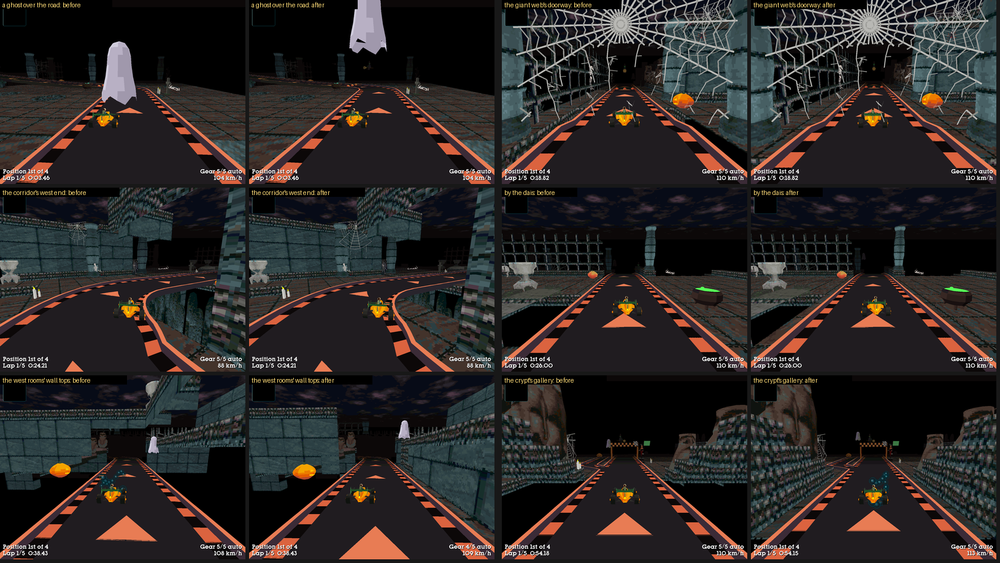

*The spooks.* The ghosts drifted 1,300-1,900 over the road, and the chase camera's eye is 2,100 over it, so the camera flew through them and
the screen filled with their sheets. A spook's height is now kept clear wherever its way comes over the road: its lowest point, bobbing,
at least 2,500 over the road there and over the road the camera comes from (the highest of the 20 points before), or a witch's highest
point at least 1,000 under the deck. Each keeps the height it was given, or the nearest that is clear:

- the ghosts fly 2,800-3,400 over the road (2,540-3,140 at their lowest);
- the witch patrolling the lower hall crossed the ramp down into it at the cars' height: she now patrols over its floor, (360, 300) to
  (392, 328), where the road is down on it;
- the witches circling the spirals a third of the way up passed through the deck where the roads in and out of the spirals cross their
  circles: 8,453 and 8,264 now, a thousand under those roads and well over the crypt's;
- the bats wheel at least 2,500 over the road under their circles (the one over the crypt's east ramp was at the camera's height).

The least clearance of any spook over the camera's eye went from -2,430 (the lower hall's witch) to +401.

*The crypt straight's witch dive* started 1 cell past the start line and dived through the gantry's beam. A dive place now keeps the line
10 cells or more outside the stretch she flies over (`GANTRY_CLEAR`): it is at (367.8, 586), on the straight in from the dark, 42 cells
before the line.

*The pumpkin rows.* An actor belongs to its cube's scene, and the ramp down into the lower hall runs along the edge of cube x 384, so the
row there had a pumpkin in scene 307 while the car was in 308, and showed two. A plan may now keep every pumpkin of a row a distance from
its cube's edges (`itemCubeMargin`, RaceTrackOptions.ItemCubeMargin, RaceTrackScenes.MushroomSpots: the row goes to the clear point of its
stretch nearest the middle that also keeps it); the Temple's is 3 cells. That row is now at the ramp's foot (378.5-380.8, 311.3-315.5), and
one at the west spiral's foot moved a cell (it was 2.1 cells from an edge). Still 7 rows of 3, each about 8 s of driving apart. Other
tracks have no margin, and their rows are where they were.

*Decor.* A piece of floor decor stands where its footprint is all on the floor at its height and none of it cut (`footprint_on`); when the
first place out from the road is not, it takes the next, or none -- the cycle of kinds goes on as before, so every other piece is as it was.
A jack-o'-lantern part-way into a wall by the west rooms, one in a row of rocks and a grave with its candles on a gallery step are gone;
four pieces partly over drops (three graves, a lantern) moved a little. No cobweb is within 4 cells of a skeleton slumped or hanging on a
wall (three corner webs over slumped skeletons, two of them the crypt's, are gone), and no skeleton hangs by the giant web's doorway (the
doorway's walls, whole now, would have had one). The gravestones' grey ramp had the temple's teal (slot 52) in it: 212, the grey between
its neighbours in the temple's palette, now.

*Races* (`E:\dump\TEMP\templefix_cuts`, the race game's car, the pumpkin F1, 5 laps, no qualifying): the test pilot alone on its line
55.38, 55.00, 55.06, 55.06, 55.06 s, HEAD's to the hundredth. Against the monsters at medium (race seeds 1, 2) and hard (1, 2), and a time
trial: no rescue, no car stuck, as in HEAD's build. The races go their own ways from the moved pumpkin row on (other items drawn): medium
seed 2's first three laps are HEAD's to the hundredth (55.37, 55.00, 57.25), the later ones within 0.16 s.

*Other tracks*: built together with HEAD's tool and this one, every file and every race file at each difficulty the same (485
checksums).

Tests: `E:\dump\TEMP\templefix_cuts` -- `build.sh <game> head|work`, `racefile.sh`, `pilot.sh`, `batch.sh <game> <prefix>` (solo, medium
and hard races, a time trial), `frames.sh` (the race camera at the audit's places), `full.sh <v>` (the plan made afresh, `templecells`, and
every measure: `tools/cutpits.py`, `classify.py`, `pits.py`, `widepits.py`, `floating.py`, `overhangs.py`, `corridor.py`), `tools/spookclear.py`,
`pumpkins.sh` (the rows against the cube edges), `regress.sh head|work` (every other track).

### Nothing through the deck (2026-10-18)

The user, the day of the release: "There's something visually clipping into the track". A dark teal shape stood up through the road's
kerb in the crypt, by the rocks under the spiral's piers. It was a lobe of a row of rocks (scene 40's, brick 2294): the road passes 60
over the block's top, and the cuts keep what is 40 or more under its surface, but a lobe stands as tall as LBA1's picture of the row
draws it over its share of the picture, up to 0.4 layers over the block. That one reached 247 over the deck's surface at its kerb; two
more, in the long corridor's rows (scene 8's brick 2264, drawn twice), 104 over it.

- *The measure* (`ScriptRoundTrip templeclip <game> <raceraised.txt> <out> [LBA1] [plan]`): every polygon of the race build's TEMPLE.ILE,
  sampled every 32 units, against the deck rail to rail and the slip lane, from 120 under its surface to 1,000 over it. Of 198,935
  polygons, three decors reached over the surface (798 samples), all rock lobes; nothing else does -- LBA1's actors, the round things,
  the ramps, the opaque faces and the Halloween decor all stay under it (the nearest: a lift's platform 12 under, floor plates 42, the
  floors 60).
- *The fix* (`TempleDeck`, `TempleModels.Model.Under`): the race build gives the models its plan's road. A row of rocks the road passes
  over has each lobe that reaches into the road's room (from 40 under the surface, the cuts' own rule, to 2,600 over it) over its own
  footprint cut flat 40 under the deck and closed there, as the lobes of a row LBA1 placed only some layers of are cut. 11 lobes of 6
  rows; the lobes beside the road, the rest of each row and the temple's plain build (LBA1's angle) are as they were. Measured again: no
  sample over the surface.

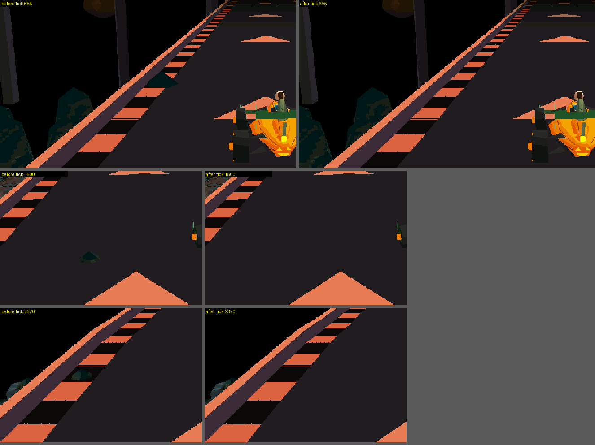

*Races* (the release's engine, the race game's car, 5 laps): the test pilot alone 55.38, 55.00, 55.06, 55.06, 55.06 s; against the
monsters at medium (seeds 1, 2 with qualifying, 3 from the back of the grid), hard and easy, and a time trial: no rescue, no car stuck,
every lap the release build's to the hundredth.

*Files*: only TEMPLE.ILE (and its .bak) and TEMPLE.OBL change; RACETRACK.JSON, the scenes, BODY.HQR and every race file are the same.
Other tracks: nothing they build goes through this code.

Tests: `E:\dump\TEMP\templefix_clip` -- `build.sh <game>` (the temple alone, the worktree's tool, and its race files), `clip.sh <game>
<out> [raceraised.txt]` (the measure), `pilot.sh`, `shots.sh <tag> <ticks> "<from>:<to>:<every> ..."`, `near.py` (the ticks the pilot
passes a place, from a `camtrace` run), `diff.py` / `pairs.py` (two builds' frames compared, before and after crops), `regress.sh <game>
<prefix>` (solo laps, five races and a time trial).

### The game's own rats and skeletons (2026-10-18)

The user: "The game contains an actor called '36: The flying rat', and '35: Rabbibunny skeleton' let's replace the current bats we have
with the ones from the game and add more of the games in-built skeletons to our temple track too." (`TempleHalloween.Creatures.cs`; the
numbers are BODY.HQR's: the flying rat of the sewers is entity 23's body, the rabbibunny skeleton of the Tralu's cave entity 22's.)

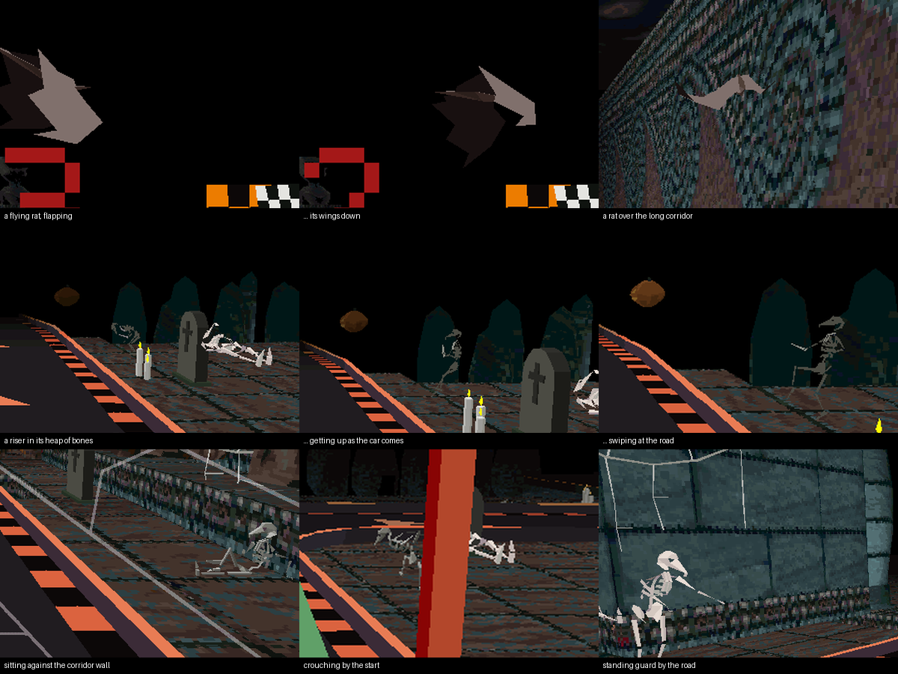

- *Flying rats for the bats*: the ten bats (six wheeling over the road, two up each spiral's middle) are the game's flying rat, on the
  same ways. It flaps its own wings -- its entity's standing animation (ANIM.HQR 266, 17 keyframes, 1.7 s a beat) -- which the race-track
  mode now plays on a spook (`spook=` flags 4: an animation after the height, stepped every frame as the flag marshal's is). Its body is
  where the bat's was in BODY.HQR (907 in a temple-alone build), so no other body moves: the game's, twice its size (1,600 across its
  wings). The game draws it flat in one near-black (224) -- lost in the temple's dark -- and lighting it with the game's light didn't
  work: its wings' two sides share their points, whose normals come out nothing (black faces, a point here and there past its ramp's
  end). So each face is a shade of its own ramp by the way it faces as modelled, as the Halloween models are (225 to 233, 229 and 232
  left out, mauve in the temple's palette): a dark brown-grey rat whose wings catch the light as they beat. It reaches 850 under its
  middle and 660 over it flapping (the bat 100 and 250), so the six over the road fly 625-750 higher than the bats did -- the same rule,
  its lowest point 2,500 over the road under the camera (`temple_design.py` SPOOK_BODY).
- *Rabbibunny skeletons as decor* (the plan's decor kinds 16-19): 17, posed by the skeleton's own animations and made bodies of one bone
  in the island's palette as LBA1's are -- 5 lying on their backs (its lying, generic 146), 3 sitting against the walls with their legs
  out towards the road (half way through its getting up, 147, keyframe 5), 5 standing guard looking at the road (its standing, 0) and 4
  crouching, an arm out (7, keyframe 1). The game's size (about 1,270 tall standing). Bone: its greys from 51 to 60, 52 left out (a teal
  in the temple's palette: 212, the grey between 51 and 53 there, as Stone has it). Where: by the start's straight in the crypt (3 just
  past the line, 2 before it), against the long corridor's north wall (2), the first floor's west end by the ramp down (5), the lower
  hall (2), the west rooms (3). Each on the floor beside the road, at the road's floor, 2.4 to 5.5 cells out from its edge (a sitting
  one's feet 0.6 clear of it), the floor under all of it whole (`footprint_on`), 3 cells or more from every other decor (the cobwebs
  included), 4 from the scares, none by the giant web; each kind's share spread along the lap; placed after all the other decor, so
  nothing else moved.
- *Risers* (spooks of kind `riser`, `spook=` flags 8): 3 of the game's own skeleton by the road -- by the ramp down at the first floor's
  west end (393.3, 424.9), in the passage of the west rooms (268.7, 438.2) and in the crypt's east room (541.7, 551.3). Each lies in a
  heap of bones (its falling apart, 151, held at its end) until Twinsen's car comes within 24 cells, then gets up and swipes at the road
  (its attack, 150, 1.04 s) and falls back into its heap as the car goes by; again next lap, once the car has been 36 cells away. 2.6
  cells or more from the road's edge (its swipe never reaches over it), in sight of the road beside it and 8 and 15 cells before it.
  The game's body drawn by the game's light was near black by the road, so it is the game's body a little lighter -- its greys from 53
  (past the temple's teal), its lines 58 -- appended at the very end of the build (after the flag marshal's and the toy truck's: no body
  moves), entity 22's body 40; the race file names it by the entity (flags 16), as `marshal=` does. Drawn down to 300 past its reach
  from the camera's eye (a flying spook's rule is 1,500, or 2,200 at the least).
- *LBA1's skeletons stay*: the 23 posed ones (lying, slumped, hung on the walls and in chains over the dark) and the scares' skeleton are
  the temple's own -- LBA1's, warm bone -- in poses the rabbibunny's animations haven't got (hung by its wrists). The two kinds now share
  the lap.
- *Budget*: TEMPLE.ILE 18 decors more (one across a cube's edge; the busiest cube 601 as before), TEMPLE.OBL 4 bodies more; BODY.HQR the
  bat's entry the rat's and one more at its end; ANIM.HQR the same; spooks 30 of 48.

*Unchanged*: nothing through the deck (`templeclip`: 0 samples over the surface); the solo lap 55.38 s; the five races (medium with seeds
1, 2 with qualifying, 3 from the back of the grid, hard, easy) and the time trial every car's every lap the same as before to the
hundredth, no rescue, no car stuck (the risers got up 16-21 times a race); every other track's 304 built files the same as before.

Tests: `E:\dump\TEMP\temple_rats` -- `build.sh <game> head|work`, `racefile.sh`, `pilot.sh`, `shots1.sh` / `shots2.sh <tag> <game>
<ticks> "<ticks>" [racecars every] [resolution]`, `passes.py` (the ticks the pilot passes each new creature), `regress.sh <game> <engine
dir> <prefix>`, `others.sh` (every other track, HEAD's tool and the worktree's), `decors.py` (decors per cube), `actorclash.py` (the new
skeletons against LBA1's actors' boxes), `plancmp.py` (two plans: only the bats' kind and height and the new entries differ);
`ScriptRoundTrip templecreatures <game> <out> <entity | b<body> | decor | rat>` draws an entity's body in every keyframe, the decor poses,
the rat.

### The vampire, the witch and the zombie (2026-10-18)

The user: "Let's also create different opponents for Twinsen, a vampire driving a coffin, A witch flying on a broom (so no wheels), A
zombie driving a hurst". Three cars made for them (`Terrain/RaceTrackCharacterCars.Monsters.cs`), the Temple's line-up since:

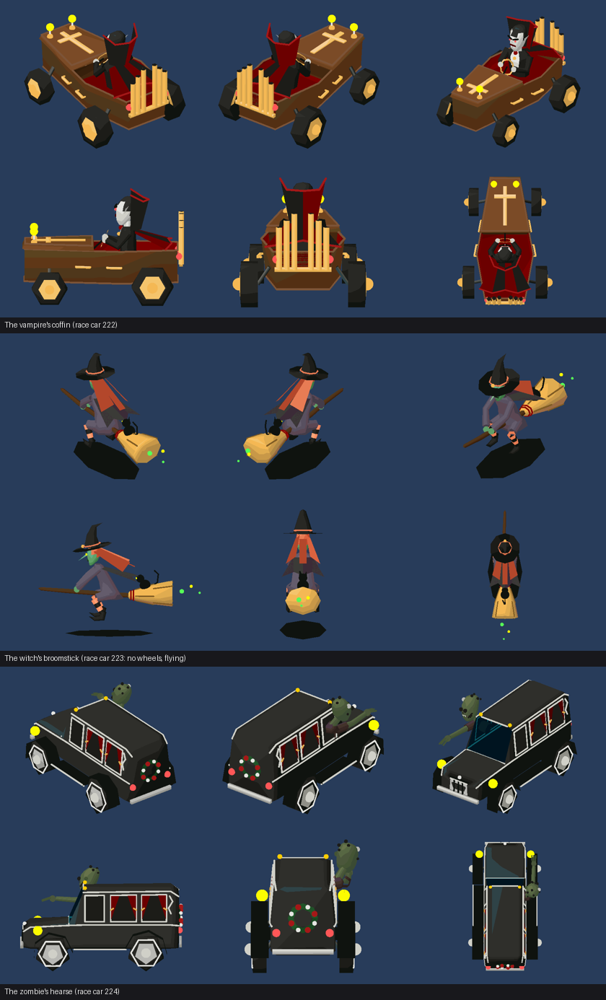

- *The vampire's coffin* (race car 222, the one to beat): a six-sided coffin of dark wood on four wheels with brass hubs, the lid's foot
  end closed over the front as the bonnet with a brass cross and two candle lamps, the head end open and lined with red velvet. The
  vampire sits up in it at the wheel -- pale, black hair slicked back to a widow's peak, pointed ears, red eyes, fangs, a tall collar black
  outside and red inside, his cape streaming back over the coffin (black, lined and hemmed red). Brass handles down its sides; at its tail
  six brass organ pipes for exhausts, the middle ones tallest -- from the camera behind it, the pipes and the collar.
- *The witch's broomstick* (223): no wheels. A gnarled broomstick, its golden bristles bound with red twine, its handle 430 over the road,
  a dark oval for its shadow under it; the witch astride it leaning into the wind -- green as the temple's own witches, her ginger hair
  streaming, a tall black hat bent back with an orange band and a gold buckle, a purple robe and cape, orange-and-black striped stockings
  and pointed black boots -- her black cat with yellow eyes riding on the bristles, green sparks in her wake.
- *The zombie's hearse* (224): a long black 1930s hearse on whitewall wheels under flowing wings and running boards, a long bonnet with a
  chrome grille and lamps, a steep windscreen, the tall rear compartment with wine-red curtains at its windows and chrome landau bars,
  a wreath of greens, roses and lilies on its back door, chrome along it and marker lamps on its roof. The zombie leans out of the driver's
  window (the car's right, the side the chase camera sees him on), grey-green, his sunken eyes glowing, teeth bared, stitches on a cheek,
  one ear gone and his skull showing, his rotting arm reaching out ahead of the car.

The drivers are made in the cars' low-poly style (no body of LBA2's is a vampire, a witch on a broom or a zombie). The colours are those
every island's palette keeps alike -- the browns, the reds, the golds, the greys, the greens 117-141, the purples 210-217 -- with a part of
the light (`CarMesh.Light`) where a whole ramp would run past its colour, so they read on the temple's near-black road and look the same on
any island (drawn in the Desert's palette too). Points 533, 439 and 522 (the limit 550); primitives 421, 393 and 446.

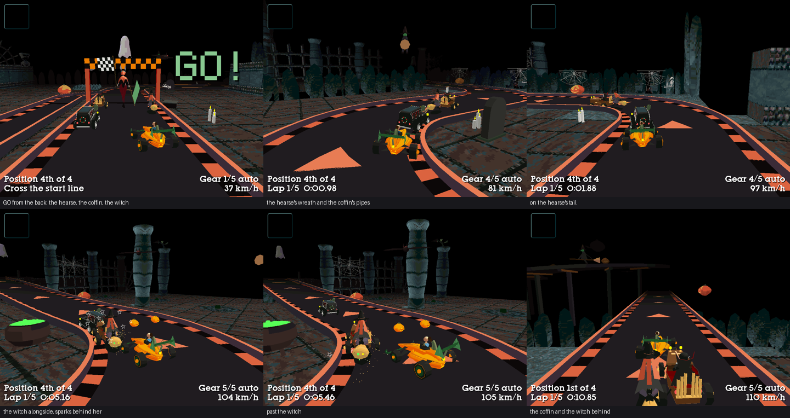

- *In the build*: bodies of the racer's entity, 66, 67 and 68 (their half-size copies, for the lightning, 166-168), installed at the very
  end of every build (`InstallMonsters`, after the flag marshal and the toy truck's violet copy: no body before them moves), with their
  lines at the end of RACECARS.JSON; anyone's to drive (Race car window, the race game's car page). The Temple's scenes put the
  opponents' copies in as the racer's entity with those bodies (as every track's character-car opponents), so its build only changes
  SCENE.HQR's 27 scenes (the three actors' entity and body), RACETRACK.JSON (names, bodies, the witch's hover), and gains the six bodies,
  RESS.HQR's entity table entry and the three catalogue lines. Other tracks gain the same bodies, table entries and lines and nothing
  else (Desert island and Island CX built together: their files and race files the same as HEAD's but for those).
- *The line-up* (`RaceDriver.Temple`): the vampire, the witch and the zombie on the skeleton's, the ghost's and the two-headed monster's
  lines, grid places, tops and grips (the line files byte for byte the same), so the levels are as they were. The race shows their names:
  "The vampire" (the one to beat), "The witch", "The zombie". The cast's cars the monsters drove before stay in the catalogue.
- *The box*: the engine meets the cars by their bodies' boxes, which a body's writing makes its own reach. The coffin's (922 across, 1,351
  long) and the hearse's (791 across, 1,507 long) are a car's, as the old monsters' were (1,052-1,142 across, 1,230 long); the broomstick's
  own would be a sliver 460 across reaching back to the sparks, so it is given a car's (`MonsterBox`: 922 across, 1,450 long, 1,203 high).
- *The hover* (`RACEMOD.CPP opponent_hover=<units> <ms>`, generic and off unless a race file names it): the broomstick bobs 45 up and down
  over its line every 1.6 s, on the grid too, a little out of step with any other flier -- the actor's height only, set where the race places
  the car each frame; its line, box, speed and what meets it are any car's. `RaceDriver.Hover` -> RACETRACK.JSON's `Hover` (left out for
  every other driver) -> the race file. A back-of-the-grid race with the key taken out is the same race to the hundredth.

*Races* (the race game's car, 5 laps, the worktree's engine; HEAD's build and engine beside them): no rescue, no car stuck, no crash in
any of 12 races. From pole (seed 1), with qualifying (seed 2), easy (seed 5), off the line from the back (seed 8) and the time trial --
Twinsen's laps the same as HEAD's to the hundredth (the trial 55.30, 54.90, 54.95, 54.87, 54.97: 275.87 s). Where Twinsen passes or
meets the cars the races go a little differently from the old cars' (contacts and the ghost power-up's start differ with the bodies),
every one placed as HEAD's: from the back (seeds 3, 2, 1) 308.1, 330.7, 328.4 s against 319.8, 338.4, 324.9 (1st, 1st, 4th); hard 292.3
against 290.7 (2nd); hard from the back 282.3 against 282.5; at 85 % of the line's speed 319.4 against 317.4. (The test pilot doesn't steer round a pack: from the back at easy it follows the eased-off pack all race, with the
old cars as with the new.) `templeclip`: nothing through the deck.

### The secret party (2026-10-19)

The user, with a picture of the hall: "let's create a secret halloween party area, complete with traditional halloween characters and
accompanyments here that the user can find if they get out of the car and explore". The hall is LBA1 scene 41's great hall, the temple's
north-east building (island cells 548..658 x 259..321, floor layer 12 -- 17,152): walls a layer and a half high dividing it, a stair down
out of its south side (LBA1's way in, from its lower east hall), a raised dais with a stair at its east end. No road comes near it: its
nearest is the long corridor 150 cells south and 3,000 lower, and nothing of it shows from the road but a jack-o'-lantern at the mouth of
the side passage that opens off the corridor.

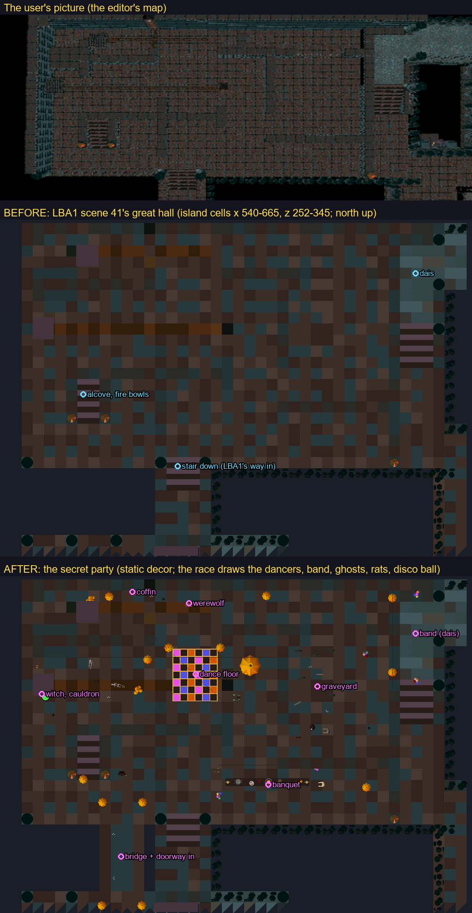

- *The way there, on foot* (RACEMOD.CPP `on_foot=1`, the Temple's race file alone): Space gets Twinsen out of his car once it has all but
  stopped (never at the start, in a jump, a loop or a skid), as the behaviour menu would -- sporty, so he runs. From the corridor up the
  side passage (LBA1 scene 41's west wing, floor 8), up its stair onto the gallery (12), through a doorway the build cuts in the gallery's
  north wall, over a short bridge it lays across the dark (`TempleHalloween.PartyCuts`, `PartyWalls`: TempleIsland's cuts and walls) and
  into the hall: about a minute's run. The way's cubes get scenes of their own after the route's (`TempleHalloween.PartyCubes`: scenes
  328-334, no route scene moves), with cube-change zones like the route's. The hall's south side is open to the dark, as LBA1 draws no
  wall on the side its camera looks from: boxes nothing draws keep a guest from walking off (but at the doorway and the stair).
- *On foot the race goes on*: the opponents keep racing (through him: they pushed him along the road at their speed), the clock runs.
  Nothing of the race's holds him: the raised road's rail lets him off it, the rescues and the stuck-car reset are the car's. The engine
  lets him up the temple's stairs (steps of 192: `RaceMod_StepUp`, 220 on foot, the game's 128 otherwise) and puts him on the floor he
  comes into a scene inside (`RaceMod_FootArrive`: the race lowered the corridor's floor under its road, 320 under the passage's, at the
  cubes' edge between them). Back in his car where it stands -- carried into its scene, however far -- with Space by it, with Ctrl
  anywhere, when he falls further than 2,300 (off a ledge into the dark), into the sea or off the island's edge, and after five minutes on
  foot; his life is kept. Every other track: nothing changes (Space keeps the game's own doing, the race waits for him).
- *The party* (`Terrain/Temple/TempleParty.cs`, `PlaceParty`: 83 pieces of the island's decor, 22 of them solid, 45 bodies of TEMPLE.OBL
  after every other, 9,372 faces): a banquet of two tables -- a punch bowl of glowing green punch with an eye floating in it, a three-tier
  cake with candles and a pumpkin, cookies, candy corn, goblets of red wine, a skull with a candle, candelabras; the witch stirring her
  cauldron of green brew over a fire, her black cat and her broom; a glowing dance floor; the vampire at the door greeting his guests (his
  goblet raised), Frankenstein's monster, the mummy at the banquet, a howling werewolf, two zombies (one after the punch), the grim reaper
  with his scythe among the gravestones and crosses; an open coffin against the wall, LBA1's skeletons slumped and fallen, black cats,
  jack-o'-lanterns, a pile of pumpkins, candles, balloons, orange, purple and green bunting across the hall, cobwebs and spiders.
- *The guests the race draws* (`PartyGuests`, `spook=` flags 32: drawn only while Twinsen is about the party; 64 on the floor, 128 swaying,
  256 standing, 512 spinning): five of the game's rabbibunny skeletons (the risers' lighter body) dancing a conga round the dance floor
  and three more dancing on the spot, the band on the dais -- the franco drummer and two guitarists, the old rabbibunny and the desert
  sphero, each in its own animation -- the race's ghosts over the dance floor and the banquet, three flying rats round high over the hall,
  a witch on her broomstick round it, a spinning disco ball and bubbles out of the cauldron (their two bodies at the very end of the build,
  the rabbibunny skeleton's entity's bodies 60 and 61: no body before them moves).

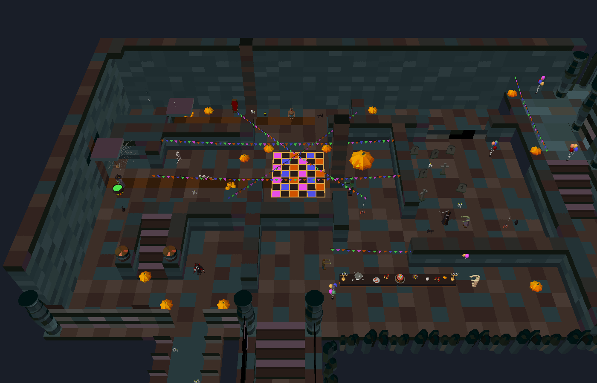

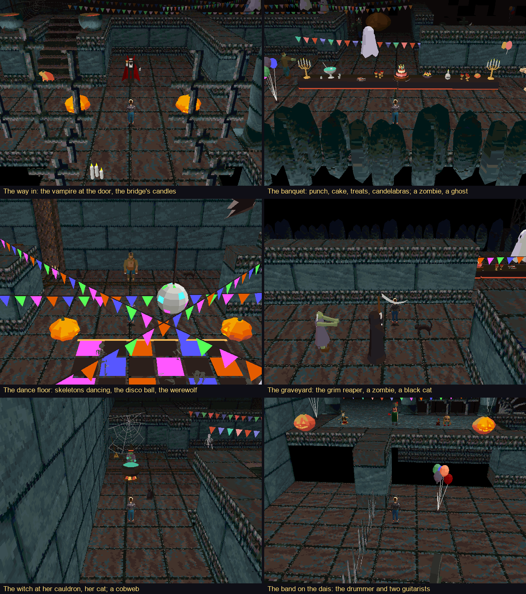

- *The race game*: its controls page shows "Space / X button: Get out / back in" for a track whose race lets him out (`on_foot=`), the
  page as it was for any other.

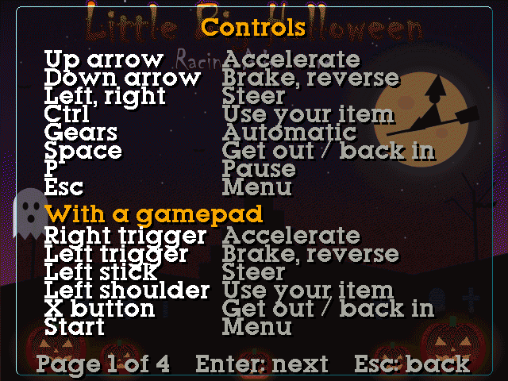

*Tests* (`E:\dump\TEMP\temple_party`): `walkparty.sh <tag> <ticks>` -- the race, the test pilot stopping the car on the corridor (console
`racestop <x> <z> <reach>`), Twinsen out, through the passage, the stair, the gallery and the bridge, round the hall (the dance floor, the
banquet, the graveyard, the dais) and back (console `racewalk [+] <x z>... [car]`), into his car with Space, the pilot driving on to the end
of the race: 169.5 s on foot, the opponents racing on meanwhile, no rescue, no car stuck, no crash. A Ctrl from the hall carries him to his
car three scenes away; a fall off the gallery puts him back in it. Race behaviour unchanged: from pole, with qualifying, hard, easy and the
time trial (`regress.sh`) every lap to the hundredth as HEAD's build and engine. Every other track built together: its 304 files the same
as HEAD's; every other track's race the same (17 tracks, `others.sh`). `templeclip`: as before. Frame times: a solo lap 11.40 ms a frame
against HEAD's 11.27 (the machine shared); the hall at the dance floor 12.5 ms (p95 16.1). Other scripts: `build.sh`, `racefile.sh`,
`rebuild.sh`, `pilot.sh`, `roomtest.sh`, `views.sh` (the engine's shots round a place), `occ.py` (where one can walk round a height, from
the island's boxes), `topall.sh`, `beforeafter.py`, `menudrive.ps1` (the race game's pages, headless).

Tests: `E:\dump\TEMP\temple_monsters` -- `cars.sh [palette]` (`ScriptRoundTrip monstercars <game> <scratch>`, then the three cars'
views), `build.sh <game> base|new [islands...]`, `racefile.sh <game> base|new`, `pilot.sh`, `regress.sh <prefix> <game> <engine>`,
`extra.sh` (six more from the back, hard, easy, off the line, slow), `summary.sh`, `cmpgames.py <A> <B>` (two builds file by file,
HQRs entry by entry, RACECARS.JSON line by line), `cmprace.sh <ILE>...` (other tracks' race files), `engbuild.sh`, `sheet.py`.

**Tests**:

- `E:\dump\TEMP\temple\pilot\run.sh <tag> <ticks>` is the headless pilot. CARF=car_fast.txt is a fast car with no qualifying.
- `E:\dump\TEMP\temple\ui\ui_temple.ps1` builds in the race window, opens TEMPLE.ILE and Plays.
- A regression build of every other track gives its 44 files byte-identical to the code before.
- The cobwebs' round: `E:\dump\TEMP\templeweb` -- `suite.sh <tag>` (a race against the opponents, the pilot off its line, solo),
  `shots.sh <tag> <every>` (a lap of screenshots), `regress.sh head|work` (every other track: 58 built files and 17 race files the same),
  `templecmp.sh` (the temple alone: only TEMPLE.ILE, TEMPLE.OBL, RACETRACK.JSON and BODY.HQR differ -- its entries before the giant web's the
  same -- and the race file only gains its web lines).
- The pumpkin F1: `ScriptRoundTrip pumpkinf1 <game> <scratch>` installs it into copies of a folder's BODY.HQR, RESS.HQR and RACECARS.JSON
  (then `BodyPipeline carviews <scratch>\BODY.HQR <index> <game> <png> 40`); `E:\dump\TEMP\pumpkinf1` -- `views.sh <tag>` (the views),
  `suite.sh <tag>` (the race in HEAD's build, in this build in the buggy, `RT_DRIVE=-4`, and in the pumpkin F1, a fixed
  `qualifying_seed=`), `others.sh head|work` (every other track built together: 59 of 62 files the same, BODY.HQR only gaining its two
  last entries, RESS.HQR only its entry 44, RACECARS.JSON only its last line).
- The shaped things' round: `E:\dump\TEMP\templerefine` -- `build.sh <game> head|work`, `racefile.sh`, `pilot.sh`, `shots.sh <tag> <every>`
  (a lap of screenshots, HEAD's build gameH and the worktree's gameW frame for frame), `suite.sh` (solo, against the opponents, off its
  line, on both), `perfab.sh` (both timed by turns, each frame's least time over the runs: the machine is shared), `raycast.py` (the
  survey, from a `camtrace 1` run and `templecells`), `checks.sh` (the temple alone: only TEMPLE.ILE and TEMPLE.OBL differ, the race file
  the same; every other track: its built files and its race file the same).
- The monsters' and levels' round: `E:\dump\TEMP\templediff` -- `build.sh <game> head|work`, `racefile.sh <game> head|work`, `pilot.sh`
  (`DIFF=`, `SEED=`, `PACE=`, `SIDE=`), `batch.sh`, `bench.sh` / `bench2.sh` and `report.py [--table]` (the table above), `cmpgames.sh`
  (the temple alone: only SCENE.HQR, SCENE.HQD and RACETRACK.JSON differ), `sceneactors.sh <scene>` (only the three opponents' entity and
  body), `regress.sh head|work` (every other track built together: its 251 built files, and its 51 race files -- each track at each
  difficulty -- with their lines, the same as HEAD's), `racefile_levels.sh`, `views.sh` (the Halloween cars in the temple's palette),
  `menudrive.ps1` (the installed race game headless through `--listen`: its pages pictured), `racewin` (the Race car window drawn in a
  process of its own), `lbra.patch` (the race game repo's changes).

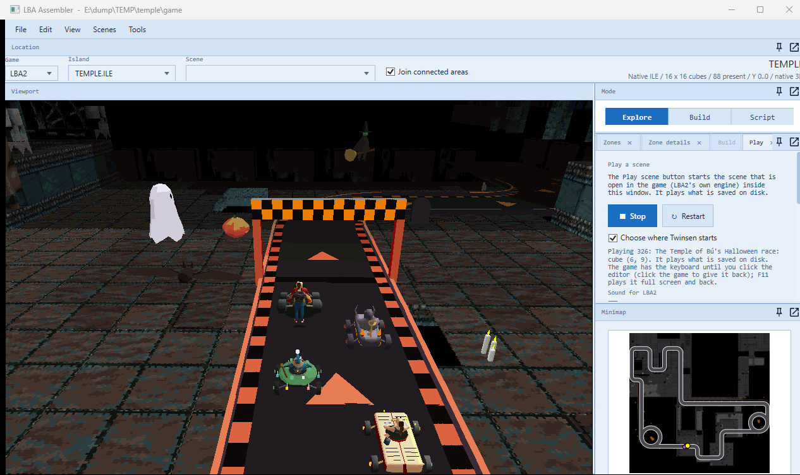
