# How to rebuild LBA1's ski resort in LBA Assembler, step by step

This guide walks you through rebuilding Hamalayi's ski resort (LBA1 scene 96) as an LBA2 island map with the editor, one window and one
button at a time. Every value you type is either in a step or in the tables of [RECREATE.md](RECREATE.md).

What you end up with:

- `skiresort.lbamap`: the snowy mountain, its trees, hut and lift.
- The ski instructor, who talks.
- A snowboard to pick up, and Twinsen riding it down four slalom runs.
- The lift back to the top.

On 2026-10-23 the whole build was repeated from an empty sandbox with the scripts in [recipe/ui/](recipe/ui/), and every picture here
comes from that run. The result matched the released map: same ground heights, light, objects, scene, scripts, characters and dialogue.
The one difference is 13 cells that got another snow tile (see the end).

## How long it takes

| Step | By hand | Scripted |
| --- | --- | --- |
| 1 Map | 2 minutes | 30 seconds |
| 2 Ground heights (875 strokes) | about 3 hours | 2 minutes |
| 3 Ground pictures (50 tiles, 3,828 paint runs) | 30 minutes for the tiles, 12 hours or more for the painting | 3 minutes |
| 4-6 Hut, tree clumps, light | 1 hour | 3 minutes |
| 7 Objects (14 made, 66 placed) | 1-2 hours | 10 minutes |
| 8-9 Map settings, text | 5 minutes | 30 seconds |
| 10 Characters | 1-2 hours | 3 minutes |
| 11 Points, actors, zones | 1 hour | 5 minutes |
| 12 Scripts | 15 minutes (paste five files) | 1 minute |

Steps 2, 3 and 5 are long, regular lists. Doing them with the scripts and the rest by hand is a fair split. Each step below names its
script; **The scripted way** at the end says how to run them.

---

## 0. Before you start

**Make a sandbox.** Copy an LBA2 game folder to a folder of its own (a plain copy, not links), for example `E:\dump\TEMP\hamalayi\game`.
In **File > Settings…**, make it the LBA2 game folder, and set the LBA1 folder too: the ground tiles and the objects are made from LBA1's
bricks. The map's workspace (the copy of the game the editor installs the map into while you edit) is made inside the game folder as
`_MAP_WORKSPACE`.

**Mute it.** The **Play** tab has **Mute all sound**.

**Learn the five places you'll use.**

1. **Mode** (top right): **Explore**, **Build**, **Script**. Everything here is in **Build**.
2. **The Build tab** in the dock under Mode (tabs Zones, Zone details, **Build**, Play). At its top, **What to edit**: **Terrain**,
   **Buildings and decor**, **Actors and zones**.
3. **The terrain panel** (Terrain, or Buildings and decor): a long column of sections you open and close by their headers. It's short in
   the main window: press **Float** on the dock (the ⧉ icon at its top right) to pop it out into a window you can make tall, as in these
   pictures, and **Dock** to put it back.
4. **The scene panel** (Build > **Actors and zones**): the scene's actors, zones and track points, edited where the view shows them.
5. **The File menu:** **New map…**, **Open map…**, **Save map** (Ctrl+S), **Map settings…**, **Map text…**.

| The terrain panel, top | The middle | The bottom |
| --- | --- | --- |
| 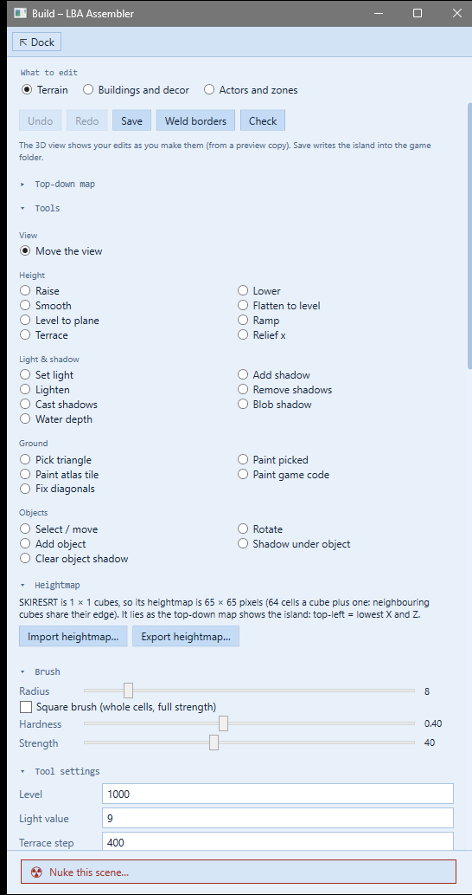 | 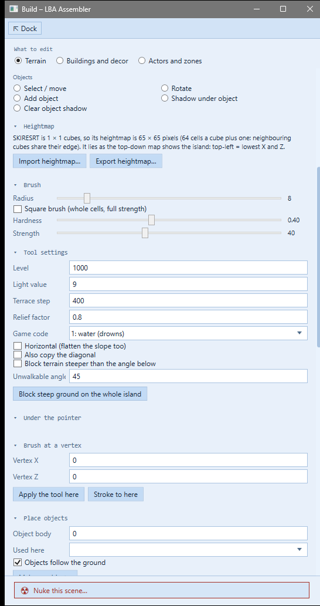 | 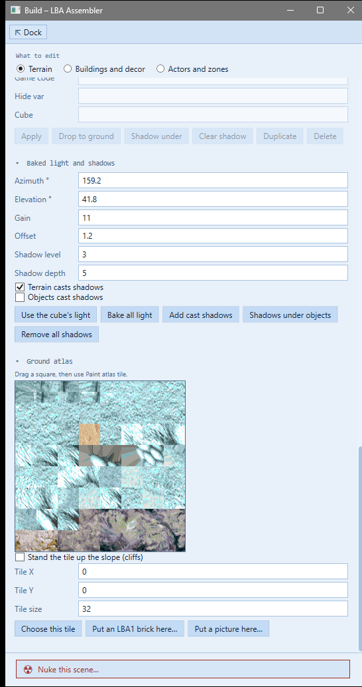 |

**Two kinds of save.**

- The terrain panel's **Save** (it reads **Save \*** while there are changes) writes the ground into the workspace. The scene panel
  writes each change into it at once.
- **File > Save map** writes the map file.

Opening a map rebuilds the workspace from the map file, so **anything not in the map file is lost** the next time you open it. Do File >
Save map at the end of every step.

**Typing a vertex instead of clicking.** Every brush and object tool works at the mouse pointer, and the same tools also work at a vertex
you type:

- Section **Brush at a vertex**: type **Vertex X** and **Vertex Z**, then press **Apply the tool here** (one click there).
- **Stroke to here** drags in a straight line from where the tool was last used to the vertex you typed.
- The map's cube runs from vertex **448 to 512** both ways, so LBA1's cell (x, z) is vertex (448 + x, 448 + z).
- To see which vertex is under the mouse, open **Under the pointer** and hover over the 3D view.

Mouse equivalents: in the 3D view, a brush tool paints with the left button, the right button turns the view, the middle button drags it,
and **[** and **]** change the brush radius.

---

## 1. Make the map

1. **File > New map…**
2. Fill it in as below and press **Create**:

   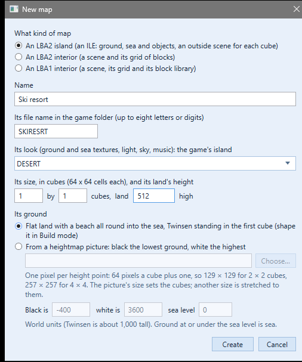

   | Field | Value |
   | --- | --- |
   | What kind of map | **An LBA2 island** |
   | Name | `Ski resort` |
   | Its file name | `SKIRESRT` |
   | Its look | **DESERT** (the default) |
   | Size | `1` by `1` cubes, land `512` high (256 is refused: the land must be 300 to 20,000) |
   | Its ground | **Flat land with a beach all round** |

3. **File > Save map as…** and save it as `skiresort.lbamap` in the editor's `Maps` folder.

**Check:** the Scene box says **405: Ski resort: cube (7,7)**, or another number in the 400s if your game folder already has maps. You
see a flat, sandy square island:

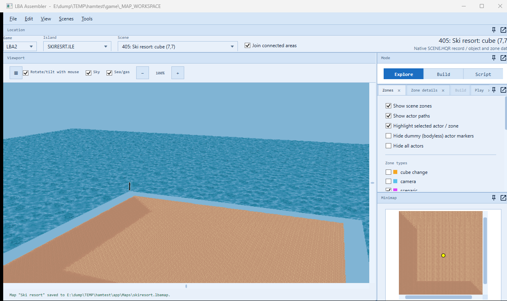

## 2. The ground's heights

Goal: every vertex of the cube at LBA1's height. The list is `runs` in [recipe/plan/targets.json](recipe/plan/targets.json): 875 rows of
`level, z, x0, x1`, sorted by level from -256 up to 6400. *Script: `paint_ground.ps1`.*

1. **Mode > Build**, the **Build** tab, **What to edit > Terrain**.
2. Section **Tools**: choose **Flatten to level** (in the Height group).
3. Section **Brush**: tick **Square brush (whole cells, full strength)**. Set **Radius** to 0 and **Strength** to 100.
4. Section **Tool settings**: tick **Block terrain steeper than the angle below** and set **Unwalkable angle °** to 45. This makes the
   cliffs walls, as LBA1's are.
5. For each row of the list:
   1. If its level is new, type it into **Level** (Tool settings).
   2. Under **Brush at a vertex**, type **Vertex X** = 448 + x0 and **Vertex Z** = 448 + z, then press **Apply the tool here**.
   3. If x1 isn't x0: type **Vertex X** = 448 + x1 and press **Stroke to here**. That's the whole run along the row.
6. Press **Save**, then **File > Save map**.

**Check:** the mountain stands up out of the sand, its terraces stepping down towards the sea:

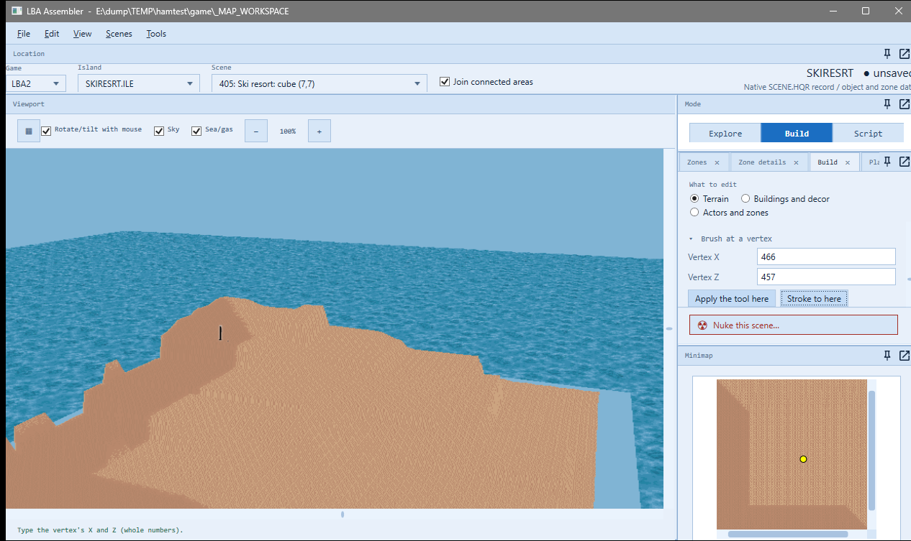

Tip: the run list is sorted by level, so you type a new Level only 43 times. If you lose your place, the **Top-down map** section's
height view shows what's done.

## 3. The ground's pictures

Goal: the ground painted with LBA1's own snow, ice and rock. The plan is [recipe/plan/tile_plan.json](recipe/plan/tile_plan.json), and the
slot table is in [RECREATE.md's appendix](RECREATE.md#appendix-the-atlas-slots). *Script: `texture_ground.ps1`.*

### 3a. Put LBA1's bricks into the ground atlas (50 tiles)

The ground atlas is the 256 × 256 picture the island's ground is painted from, in 32 × 32 tiles. Open the section **Ground atlas** (bottom
of the panel). For each slot of the table:

1. Type **Tile X** and **Tile Y** (the slot's corner, in pixels), set **Tile size** to 32, and press **Choose this tile**. Or drag a
   square on the atlas picture.
2. Press **Put an LBA1 brick here…**. In the dialog:
   - A ground slot (slots 4-50): **The brick** = its number. **Which of its faces** = *Its top (the ground)*.
   - A cliff slot (slots 0-3): **The brick** = the first number of the pair. **Which of its faces** = *Its side over another brick's (a
     cliff two layers high)*. **The brick under it** = the second number.
   - The dialog shows the brick and the tile it makes. Press **Put it in**.

| A cliff slot (slot 0: 3033 over 3034) | A ground slot (slot 4: the top of 2721) |
| --- | --- |
| 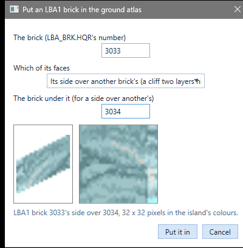 | 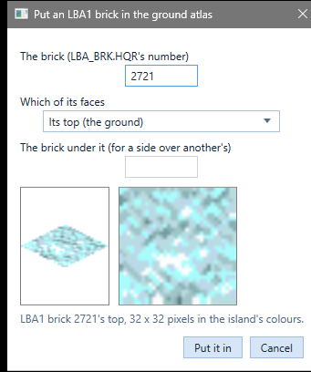 |

Skip slot 19 (Tile 96, 64): it's the island's sea tile.

### 3b. Paint the ground (3,828 runs)

1. Tool **Paint atlas tile**, **Square brush** ticked, **Radius** 0.
2. For each slot: choose its tile (Tile X, Tile Y, size 32, **Choose this tile**). Then tick **Stand the tile up the slope (cliffs)** for
   slots 0-3, and untick it for the others.
3. For each of that slot's `runs` (z, x0, x1): **Vertex X** = 448 + x0, **Vertex Z** = 448 + z, **Apply the tool here**. If x1 ≠ x0:
   **Vertex X** = 448 + x1, **Stroke to here**.

### 3c. Say what the ground does

The new map coded its beach as water. Make the land plain ground, and keep the sea's corner as water:

1. Tool **Paint game code**. **Game code** (Tool settings) = *0: none*. **Radius** 32. Vertex 480, 480, **Apply the tool here**: one
   dab covers the cube.
2. **Radius** 0. **Game code** = *1: water (drowns)*. Press **Apply the tool here** at vertex 511 with Z 448, 449, 450, 451, 452 and 453
   (the corner cells 63,0 to 63,5).
3. Save, then **File > Save map**.

**Check:** snow on the terraces, grey ice cliffs between them:

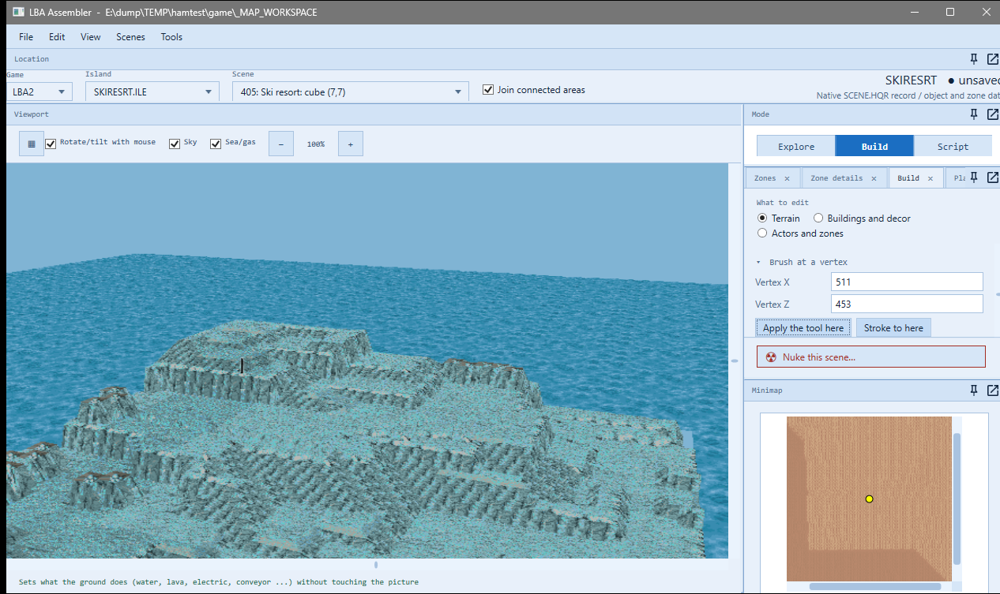

## 4. Flatten the hut's ground

LBA1 roofs the hut with snow-coded bricks, so step 2 took its roof for ground. The plan is
[recipe/plan/hut_fix.json](recipe/plan/hut_fix.json). *Script: `fix_hut.ps1`.*

1. **Flatten to level**, square brush, radius 0, strength 100, **Level** 256.
2. For each Z from 448 + 54 to 448 + 57 (502 to 505): **Vertex X** 487 (448 + 39), **Vertex Z** = that Z, **Apply the tool here**; then
   **Vertex X** 490 (448 + 42), **Stroke to here**.
3. Untick **Stand the tile up the slope**, then repaint the 25 cells listed under `cells`. For each: choose its `tile`, tool **Paint
   atlas tile**, vertex (448 + x, 448 + z), **Apply the tool here**.
4. Save, then **File > Save map**.

## 5. Lower the ground under the tree clumps

Step 2's heights also took LBA1's snowy tree clumps for ground, which would leave the trees standing on pillars.
[recipe/plan/ground_fix.py](recipe/plan/ground_fix.py) works out the ground without the blocks that become objects, compares it with your
island, and lists what to change. *Script: `fix_ground2.ps1`.*

1. Run it on your workspace's island (Python 3):

   ```
   python recipe\plan\ground_fix.py <sandbox>\game\_MAP_WORKSPACE\SKIRESRT.ILE
   ```

   It writes `recipe\plan\ground_fix.json`. In the test run it found 464 vertices, as 153 runs and 783 cells to repaint.
2. **Flatten to level** as in step 2, for each of its `runs`.
3. For each of its `tiles`: choose the tile, tool **Paint atlas tile**, tick **Stand the tile up the slope** only when `cliff` is true,
   vertex (448 + x, 448 + z), **Apply the tool here**.
4. **Unwalkable angle °** 45, then press **Block steep ground on the whole island**.
5. Save, then **File > Save map**.
6. Run `ground_fix.py` again: it should say **0 vertices differ**. Your ground is now exactly LBA1's.

## 6. Light

1. Open **Baked light and shadows**.
2. Set **Gain** to 8 and **Offset** to 5, and press **Bake all light**.
3. Save, then **File > Save map**.

Bake after the last ground change. *Script: `bake.ps1`.*

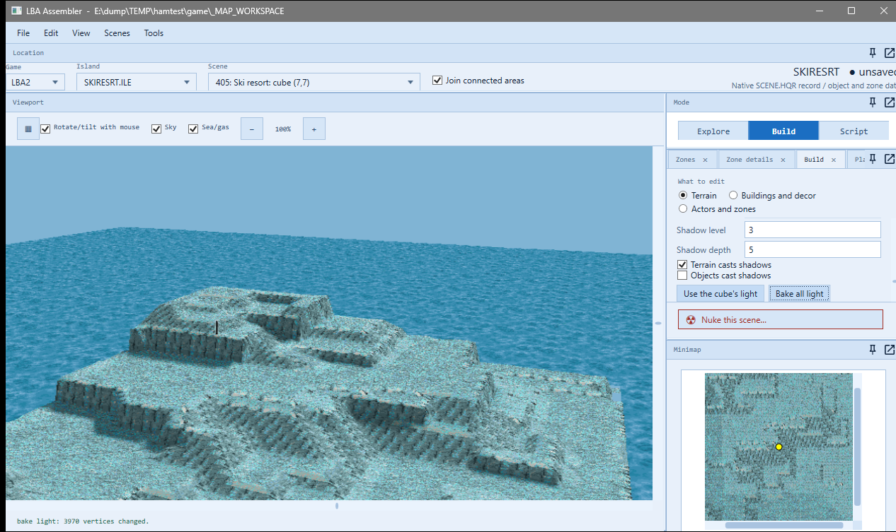

## 7. The objects

Goal: the trees, hut, lift pylons, fence, snowman, small trees, stone and rock wall, made from LBA1's bricks and placed where LBA1 has them.
*Script: `make_objects.ps1`.*

### 7a. Make the 14 objects in the Object maker

1. **What to edit > Buildings and decor**. In the section **Place objects**, press **Make an object…**.
2. For each object in this order: tree, bigtree, hut, pylon, fence, fencecorner, snowman, smalltree, stone, rockwall1 to rockwall5:
   1. Press **Open design…** and pick `recipe/objects/<name>.lbaobject`.

      Or build it brick by brick from the design file, which has one brick a line: X, layer, Z, LBA1 brick. Type **X**, **Layer**, **Z**
      and the brick number, then press **Put the brick here**. **Fill the box with the brick** does a whole box at once.
   2. Press **Add it to the island**. The text under it says **Body N added…**; write N down. In a clean run they come out as 106 to 119
      in this order.

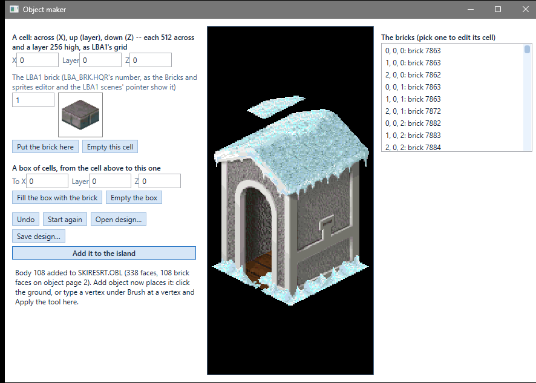

Place each body before you close the map: the maker keeps an object's page in memory until a copy of it is placed.

### 7b. Place the 66 copies

The places are in [RECREATE.md's object appendix](RECREATE.md#appendix-the-objects-places-x-y-z) (X, Y, Z for each copy). In the terrain
panel, Buildings and decor:

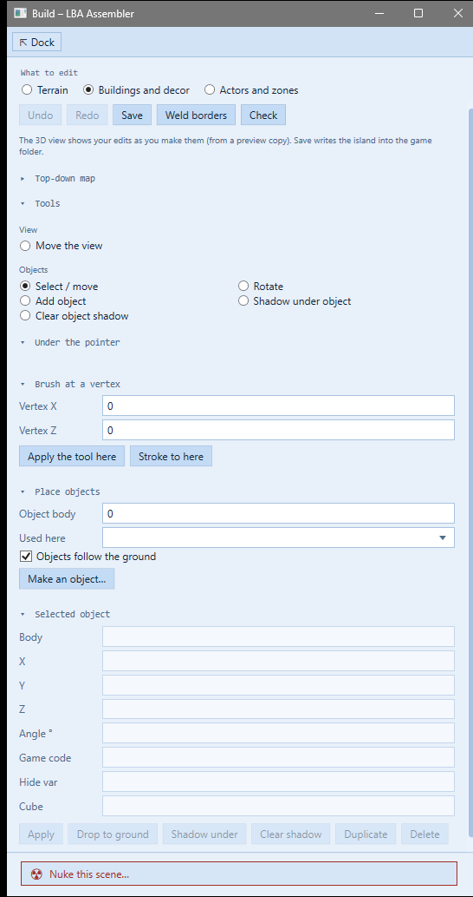

1. **Untick Objects follow the ground.** It's ticked every time the editor starts. Left on, any later ground edit moves the objects.
2. For each copy:
   1. Type the body number into **Object body**, and choose the tool **Add object**.
   2. Under **Brush at a vertex**: **Vertex X** = 448 + round(X ÷ 512) and **Vertex Z** = 448 + round(Z ÷ 512). Use **at most 511**:
      the two small trees at X 32512 sit on the cube's far edge, and vertex 512 is outside it. Press **Apply the tool here**.
   3. The new object is selected. Under **Selected object**, type its exact **X**, **Y** and **Z**, and press **Apply**.
3. **Check:** **Used here** lists 43 of the tree's body, 5 of the small tree's, and so on: 66 in all.
4. Save, then **File > Save map**.

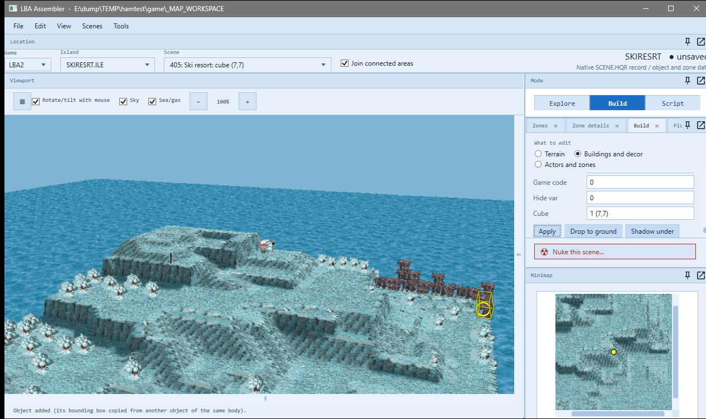

If two objects end up in one place, choose **Select / move** and select at that very point again to step from one to the next. Then
**Delete** the extra one.

## 8. Map settings

**File > Map settings…**: **Weather** *Clear*, **Cliffs** *Ledges to walk or ride off, as LBA1's (falling)*. Press **OK**, then **File >
Save map**. *Script: `map_settings.ps1`.*

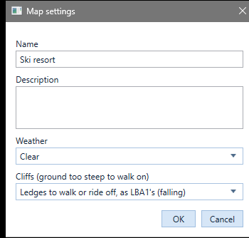

Without this setting, the snowboarder stops dead at every cliff edge instead of jumping off it.

## 9. Map text

1. **File > Map text…**
2. For each line, type **Number** and **Words**, and press **Put this line**:
   - 1000: `Good day.`
   - 1001: `I'm looking for the plans for the Teleportation Center.`
   - 1002: `Use your red card to use the skilift.`
   - 1003: `Sorry, I don't know where they are.`
3. Press **Save**, then **File > Save map**.

*Script: `map_text.ps1`.*

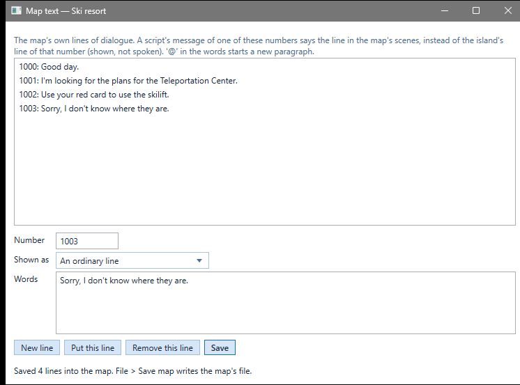

## 10. The characters

**What to edit > Actors and zones**. Under the scene panel, open **Help and other editors**, then press **Character maker…**:

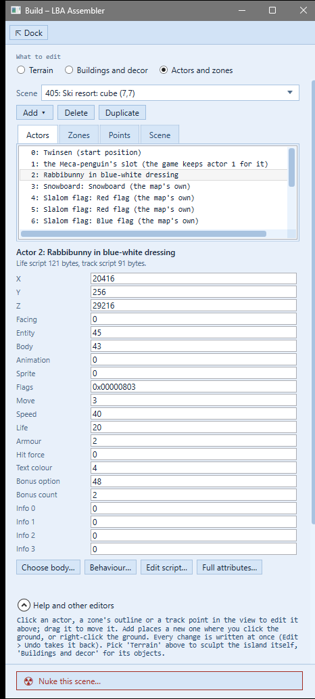

The Character maker makes a map's own kinds of actor: their bodies and their animations. Make three, in this order. All the numbers are
in [RECREATE.md step 10](RECREATE.md#10-the-characters).

### 10a. Twinsen with snowboard: the body

*Script: `char_rider_body.ps1`.*

1. **Body** tab: type `1` into **Start from the game's body** (the tunic Twinsen) and press **Start from it**.
2. Add three parts: the board and two bindings. For each, set **Shape** *Box*, **From point** 0, the **Offset X/Y/Z**, the **Size
   X/Y/Z**, **Turn °** 0 and the **Colour**, then press **Add the part**:
   - board: offset 0, -25, 0; size 260, 50, 1000; colour 70
   - binding: offset 0, 8, 230; size 230, 16, 70; colour 48
   - binding: offset 0, 8, -230; size 230, 16, 70; colour 48
3. Under the bodies list: **Number** 0, **Name** `Twinsen on his snowboard`, **Set**.
4. At the top: **Name** `Twinsen with snowboard`. Press **Save into the map**.

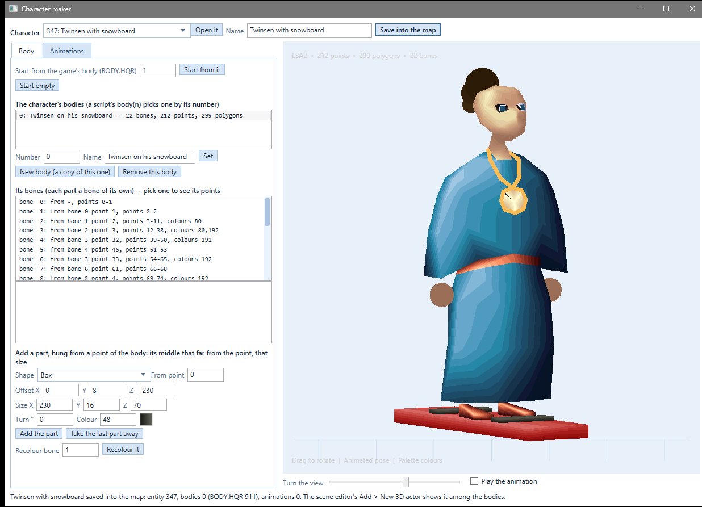

### 10b. Twinsen with snowboard: nine animations

*Script: `char_rider_anims.ps1`.*

**Animations** tab. Each animation is a list of keyframes. A keyframe has:

- a time (**Milliseconds**), and how far it moves (**Move X/Y/Z**: Z is forward, Y up);
- whether it **Leaves the ground** (no gravity: the jump);
- a pose: each bone's turn in degrees.

How each control works:

- **Pose bone**, **Turn X/Y/Z**, **Set the bone**: one keyframe's bone.
- **Same in every keyframe**: that bone's turn in all of the animation's keyframes.
- **Add a keyframe (a copy of this one)**: copies the keyframe chosen.
- **Loop back to it**: after the last keyframe, the animation goes on from the one chosen.
- **Set** (beside Move): applies the time, the move and Leaves the ground.

For each animation in the table:

1. Type **Number** and **Name**, leave **Copy of the game's animation** empty, and press **New animation**. Animation 0 already exists:
   rename it and press **Set number and name**.
2. Set the stance with **Same in every keyframe**.
3. Add the keyframes it needs, and set each one's time, move and changed bones.
4. Pick the loop keyframe and press **Loop back to it**.

The full table is in [RECREATE.md step 10](RECREATE.md#10-the-characters). Watch the figure on the right as you go: tick **Play the
animation**, and drag to turn it. Press **Save into the map** at the end.

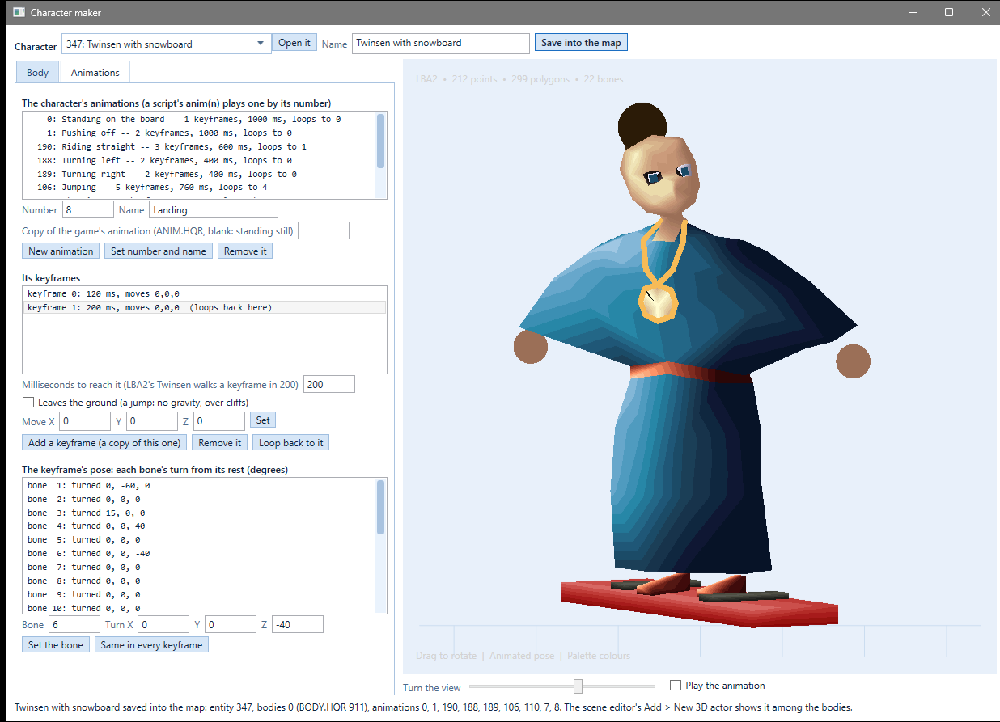

### 10c. Slalom flag and Snowboard

*Script: `char_flag_board.ps1`.*

1. In **Character**, pick **(a new character)** and press **Open it**. **Name** `Slalom flag`.
2. **Body** tab: **Start empty**, then add two parts:
   - the pole: *Box*, from point 0, offset 0, 750, 0, size 40, 1500, 40, colour 16
   - the pennant: *Flat triangle*, from point 7 (the pole's top corner), offset 250, -150, -20, size 500, 300, 0, colour 64
3. Number 0, Name `Red flag`, **Set**.
4. Then for each of these: type Number and Name, press **New body (a copy of this one)**, set **Colour** and **Recolour bone** 2, and
   press **Recolour it**:
   - 17 `Green flag`, colour 128
   - 48 `Blue flag`, colour 192
   - 49 `Light blue flag`, colour 160
5. **Animations** tab: animation 0 `Waving` (**New animation**), then press **Add a keyframe** once.
   - keyframe 0: 300 ms, bone 2 turned 0, 12, 0
   - keyframe 1: 300 ms, bone 2 turned 0, -12, 0
6. Press **Save into the map**.
7. Make a new character, `Snowboard`. **Start empty**, then add four boxes, all from point 0:
   - board: offset 0, 500, 0, size 280, 1000, 50, colour 64
   - edge: offset -145, 500, 0, size 12, 1000, 56, colour 128
   - binding: offset 0, 650, 30, size 220, 70, 16, colour 48
   - binding: offset 0, 350, 30, size 220, 70, 16, colour 48
8. Body name `Snowboard`, **Set**, **Save into the map**.
9. **File > Save map**.

| The flag | The snowboard |
| --- | --- |
| 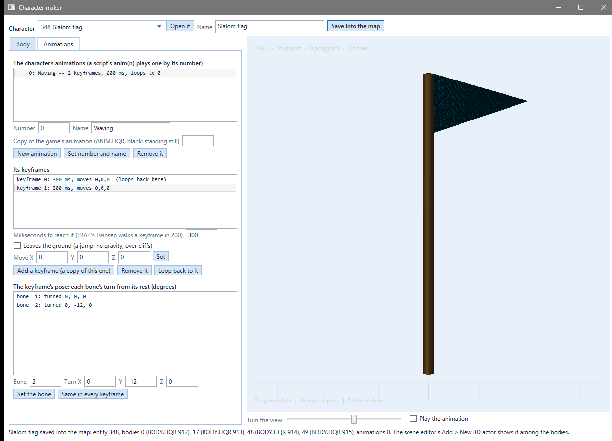 | 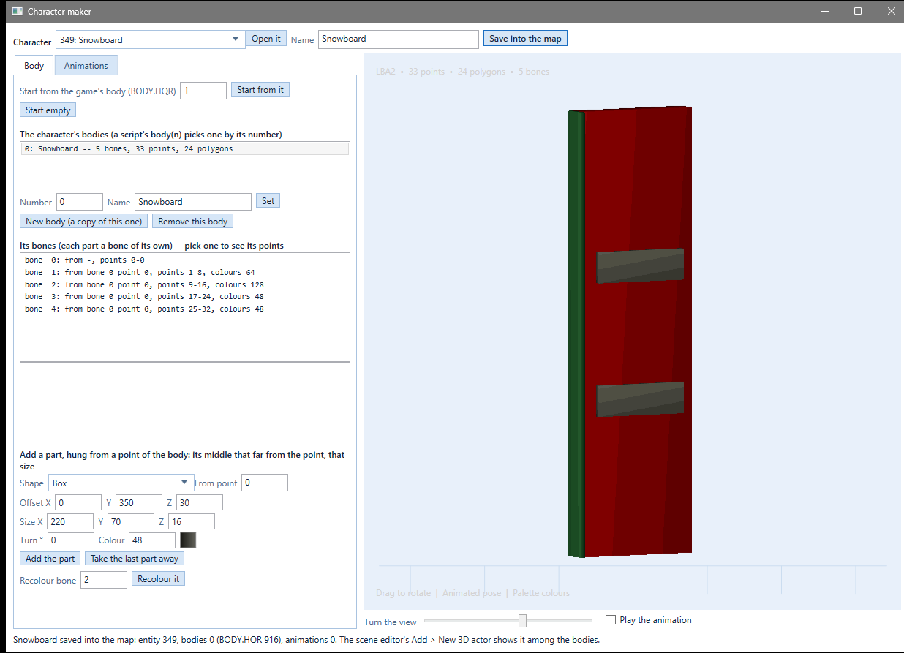 |

## 11. Track points, actors and zones

**Build > What to edit > Actors and zones.** The Build tab becomes the scene panel, and you edit the scene in the 3D view itself:

- **The scene box** at the top says which scene is listed (405: Ski resort). Under it: **Add ▾**, **Delete**, **Duplicate**.
- **The lists**, in tabs: Actors, Zones, Points, and Scene (the scene's header). Pick an item there and the view shows it, with a ring
  round it; it moves the view only if the item is off screen.
- **The inspector** below them: the selected item's fields. A field is written when you leave it: press Tab or Enter, or click elsewhere.
- **In the view:** click an actor, a zone's outline or a track point (gold diamonds while the panel is up) to select it, and drag it to
  move it.
- **Add ▾** places something new where you click the ground in the view: a yellow ring follows the ground under the pointer, and the
  status line shows the scene and the spot. Or type **Place X/Y/Z** in the bar that appears and press **Place here**. Esc or a right-click
  cancels. Right-clicking the ground offers the same, right there.
- **Every change is written at once**, and is one step on **Edit > Undo** (Ctrl+Z).

All the values are in [RECREATE.md step 11](RECREATE.md#11-points-actors-and-zones) and its track-point appendix. *Scripts: `actors.ps1`,
then `zones.ps1`.*

### 11a. Track points

**Add ▾ > Track point**, then click the spot in the view, or type its Place X/Y/Z and press **Place here** (the exact values are in the
appendix). Do this 34 times, in order: the scripts name the points by their numbers (0-33).

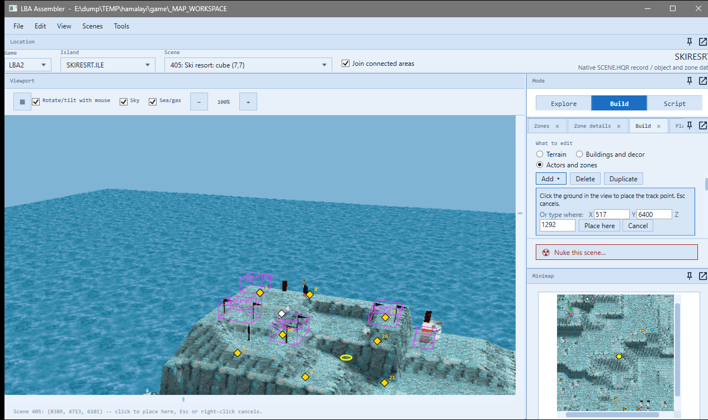

### 11b. Twinsen's start

In the **Actors** tab, choose **0: Twinsen (start position)** and type **X** 517, **Y** 6400, **Z** 1292. Or drag him in the view.

### 11c. The actors

For each actor, from 2 to 13 in order:

1. Press **Add ▾ > New 3D actor without a script…**.
2. In **Choose a body**, type the filter from the table (for example `Slalom flag: Blue flag`), choose the body and press **OK**.
3. Click its spot in the view, or type its place and press **Place here**.
4. In the inspector, type **Flags**, **Life**, **Armour**, and where the table says so, **Bonus option**, **Bonus count** and **Move**.
   Actors 2 and 13 need **Move 3**, so that their track scripts run from the start.

The first actor you add also fills slot 1 with the meca-penguin's placeholder (the game clears that slot in every scene). So your actors
get the numbers the scripts expect, 2 to 13. Then **File > Save map**.

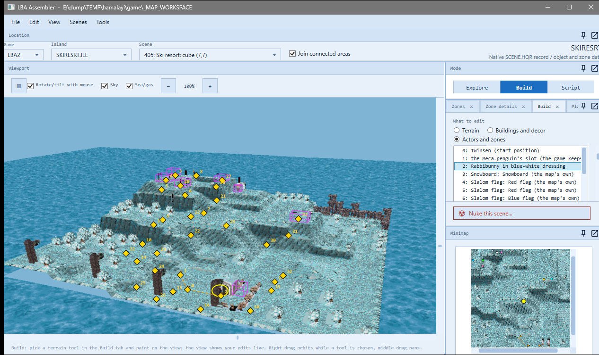

### 11d. The zones

For each zone, press **Add ▾ > Zone ▸** *cube change* or *scenaric*. Place it at the middle of its box (X and Z) and its Y min. Then type
**X min** to **Z max**, plus:

- the cube change: **Destination scene** = your scene's own number (the scene box shows it) and **Arrival X/Y/Z**;
- a scenaric zone: its **Zone number**.

A zone is drawn as a box in its type's colour. Drag its outline to move it: a yellow copy of the box follows the pointer (below, in a
Citadel interior). Then **File > Save map**.

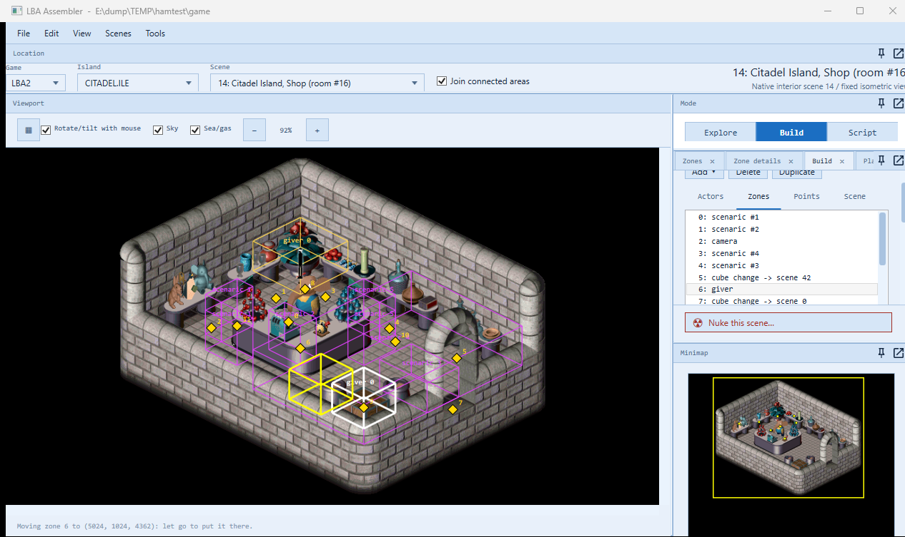

## 12. Scripts

*Script: `scripts.ps1 -Only 3,2,12,13,0 -SaveLast`.*

The five scripts are in [recipe/scripts/](recipe/scripts/). They name each other's labels: Twinsen's script starts the rider's track, and
the rider's script ends Twinsen's. So type all five before saving. Do the actors in the order 3, 2, 12, 13, 0:

1. In the scene panel's **Actors** list (or in the view), choose the actor and press **Edit script…** (under the inspector).
2. If it has a `_track.c` file: press **Track (C)** and paste the file in.
3. Press **Life (C)** and paste `actor<N>_life.c` in. Leave the window open.

   The line under the text says **✓ compiles** when the script is right. Actor 13's says it can't find `label_2` until actor 0's track
   is in; that's expected.
4. In the last window (actor 0's), press **Save to the map…** and answer the **Save scripts** question with **OK**. That saves all five.
5. Close the script windows, then **File > Save map**.

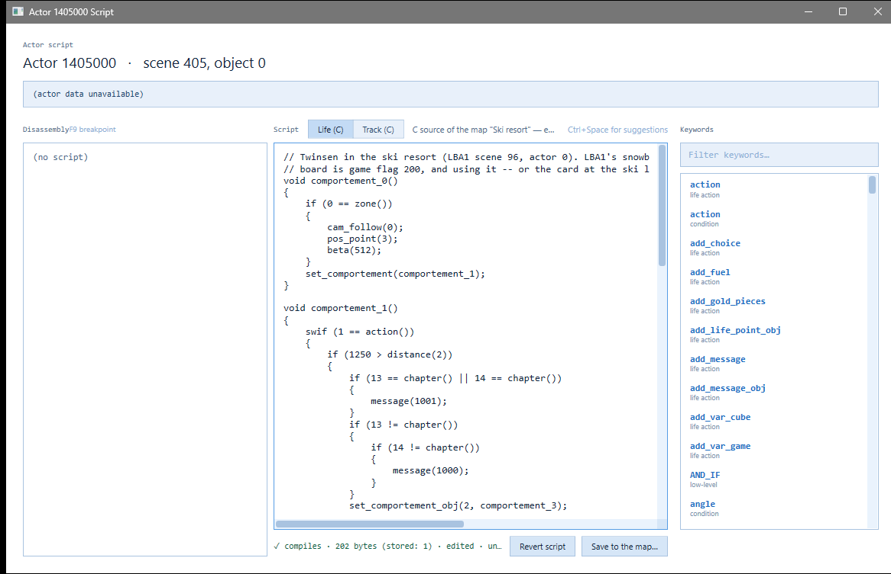

## 13. Play it

Open the **Play** tab, tick **Mute all sound**, and press **Play**:

- [ ] Twinsen starts at the top of the mountain. Far below, by the hut, the instructor walks between the lift and the hut.
- [ ] Walk into the snowboard near the start: it's gone, and now you have it.
- [ ] Walk into a run's start gate and press the action key. Twinsen turns into the rider, who rides the run past the flags, jumps off
  the cliffs and stops at the bottom, where Twinsen stands again.
- [ ] Walk to the instructor and press the action key. Twinsen says "Good day.", and the instructor turns to him and answers about the
  red card.
- [ ] In the lift zone by the hut, the action key takes Twinsen back to the top.
- [ ] In discreet mode, the action key in the hidden zone up the mountain gives a bonus, once.

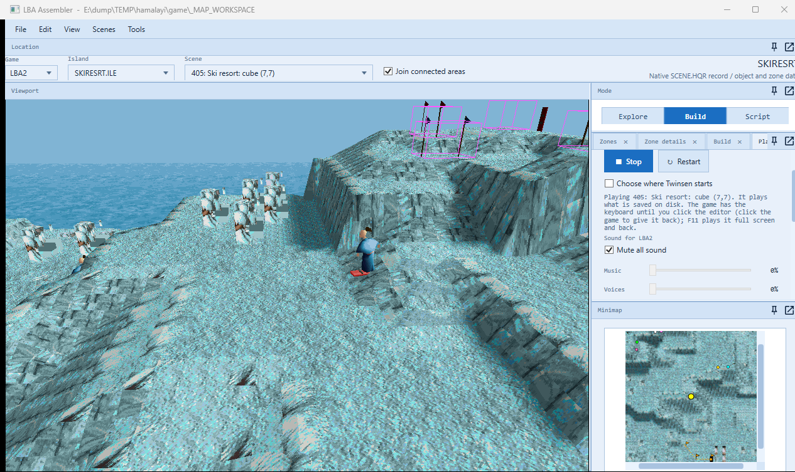

Then **File > Save map** one last time. `skiresort.lbamap` is the map: copy it into any LBA2 game folder's `MAPS` folder, or open it with
File > Open map.

---

## The scripted way

The scripts in [recipe/ui/](recipe/ui/) press the same buttons through Windows UI Automation. Watching them run is a good way to see each
step done. They run in Windows PowerShell 5.1 (`powershell.exe`) and need the Debug build (`dotnet build -c Debug`):

```powershell
$Global:Sandbox = "E:\dump\TEMP\mybuild"     # holds game\ (a plain copy of LBA2), app\ and settings\ (made for you)
$Global:Lba1Dir = "E:\path\to\a\copy\of\LBA1"
$R = "<repo>\docs\hamalayi\recipe\ui"
. "$R\lib.ps1"
& "$R\new_map.ps1"                            # 1 (starts the editor and leaves it open)
SelectItem (ById "ModeBuildButton"); Invoke (ById "DockTab_Build"); SelectItem (ById "BuildTerrainRadio")
& "$R\paint_ground.ps1"; & "$R\texture_ground.ps1"; & "$R\fix_hut.ps1"            # 2-4
python "$R\..\plan\ground_fix.py" "$Global:Sandbox\game\_MAP_WORKSPACE\SKIRESRT.ILE"
& "$R\fix_ground2.ps1"; & "$R\bake.ps1"                                            # 5-6
& "$R\make_objects.ps1"; & "$R\map_settings.ps1"; & "$R\map_text.ps1"             # 7-9
& "$R\char_rider_body.ps1"; & "$R\char_rider_anims.ps1"; & "$R\char_flag_board.ps1" # 10
SelectItem (ById "BuildSceneRadio"); Invoke (ById "BuildSceneEditorButton"); Start-Sleep 6
& "$R\actors.ps1"; & "$R\zones.ps1"; & "$R\scripts.ps1" -Only 3,2,12,13,0 -SaveLast # 11-12
```

How they behave:

- Each script saves the map when it finishes, and puts a picture of what it did in `<sandbox>\ui\shots`.
- They take the keyboard focus while they run, so leave the PC alone.
- `Stop-Editor` closes the sandbox's editor, and `Open-SkiResort` opens it again on the map.

## What the test run turned up, and what changed

Repeating the build from an empty sandbox found these, all now fixed:

- **The released map's slalom flags didn't wave.** When the pennant was remade on the first run, the Waving animation's bone turns were
  lost. The flag's animation is now ±12°, matching the test run.
- **The released map's Landing animation had tick times** (6 and 10 ms instead of 120 and 200). The Character maker's animation list
  only realizes the items in view, so the script that retyped the times never reached the ninth one. A user scrolls to it.
- **The pickup snowboard's still frame** is now 1000 ms, as a fresh map makes it.
- **`ground_fix.py` repainted two of the sea's corner cells with snow.** It now leaves the sea cells alone.
- **The body list didn't include a character made while the scene editor (now the scene panel) was open.** It's now read again each time you choose a
  body.
- **The 3D view's renderer now reads the entity table, bodies and animations again when the Character maker saves.** It used to keep
  what it read at start.
- **The editor crashed once** during step 11, in the 3D view's island loading (a native fault), in a session where the characters had
  just been made.
  - I couldn't reproduce it, even with characters made mid-session, saved and drawn.
  - The renderer reload above, and a guard in the engine's scene loading (an entity number past the table now falls back to entity 0
    instead of reading garbage), close the two gaps I found on the way. Neither was proven to be the cause.
  - If it happens to you, start the editor with the environment variable `LBA2_RENDERER_CRASHLOG` set to a file path. The renderer then
    writes where it faulted.

The one remaining difference between a fresh build and the released map: **13 cells round the tree clumps** carry another of LBA1's
snow tiles, out of 4,096. Both come from LBA1's bricks, read two ways (the first run's painting plan versus `ground_fix.py`).
